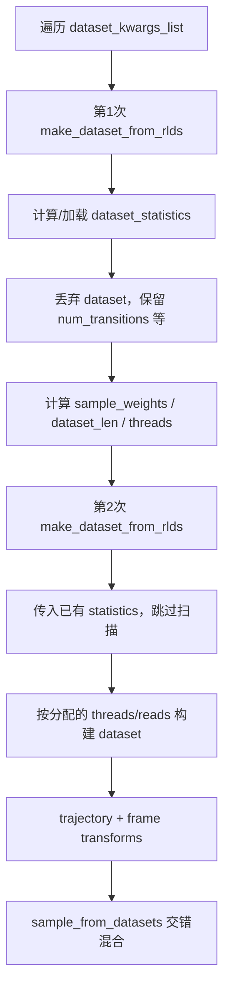
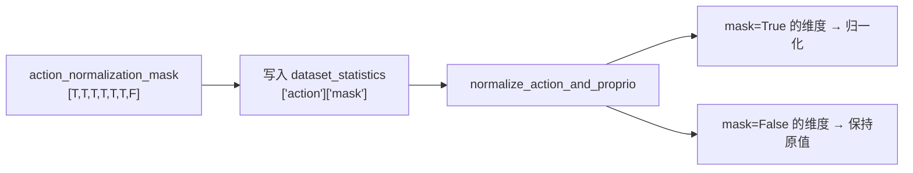

<!-- Generated by SpecStory, Markdown v2.1.0 -->

# 2026-05-15 05:36:03Z

<!-- Cursor IDE Session deb2ca8f-eea0-42b4-868d-2cbe1af8695c (2026-05-15 05:36:03Z) -->

_**User**_

@prismatic/vla/datasets/rlds/dataset.py @dataset.py (561-568) @dataset.py (520-524) 
为什么这个代码中要调用两次这个函数，我没看明白，你给我详细讲解一下

---

_**Agent (default)**_

正在阅读 `dataset.py` 中这两处调用的完整上下文，以便解释为何调用两次 `make_dataset_from_rlds`。


_**Agent (default)**_

<tool-use data-tool-type="read" data-tool-name="read_file_v2"><details>
<summary>Tool use: **read_file_v2** • Read file: /home/byang/Project/VLA-Adapter/prismatic/vla/datasets/rlds/dataset.py</summary>

</details></tool-use>

_**Agent (default)**_

<tool-use data-tool-type="unknown" data-tool-name="ripgrep_raw_search"><details>
<summary>Tool use: **ripgrep_raw_search**</summary>

Parameters:

```json
{
  "caseInsensitive": false,
  "path": "/home/byang/Project/VLA-Adapter",
  "pattern": "def make_dataset_from_rlds"
}
```
Additional data:

```json
{
  "isPruned": true,
  "outputMode": "content",
  "path": "/home/byang/Project/VLA-Adapter",
  "pattern": "def make_dataset_from_rlds",
  "topFiles": [
    {
      "matchCount": 1,
      "uri": "./prismatic/vla/datasets/rlds/dataset.py"
    }
  ],
  "totalFiles": 1,
  "totalMatches": 1
}
```
Status: **completed**

</details></tool-use>

_**Agent (default)**_

<tool-use data-tool-type="read" data-tool-name="read_file_v2"><details>
<summary>Tool use: **read_file_v2** • Read file: /home/byang/Project/VLA-Adapter/prismatic/vla/datasets/rlds/dataset.py</summary>

</details></tool-use>

_**Agent (default)**_

<tool-use data-tool-type="unknown" data-tool-name="ripgrep_raw_search"><details>
<summary>Tool use: **ripgrep_raw_search**</summary>

Parameters:

```json
{
  "caseInsensitive": false,
  "glob": "**/rlds/**/*.py",
  "path": "/home/byang/Project/VLA-Adapter",
  "pattern": "def get_dataset_statistics|dataset_statistics"
}
```
Additional data:

```json
{
  "isPruned": true,
  "outputMode": "content",
  "path": "/home/byang/Project/VLA-Adapter",
  "pattern": "def get_dataset_statistics|dataset_statistics",
  "topFiles": [
    {
      "matchCount": 25,
      "uri": "./prismatic/vla/datasets/rlds/dataset.py"
    },
    {
      "matchCount": 8,
      "uri": "./prismatic/vla/datasets/rlds/utils/data_utils.py"
    }
  ],
  "totalFiles": 2,
  "totalMatches": 33
}
```
Status: **completed**

</details></tool-use>

_**Agent (default)**_

<tool-use data-tool-type="read" data-tool-name="read_file_v2"><details>
<summary>Tool use: **read_file_v2** • Read file: /home/byang/Project/VLA-Adapter/prismatic/vla/datasets/rlds/dataset.py</summary>

</details></tool-use>

_**Agent (default)**_

<tool-use data-tool-type="read" data-tool-name="read_file_v2"><details>
<summary>Tool use: **read_file_v2** • Read file: /home/byang/Project/VLA-Adapter/prismatic/vla/datasets/rlds/utils/data_utils.py</summary>

</details></tool-use>

_**Agent (default)**_

<tool-use data-tool-type="unknown" data-tool-name="ripgrep_raw_search"><details>
<summary>Tool use: **ripgrep_raw_search**</summary>

Parameters:

```json
{
  "caseInsensitive": false,
  "path": "/home/byang/Project/VLA-Adapter",
  "pattern": "def make_interleaved_dataset"
}
```
Additional data:

```json
{
  "isPruned": true,
  "outputMode": "content",
  "path": "/home/byang/Project/VLA-Adapter",
  "pattern": "def make_interleaved_dataset",
  "topFiles": [],
  "totalFiles": 0,
  "totalMatches": 0
}
```
Status: **completed**

</details></tool-use>

_**Agent (default)**_

<tool-use data-tool-type="read" data-tool-name="read_file_v2"><details>
<summary>Tool use: **read_file_v2** • Read file: /home/byang/Project/VLA-Adapter/prismatic/vla/datasets/rlds/dataset.py</summary>

</details></tool-use>

_**Agent (default)**_

<tool-use data-tool-type="unknown" data-tool-name="ripgrep_raw_search"><details>
<summary>Tool use: **ripgrep_raw_search**</summary>

Parameters:

```json
{
  "caseInsensitive": false,
  "path": "/home/byang/Project/VLA-Adapter",
  "pattern": "make_interleaved|interleaved_dataset"
}
```
Additional data:

```json
{
  "isPruned": true,
  "outputMode": "content",
  "path": "/home/byang/Project/VLA-Adapter",
  "pattern": "make_interleaved|interleaved_dataset",
  "topFiles": [
    {
      "matchCount": 2,
      "uri": "./prismatic/vla/datasets/rlds/dataset.py"
    },
    {
      "matchCount": 3,
      "uri": "./prismatic/vla/datasets/datasets.py"
    },
    {
      "matchCount": 1,
      "uri": "./prismatic/vla/datasets/rlds/__init__.py"
    },
    {
      "matchCount": 2,
      "uri": "./vla-scripts/inspect_libero_rlds.py"
    },
    {
      "matchCount": 1,
      "uri": "./prismatic/vla/datasets/rlds/oxe/materialize.py"
    }
  ],
  "totalFiles": 5,
  "totalMatches": 9
}
```
Status: **completed**

</details></tool-use>

_**Agent (default)**_

<think><details><summary>Thought Process</summary>
I now have a good understanding.
</details></think>

_**Agent (default)**_

<tool-use data-tool-type="unknown" data-tool-name="ripgrep_raw_search"><details>
<summary>Tool use: **ripgrep_raw_search**</summary>

Parameters:

```json
{
  "caseInsensitive": false,
  "path": "/home/byang/Project/VLA-Adapter",
  "pattern": "def make_interleaved_dataset"
}
```
Additional data:

```json
{
  "isPruned": true,
  "outputMode": "content",
  "path": "/home/byang/Project/VLA-Adapter",
  "pattern": "def make_interleaved_dataset",
  "topFiles": [],
  "totalFiles": 0,
  "totalMatches": 0
}
```
Status: **completed**

</details></tool-use>

_**Agent (default)**_

<tool-use data-tool-type="read" data-tool-name="read_file_v2"><details>
<summary>Tool use: **read_file_v2** • Read file: /home/byang/Project/VLA-Adapter/prismatic/vla/datasets/datasets.py</summary>

</details></tool-use>

_**Agent (default)**_

<tool-use data-tool-type="read" data-tool-name="read_file_v2"><details>
<summary>Tool use: **read_file_v2** • Read file: /home/byang/Project/VLA-Adapter/prismatic/vla/datasets/rlds/__init__.py</summary>

</details></tool-use>

_**Agent (default)**_

<tool-use data-tool-type="unknown" data-tool-name="ripgrep_raw_search"><details>
<summary>Tool use: **ripgrep_raw_search**</summary>

Parameters:

```json
{
  "caseInsensitive": false,
  "path": "/home/byang/Project/VLA-Adapter",
  "pattern": "make_interleaved_dataset\\s*="
}
```
Additional data:

```json
{
  "isPruned": true,
  "outputMode": "content",
  "path": "/home/byang/Project/VLA-Adapter",
  "pattern": "make_interleaved_dataset\\s*=",
  "topFiles": [],
  "totalFiles": 0,
  "totalMatches": 0
}
```
Status: **completed**

</details></tool-use>

_**Agent (default)**_

<think><details><summary>Thought Process</summary>
Perhaps `make_interleaved_dataset` was renamed or replaced with a different version.
</details></think>

_**Agent (default)**_

<tool-use data-tool-type="unknown" data-tool-name="ripgrep_raw_search"><details>
<summary>Tool use: **ripgrep_raw_search**</summary>

Parameters:

```json
{
  "caseInsensitive": false,
  "path": "/home/byang/Project/VLA-Adapter",
  "pattern": "def allocate_threads"
}
```
Additional data:

```json
{
  "isPruned": true,
  "outputMode": "content",
  "path": "/home/byang/Project/VLA-Adapter",
  "pattern": "def allocate_threads",
  "topFiles": [
    {
      "matchCount": 1,
      "uri": "./prismatic/vla/datasets/rlds/utils/data_utils.py"
    }
  ],
  "totalFiles": 1,
  "totalMatches": 1
}
```
Status: **completed**

</details></tool-use>

_**Agent (default)**_

<think><details><summary>Thought Process</summary>
The first call in `make_interleaved_episodic_dataset` retrieves dataset statistics without building the full pipeline, discarding the dataset itself but preserving statistics like transition counts and normalization values. It uses default parallelization settings.

The second call constructs the actual dataset for training using pre-computed statistics and allocated resources based on sampling weights. Two phases are used to avoid a chicken-and-egg problem where sample weights depend on transition counts that require the full dataset to compute.

To allocate threads proportionally, final sample weights are needed, and dataset length requires both sizes and weights. Statistics must be known before building the dataset. When dataset_statistics is None, make_dataset_from_rlds scans the entire dataset to compute stats, which is expensive. In an interleaved setup with multiple datasets, stats are computed once per dataset and reused during construction, avoiding the expensive scan in the second call.

Thread allocation requires sample weights, which in turn depend on dataset sizesthus, allocation cannot be determined until after the first pass. When `dataset_statistics` is None, `make_dataset_from_rlds` computes statistics by iterating through the entire dataset, which is expensive. However, when statistics are provided, this costly computation is skipped during the second call.

The first call computes statistics by iterating through the full dataset and builds a temporary dataset that gets discarded, but caches the statistics for reuse. The second call uses these cached statistics to build the actual training dataset without re-computing statistics.
</details></think>

_**Agent (default)**_

你问的是 `make_interleaved_episodic_dataset` 里为什么对同一个 `make_dataset_from_rlds` 调了两次。本质上是 **先摸底（统计信息）→ 再规划（权重/线程/长度）→ 最后真正建数据集**，两阶段分工不同。

---

## 整体在做什么

这个函数要把多个 RLDS 数据集 **按比例交错采样** 成一个训练用的大数据集。要做到这一点，必须先知道每个子数据集有多大、怎么分配采样权重和并行线程，然后才能正确构建并 `sample_from_datasets` 交错。

所以流程被拆成两趟：

```
第一次调用  →  只关心统计信息（尤其 num_transitions）
       ↓
计算 sample_weights、dataset_len、threads_per_dataset
       ↓
第二次调用  →  真正构建可训练的 dataset 对象
```

---

## 第一次调用（520–524 行）：摸底 / 规划阶段

```514:526:prismatic/vla/datasets/rlds/dataset.py
    # Get Dataset Sizes
    dataset_sizes, all_dataset_statistics = [], {}
    for dataset_kwargs in dataset_kwargs_list:
        data_kwargs = copy.deepcopy(dataset_kwargs)
        if "dataset_frame_transform_kwargs" in data_kwargs:
            data_kwargs.pop("dataset_frame_transform_kwargs")
        _, dataset_statistics = make_dataset_from_rlds(
            **data_kwargs,
            train=train,
            load_all_data_for_training=load_all_data_for_training
        )
        dataset_sizes.append(dataset_statistics["num_transitions"])
        all_dataset_statistics[dataset_kwargs["name"]] = dataset_statistics
```

这里的关键点：

1. **返回值里只要 `dataset_statistics`，dataset 本身用 `_` 丢掉了**  
   需要的是每个数据集的元信息，尤其是 `num_transitions`（总 transition/frame 数）。

2. **没有传 `dataset_statistics`**  
   在 `make_dataset_from_rlds` 内部会走“计算或加载统计量”的分支：

```210:223:prismatic/vla/datasets/rlds/dataset.py
    elif dataset_statistics is None:
        full_dataset = dl.DLataset.from_rlds(
            builder, split="all", shuffle=False, num_parallel_reads=num_parallel_reads
        ).traj_map(restructure, num_parallel_calls)
        # tries to load from cache, otherwise computes on the fly
        dataset_statistics = get_dataset_statistics(
            full_dataset,
            hash_dependencies=(...),
            save_dir=builder.data_dir,
        )
```

`get_dataset_statistics` 会扫一遍数据，得到 action/proprio 的 mean/std/min/max，以及 `num_transitions`、`num_trajectories`。结果会缓存到 JSON，下次可直接加载。

3. **这些统计量后面会用来**：
   - `balance_weights=True` 时，按数据集大小调整采样权重（533 行）
   - 计算交错数据集的等效长度 `dataset_len`（539 行）
   - 按权重分配 `threads_per_dataset` / `reads_per_dataset`（542–543 行）

4. **还没法在这一步分配线程**  
   线程分配依赖最终的 `sample_weights`，而权重又依赖 `dataset_sizes`。所以必须先跑一遍拿 size，再建真正的 dataset。

---

## 中间规划阶段（528–546 行）

第一次调用之后，代码用统计信息做规划：

| 步骤 | 代码 | 作用 |
|------|------|------|
| 平衡权重 | `sample_weights * dataset_sizes` | 让大数据集在交错采样里占更多比例 |
| 归一化权重 | `/ np.sum(sample_weights)` | 变成合法概率分布 |
| 算训练长度 | `(dataset_sizes / sample_weights)[primary].max()` | 主数据集（weight=1.0）至少完整过一遍要多少 step |
| 分配线程 | `allocate_threads(...)` | 总线程按权重分给各子数据集 |

**没有第一次调用提供的 `num_transitions`，后面这些都没法算。**

---

## 第二次调用（561–568 行）：真正构建阶段

```548:568:prismatic/vla/datasets/rlds/dataset.py
    # Construct Datasets
    overwatch.info("Constructing datasets...")
    datasets = []
    for dataset_kwargs, threads, reads in zip(
        dataset_kwargs_list,
        threads_per_dataset,
        reads_per_dataset,
    ):
        ...
        dataset, _ = make_dataset_from_rlds(
            **dataset_kwargs,
            train=train,
            num_parallel_calls=threads,
            num_parallel_reads=reads,
            dataset_statistics=all_dataset_statistics[dataset_kwargs["name"]],
            load_all_data_for_training=load_all_data_for_training,
        )
```

和第一次的区别：

1. **这次要的是 `dataset`，统计量用 `_` 丢掉**（已经算过了）。

2. **显式传入 `dataset_statistics`**  
   会跳过昂贵的全量扫描，直接用第一次的结果做 action/proprio 归一化。

3. **带上规划好的 `threads` 和 `reads`**  
   多数据集混训时，并行资源按采样权重分配，而不是每个数据集都用 `AUTOTUNE`。

4. **后面还要接 transform 管道**  
   `apply_trajectory_transforms` → 可选 `group_sample` → `apply_per_dataset_frame_transforms`，最后 `sample_from_datasets` 交错。

---

## 为什么不能只调用一次？

可以概括成三个依赖链：

```
需要 dataset_statistics  →  才能做归一化
需要 num_transitions     →  才能算 balance_weights 和 dataset_len
需要最终 sample_weights  →  才能 allocate_threads
```

如果只做一次调用，你会面临：

- **要么** 在不知道各数据集大小的情况下瞎设 `sample_weights` 和 `dataset_len`；
- **要么** 先建好 dataset 再回头算统计，但线程分配、权重规划仍然得在构建前完成；
- **要么** 每个子数据集各自算一遍 statistics，多数据集混训时既慢又不一致。

两阶段设计就是：**第一次专门解决“还不知道该怎么混”的问题；第二次在信息齐全后，用正确配置建可训练 pipeline。**

---

## 一个容易忽略的细节：第一次调用其实有点“浪费”

`make_dataset_from_rlds` 在算完 statistics 之后，**仍然会构建一个完整的 dataset**（读 split、restructure、normalize）：

```235:255:prismatic/vla/datasets/rlds/dataset.py
    dataset = dl.DLataset.from_rlds(builder, split=split, shuffle=shuffle, ...)
    dataset = dataset.traj_map(restructure, num_parallel_calls)
    dataset = dataset.traj_map(
        partial(normalize_action_and_proprio, metadata=dataset_statistics, ...),
        num_parallel_calls,
    )
    return dataset, dataset_statistics
```

第一次调用把这个 dataset 丢掉了，第二次又建一遍。这是实现上的取舍：

- 统计量有缓存，全量扫描通常只做一次；
- 第二次会复用缓存的 statistics，跳过扫描；
- 但第一次返回的 dataset 对象确实没被用到，有一定重复构建成本。

从设计意图看，这不是“同一个 dataset 用两次”，而是 **同一个工厂函数承担了两个角色：统计收集器 + 数据集构建器**。

---

## 用流程图总结



---

## 一句话总结

- **第一次**：为了 **规划** —— 拿到每个子数据集的大小和归一化统计量，用来算采样权重、训练长度、线程分配。  
- **第二次**：为了 **执行** —— 在规划完成后，用正确配置真正构建可训练的 dataset，并进入后续的 transform 和交错采样。

如果你还想继续深挖，我可以再讲：`balance_weights` 和 `dataset_len` 在训练里具体怎么影响 epoch 长度，或者 `get_dataset_statistics` 的缓存 key 是怎么生成的。

---

_**User**_

dataset_statistics = tree_map(np.array, dataset_statistics) 这句代码是什么意思？详细讲解一下

---

_**Agent (default)**_

查看 `tree_map` 的来源及 `dataset_statistics` 的数据结构。


_**Agent (default)**_

<tool-use data-tool-type="read" data-tool-name="read_file_v2"><details>
<summary>Tool use: **read_file_v2** • Read file: /home/byang/Project/VLA-Adapter/prismatic/vla/datasets/rlds/dataset.py</summary>

</details></tool-use>

_**Agent (default)**_

<tool-use data-tool-type="unknown" data-tool-name="ripgrep_raw_search"><details>
<summary>Tool use: **ripgrep_raw_search**</summary>

Parameters:

```json
{
  "caseInsensitive": false,
  "glob": "**/*.py",
  "path": "/home/byang/Project/VLA-Adapter",
  "pattern": "tree_map"
}
```
Additional data:

```json
{
  "isPruned": true,
  "outputMode": "content",
  "path": "/home/byang/Project/VLA-Adapter",
  "pattern": "tree_map",
  "topFiles": [
    {
      "matchCount": 2,
      "uri": "./prismatic/vla/datasets/rlds/dataset.py"
    },
    {
      "matchCount": 3,
      "uri": "./prismatic/vla/datasets/datasets.py"
    },
    {
      "matchCount": 5,
      "uri": "./prismatic/vla/datasets/rlds/utils/data_utils.py"
    },
    {
      "matchCount": 4,
      "uri": "./prismatic/util/data_utils.py"
    }
  ],
  "totalFiles": 4,
  "totalMatches": 14
}
```
Status: **completed**

</details></tool-use>

_**Agent (default)**_

<tool-use data-tool-type="read" data-tool-name="read_file_v2"><details>
<summary>Tool use: **read_file_v2** • Read file: /home/byang/Project/VLA-Adapter/prismatic/vla/datasets/rlds/utils/data_utils.py</summary>

</details></tool-use>

_**Agent (default)**_

<tool-use data-tool-type="unknown" data-tool-name="ripgrep_raw_search"><details>
<summary>Tool use: **ripgrep_raw_search**</summary>

Parameters:

```json
{
  "caseInsensitive": false,
  "contextAfter": 60,
  "path": "/home/byang/Project/VLA-Adapter/prismatic/vla/datasets/rlds/utils/data_utils.py",
  "pattern": "def normalize_action_and_proprio"
}
```
Additional data:

```json
{
  "isPruned": true,
  "outputMode": "content",
  "path": "/home/byang/Project/VLA-Adapter/prismatic/vla/datasets/rlds/utils/data_utils.py",
  "pattern": "def normalize_action_and_proprio",
  "topFiles": [
    {
      "matchCount": 61,
      "uri": "prismatic/vla/datasets/rlds/utils/data_utils.py"
    }
  ],
  "totalFiles": 1,
  "totalMatches": 1
}
```
Status: **completed**

</details></tool-use>

_**Agent (default)**_

<tool-use data-tool-type="read" data-tool-name="read_file_v2"><details>
<summary>Tool use: **read_file_v2** • Read file: /home/byang/Project/VLA-Adapter/prismatic/vla/datasets/rlds/utils/data_utils.py</summary>

</details></tool-use>

_**Agent (default)**_

<think><details><summary>Thought Process</summary>
Now I have a complete picture. Let me explain:
</details></think>

_**Agent (default)**_

这句代码的作用可以拆成三部分理解：**`tree_map` 是什么**、**`dataset_statistics` 长什么样**、**为什么要套一层 `np.array`**。

---

## 1. 这行代码在做什么

```224:224:prismatic/vla/datasets/rlds/dataset.py
    dataset_statistics = tree_map(np.array, dataset_statistics)
```

含义是：

> 对 `dataset_statistics` 这棵**嵌套字典**里的**每一个叶子节点**，都调用一次 `np.array(...)`，保持字典结构不变，只把叶子值的类型统一转成 NumPy 数组。

---

## 2. `tree_map` 是怎么工作的

项目里自己实现了一个递归版 `tree_map`：

```24:25:prismatic/vla/datasets/rlds/utils/data_utils.py
def tree_map(fn: Callable, tree: Dict) -> Dict:
    return {k: tree_map(fn, v) if isinstance(v, dict) else fn(v) for k, v in tree.items()}
```

逻辑很简单：

- 如果当前值 `v` 还是 **dict** → 继续往里递归；
- 如果 `v` 不是 dict（叶子节点）→ 对 `v` 调用 `fn`，这里 `fn` 就是 `np.array`。

可以把它想成“对树形结构做 `map`”，只改叶子，不改 key 和层级。

---

## 3. `dataset_statistics` 的结构

它来自 `get_dataset_statistics`，或从 JSON 缓存里加载。典型结构如下：

```python
{
    "action": {
        "mean": [0.1, 0.2, ...],      # Python list
        "std":  [0.5, 0.3, ...],
        "max":  [...],
        "min":  [...],
        "q01":  [...],
        "q99":  [...],
    },
    "proprio": {
        "mean": [...],
        "std":  [...],
        ...
    },
    "num_transitions": 123456,        # Python int
    "num_trajectories": 789,          # Python int
}
```

注意两点：

1. **统计量**（mean/std/min/max 等）在写入 JSON 时被转成了 **Python list**（见 `get_dataset_statistics` 里的 `.tolist()`）。
2. **计数**（`num_transitions`、`num_trajectories`）是 **Python int**。

从 JSON 读回来时，也仍然是 list / int，不是 NumPy 数组。

---

## 4. `tree_map(np.array, ...)` 之后会变成什么

对每个叶子调用 `np.array` 后，大致变成：

```python
{
    "action": {
        "mean": np.array([0.1, 0.2, ...]),   # ndarray, shape=(action_dim,)
        "std":  np.array([0.5, 0.3, ...]),
        ...
    },
    "proprio": {
        "mean": np.array([...]),
        ...
    },
    "num_transitions": np.array(123456),      # ndarray 标量，shape=()
    "num_trajectories": np.array(789),
}
```

也就是说：

- 向量统计量 → **一维 `ndarray`**
- 整数计数 → **0 维 `ndarray` 标量**（`np.array(123456)` 不是普通 int）

字典的嵌套结构完全保留，只是叶子类型统一了。

---

## 5. 为什么要做这步转换

### 原因 1：数据来源类型不一致

`dataset_statistics` 可能来自两条路径：

| 来源 | 叶子类型 |
|------|----------|
| 刚算完（`get_dataset_statistics`） | list、int |
| 从 JSON 缓存加载 | list、int |

无论哪条路径，到这里都要变成**同一种内部表示**，后面代码才能稳定使用。

### 原因 2：后面要做 NumPy 运算

紧接着就有这类代码：

```227:233:prismatic/vla/datasets/rlds/dataset.py
    if action_normalization_mask is not None:
        if len(action_normalization_mask) != dataset_statistics["action"]["mean"].shape[-1]:
            ...
        dataset_statistics["action"]["mask"] = np.array(action_normalization_mask)
```

这里用到了：

- `dataset_statistics["action"]["mean"].shape[-1]` → 需要 **ndarray** 才有 `.shape`
- 直接赋值 `np.array(action_normalization_mask)` → 和别的字段类型一致

如果 `mean` 还是 Python list，虽然 `len(list)` 也能用，但和后面基于 shape、广播、逐元素比较的逻辑不统一。

### 原因 3：归一化函数里要和 TensorFlow 张量运算

`normalize_action_and_proprio` 会用这些统计量做减均值、除标准差、clip 等：

```56:63:prismatic/vla/datasets/rlds/utils/data_utils.py
    if normalization_type == NormalizationType.NORMAL:
        for key, traj_key in keys_to_normalize.items():
            mask = metadata[key].get("mask", tf.ones_like(metadata[key]["mean"], dtype=tf.bool))
            traj = dl.transforms.selective_tree_map(
                traj,
                match=lambda k, _: k == traj_key,
                map_fn=lambda x: tf.where(mask, (x - metadata[key]["mean"]) / (metadata[key]["std"] + 1e-8), x),
            )
```

这里 `x` 是 **TensorFlow Tensor**，`mean`/`std` 是 **NumPy ndarray**。TensorFlow 会把 ndarray 当作常量嵌进计算图，做广播运算。  
如果还是 Python list，有时也能工作，但更容易出类型/广播问题；统一成 ndarray 更稳妥。

还有这种比较：

```87:89:prismatic/vla/datasets/rlds/utils/data_utils.py
            zeros_mask = metadata[key]["min"] == metadata[key]["max"]
            traj = dl.transforms.selective_tree_map(
                traj, match=lambda k, _: k == traj_key, map_fn=lambda x: tf.where(zeros_mask, 0.0, x)
```

`min == max` 在 ndarray 上是**逐元素布尔数组**，这正是这里想要的；list 的 `==` 语义完全不同。

### 原因 4：跨数据集复用时类型一致

在 `make_interleaved_episodic_dataset` 里，第一次调用算出 statistics，第二次调用再传回去。  
统一转成 ndarray 后，无论是“刚算出来的”还是“从 JSON 读出来的”，后续行为都一致。

---

## 6. 一个小例子

转换前：

```python
dataset_statistics = {
    "action": {
        "mean": [1.0, 2.0, 3.0],
        "std": [0.5, 0.5, 0.5],
    },
    "num_transitions": 10000,
}
```

执行 `tree_map(np.array, dataset_statistics)` 后：

```python
{
    "action": {
        "mean": array([1., 2., 3.]),
        "std":  array([0.5, 0.5, 0.5]),
    },
    "num_transitions": array(10000),
}
```

---

## 7. 和 JAX 的 `tree_map` 的关系

名字类似 JAX/Flax 里的 `tree_map`，但这里是项目里自己写的轻量版本：

- 只处理 **dict 嵌套**
- 不处理 list/tuple 作为树节点
- 对 `dataset_statistics` 这种“dict of dict of numbers”刚好够用

---

## 一句话总结

`dataset_statistics = tree_map(np.array, dataset_statistics)` 的意思是：

> **把嵌套字典里所有叶子值（list、int 等）递归转换成 NumPy 数组，让统计量在后续 shape 检查、mask 赋值、TensorFlow 归一化运算里类型统一、行为稳定。**

它不负责重新计算统计量，只做**类型规范化（type normalization）**。

---

_**User**_

@prismatic/vla/datasets/rlds/dataset.py:227-233 这个action mask是干什么的？给我详细讲解一下

---

_**Agent (default)**_

查找 `action_normalization_mask` 的定义与用法，以便完整解释其作用。


_**Agent (default)**_

<tool-use data-tool-type="unknown" data-tool-name="ripgrep_raw_search"><details>
<summary>Tool use: **ripgrep_raw_search**</summary>

Parameters:

```json
{
  "caseInsensitive": false,
  "path": "/home/byang/Project/VLA-Adapter",
  "pattern": "action_normalization_mask"
}
```
Additional data:

```json
{
  "isPruned": true,
  "outputMode": "content",
  "path": "/home/byang/Project/VLA-Adapter",
  "pattern": "action_normalization_mask",
  "topFiles": [
    {
      "matchCount": 6,
      "uri": "./prismatic/vla/datasets/rlds/dataset.py"
    },
    {
      "matchCount": 3,
      "uri": "./prismatic/vla/datasets/rlds/oxe/materialize.py"
    }
  ],
  "totalFiles": 2,
  "totalMatches": 9
}
```
Status: **completed**

</details></tool-use>

_**Agent (default)**_

<tool-use data-tool-type="read" data-tool-name="read_file_v2"><details>
<summary>Tool use: **read_file_v2** • Read file: /home/byang/Project/VLA-Adapter/prismatic/vla/datasets/rlds/utils/data_utils.py</summary>

</details></tool-use>

_**Agent (default)**_

<tool-use data-tool-type="read" data-tool-name="read_file_v2"><details>
<summary>Tool use: **read_file_v2** • Read file: /home/byang/Project/VLA-Adapter/prismatic/vla/datasets/rlds/oxe/materialize.py</summary>

</details></tool-use>

_**Agent (default)**_

<tool-use data-tool-type="read" data-tool-name="read_file_v2"><details>
<summary>Tool use: **read_file_v2** • Read file: /home/byang/Project/VLA-Adapter/prismatic/vla/datasets/rlds/dataset.py</summary>

</details></tool-use>

_**Agent (default)**_

<tool-use data-tool-type="unknown" data-tool-name="ripgrep_raw_search"><details>
<summary>Tool use: **ripgrep_raw_search**</summary>

Parameters:

```json
{
  "caseInsensitive": false,
  "glob": "**/*.py",
  "path": "/home/byang/Project/VLA-Adapter",
  "pattern": "binarize_gripper|gripper"
}
```
Additional data:

```json
{
  "isPruned": true,
  "outputMode": "content",
  "path": "/home/byang/Project/VLA-Adapter",
  "pattern": "binarize_gripper|gripper",
  "topFiles": [
    {
      "matchCount": 1,
      "uri": "./prismatic/vla/datasets/rlds/dataset.py"
    },
    {
      "matchCount": 4,
      "uri": "./LIBERO/scripts/create_dataset.py"
    },
    {
      "matchCount": 10,
      "uri": "./LIBERO/libero/lifelong/models/bc_transformer_policy.py"
    },
    {
      "matchCount": 2,
      "uri": "./LIBERO/libero/lifelong/models/bc_vilt_policy.py"
    },
    {
      "matchCount": 10,
      "uri": "./LIBERO/libero/lifelong/models/bc_rnn_policy.py"
    },
    {
      "matchCount": 1,
      "uri": "./LIBERO/libero/libero/envs/robots/mounted_panda.py"
    },
    {
      "matchCount": 1,
      "uri": "./LIBERO/libero/libero/envs/robots/on_the_ground_panda.py"
    },
    {
      "matchCount": 1,
      "uri": "./LIBERO/libero/libero/envs/env_wrapper.py"
    }
  ],
  "totalFiles": 8,
  "totalMatches": 276
}
```
Status: **completed**

</details></tool-use>

_**Agent (default)**_

<think><details><summary>Thought Process</summary>
I have a good picture. I should also verify if proprio uses a similar mask, as the code indicates masks are only applied to actions, not proprio.
</details></think>

_**Agent (default)**_

`action_normalization_mask` 用来控制：**action 的每一维要不要做归一化**。227–233 行是在做校验，并把 mask 写进 `dataset_statistics`，供后面的 `normalize_action_and_proprio` 使用。

---

## 1. 227–233 行在做什么

```227:233:prismatic/vla/datasets/rlds/dataset.py
    if action_normalization_mask is not None:
        if len(action_normalization_mask) != dataset_statistics["action"]["mean"].shape[-1]:
            raise ValueError(
                f"Length of skip_normalization_mask ({len(action_normalization_mask)}) "
                f"does not match action dimension ({dataset_statistics['action']['mean'].shape[-1]})."
            )
        dataset_statistics["action"]["mask"] = np.array(action_normalization_mask)
```

三步：

1. 如果调用方传了 `action_normalization_mask`，就启用按维控制。
2. 检查长度是否等于 action 维度（和 `mean` 的最后一维一致）。
3. 转成 `np.ndarray`，存到 `dataset_statistics["action"]["mask"]`。

注意：参数名叫 `action_normalization_mask`，错误信息里写的是 `skip_normalization_mask`，容易误解。实际语义是：

- `True` → **要归一化**
- `False` → **不归一化，保留原值**

---

## 2. Mask 真正生效的地方

在 `normalize_action_and_proprio` 里，通过 `tf.where(mask, 归一化后的值, 原值)` 实现：

```56:63:prismatic/vla/datasets/rlds/utils/data_utils.py
    if normalization_type == NormalizationType.NORMAL:
        for key, traj_key in keys_to_normalize.items():
            mask = metadata[key].get("mask", tf.ones_like(metadata[key]["mean"], dtype=tf.bool))
            traj = dl.transforms.selective_tree_map(
                traj,
                match=lambda k, _: k == traj_key,
                map_fn=lambda x: tf.where(mask, (x - metadata[key]["mean"]) / (metadata[key]["std"] + 1e-8), x),
            )
```

`BOUNDS` / `BOUNDS_Q99` 模式同理：

```75:83:prismatic/vla/datasets/rlds/utils/data_utils.py
            mask = metadata[key].get("mask", tf.ones_like(metadata[key]["min"], dtype=tf.bool))
            traj = dl.transforms.selective_tree_map(
                traj,
                match=lambda k, _: k == traj_key,
                map_fn=lambda x: tf.where(
                    mask,
                    tf.clip_by_value(2 * (x - low) / (high - low + 1e-8) - 1, -1, 1),
                    x,
                ),
            )
```

逻辑可以写成：

```python
# 对每个 action 维度 i：
if mask[i] == True:
    action[i] = normalize(action[i])   # 减均值除标准差，或缩放到 [-1, 1]
else:
    action[i] = action[i]              # 原样保留
```

如果没传 mask，默认全是 `True`，所有维度都归一化。

---

## 3. 为什么要跳过某些维度？

文档里的例子很典型：

```112:114:prismatic/vla/datasets/rlds/dataset.py
        action_normalization_mask (Sequence[bool], optional): If provided, indicates which action dimensions
            should be normalized. For example, you might not want to normalize the gripper action dimension if
            it's always exactly 0 or 1. By default, all action dimensions are normalized.
```

**夹爪（gripper）通常是 0/1 二值**，不是连续控制量。若对它做 z-score 或 bounds 归一化：

| 问题 | 说明 |
|------|------|
| 语义被破坏 | 0/1 表示开/关，归一化后变成别的数，失去离散含义 |
| 统计量无意义 | mean/std 对几乎只有 0 和 1 的维度没意义 |
| std 可能很小 | 除法后数值不稳定 |

所以常见做法是：**连续控制量归一化，离散/绝对量保持原值**。

---

## 4. 项目里的具体配置

在 OXE 数据集配置里，mask 和 `absolute_action_mask` 一起设置：

```35:45:prismatic/vla/datasets/rlds/oxe/materialize.py
    # [Contract] For EEF_POS & EEF_R6 actions, only the last action dimension (gripper) is absolute!
    # Normalize all action dimensions *except* the gripper
    if dataset_kwargs["action_encoding"] is ActionEncoding.EEF_POS:
        dataset_kwargs["absolute_action_mask"] = [False] * 6 + [True]
        dataset_kwargs["action_normalization_mask"] = [True] * 6 + [False]
    elif dataset_kwargs["action_encoding"] is ActionEncoding.EEF_R6:
        dataset_kwargs["absolute_action_mask"] = [False] * 9 + [True]
        dataset_kwargs["action_normalization_mask"] = [True] * 9 + [False]
    elif dataset_kwargs["action_encoding"] is ActionEncoding.JOINT_POS_BIMANUAL:
        dataset_kwargs["absolute_action_mask"] = [True] * 14
        dataset_kwargs["action_normalization_mask"] = [True] * 14
```

以 `EEF_POS`（7 维）为例：

```
维度:  [0, 1, 2, 3, 4, 5,  6      ]
含义:  Δx Δy Δz Δrx Δry Δrz gripper
相对?:  相对位移/旋转              绝对开闭
归一化: True ... True            False
```

- 前 6 维：相对末端位姿增量 → 归一化
- 第 7 维：夹爪 0/1 → **不归一化**

`JOINT_POS_BIMANUAL` 则 14 维全部归一化（包括夹爪也按连续关节处理）。

---

## 5. 和 `absolute_action_mask` 的区别

这两个 mask 容易混，但用途不同：

| | `action_normalization_mask` | `absolute_action_mask` |
|---|---|---|
| **作用阶段** | 数据加载时的归一化 | 轨迹 transform（如 future action window） |
| **回答问题** | 这维要不要做 normalize？ | 这维是相对量还是绝对量？ |
| **False/True 含义** | False = 不归一化 | True = 绝对量 |
| **典型 gripper** | False（保持 0/1） | True（超出轨迹时用最后一个有效值，而不是 0） |

它们常配套：gripper 既是绝对量，又不做归一化。

---

## 6. 只作用于 action，不作用于 proprio

`normalize_action_and_proprio` 对 action 和 proprio 都会归一化，但 **mask 只在 action 的 statistics 里写入**。proprio 走默认分支：

```python
mask = metadata["proprio"].get("mask", tf.ones_like(...))  # 没有 mask → 全 True
```

所以当前实现里，**按维跳过归一化只针对 action**。

---

## 7. 数值例子

假设 `EEF_POS`，`NORMAL` 归一化，`mean=[0,0,0,0,0,0,0.5]`，`std=[1,1,1,1,1,1,0.5]`，某帧 action 为：

```python
action = [0.1, -0.2, 0.0, 0.0, 0.0, 0.0, 1.0]  # 最后一维是 gripper=开
mask   = [True, True, True, True, True, True, False]
```

归一化后：

```python
# 前 6 维: (x - mean) / std
# 第 7 维: 保持 1.0，不做 (1.0 - 0.5) / 0.5
result = [0.1, -0.2, 0.0, 0.0, 0.0, 0.0, 1.0]
```

若 mask 全为 `True`，gripper 会变成 `(1.0 - 0.5) / 0.5 = 1.0`（这个例子里碰巧一样），但一般 0/1 分布下归一化会破坏语义，所以显式设为 `False`。

---

## 8. 数据流小结



---

## 一句话总结

`action_normalization_mask` 是一个**按维开关**：`True` 的维度做 mean/std 或 bounds 归一化，`False` 的维度保持原始数值。227–233 行负责校验长度并把它存进 statistics；在机器人数据里，最常见用途是 **跳过 gripper 的 0/1 维度，只归一化连续的相对运动维度**。

---

_**User**_

@dataset.py (243-253) 这几句代码是什么意思？给我详细讲解一下

---

_**Agent (default)**_

<think><details><summary>Thought Process</summary>
The user requests an explanation of lines 243-253 in the dataset.py file.
</details></think>

_**Agent (default)**_

读取这几行前后的完整上下文，便于准确解释。


_**Agent (default)**_

<tool-use data-tool-type="read" data-tool-name="read_file_v2"><details>
<summary>Tool use: **read_file_v2** • Read file: /home/byang/Project/VLA-Adapter/prismatic/vla/datasets/rlds/dataset.py</summary>

</details></tool-use>

_**Agent (default)**_

<think><details><summary>Thought Process</summary>
I can now provide a detailed explanation of lines 243-253.
</details></think>

_**Agent (default)**_

这几行在 `make_dataset_from_rlds` 里，属于**在已经拿到 `dataset_statistics` 之后，真正构造训练/验证用的数据管道**的最后三步。前面 236–241 行已经根据 `train`、`load_all_data_for_training` 等选好了 `split`（例如 `train`、`val`、`train[:95%]` 或整段 `train`）。

下面按行说明。

---

## 第 243 行：从 RLDS 读出原始轨迹流

```243:243:prismatic/vla/datasets/rlds/dataset.py
    dataset = dl.DLataset.from_rlds(builder, split=split, shuffle=shuffle, num_parallel_reads=num_parallel_reads)
```

- **`builder`**：`tfds.builder(name, data_dir=data_dir)` 得到的 TFDS 数据集构建器，指向磁盘上的 RLDS 数据。
- **`dl.DLataset`**：来自 `dlimp` 库，在 TensorFlow 数据管道之上包了一层，专门按**整条轨迹（trajectory）**组织数据，而不是一开始就按单帧 flatten。
- **`from_rlds(...)`**：按 RLDS 格式从 TFDS 里读 `split` 指定的子集，得到仍是「原始 episode/trajectory」形态的数据集。
- **`shuffle`**：是否打乱**文件/读取顺序**等（注释里也说过，不是对整个数据集做完全均匀 shuffle）。
- **`num_parallel_reads`**：并行读文件的 worker 数，用来加快 I/O。

这一行的输出可以理解为：**一串原始轨迹**，每条里还是各数据集自己的字段结构（例如自己的 `observation` 子字典、语言字段名等），尚未统一成本工程约定的格式。

---

## 第 245 行：按轨迹做「结构重组」

```245:245:prismatic/vla/datasets/rlds/dataset.py
    dataset = dataset.traj_map(restructure, num_parallel_calls)
```

- **`traj_map`**：对**每一条轨迹**整体调用一个函数，输入输出仍是「一条 trajectory」（时间维还在），不会把时间维拆成单步样本。
- **`restructure`**：本函数内部定义的闭包（133–202 行），主要做这些事：
  - 可选：`standardize_fn` 把各数据集先转成通用中间格式。
  - 检查是否包含 `observation`、`action`（以及可选的 `language_key`）。
  - 按 `image_obs_keys` / `depth_obs_keys` / `state_obs_keys` 把观测整理成统一的 `observation`（如 `image_primary`、`proprio`、`timestep` 等）。
  - 若有 `language_key`，把语言指令放进 `task["language_instruction"]`。
  - 输出统一成：`observation`、`task`、`action`、`dataset_name`（以及可选的 `absolute_action_mask`）。

这一行的作用：**在保持「整条轨迹」的前提下，把不同 RLDS 数据集对齐到同一套键和空间布局**，后面的归一化、轨迹级 transform 才能共用同一套代码。

---

## 第 246–253 行：按轨迹做 action / proprio 归一化

```246:253:prismatic/vla/datasets/rlds/dataset.py
    dataset = dataset.traj_map(
        partial(
            normalize_action_and_proprio,
            metadata=dataset_statistics,
            normalization_type=action_proprio_normalization_type,
        ),
        num_parallel_calls,
    )
```

- **`partial(...)`**：固定 `normalize_action_and_proprio` 的两个参数——`metadata=dataset_statistics`（含 mean/std 或 min/max、以及可选的 action mask）和 `normalization_type=...`，这样 `traj_map` 里每次只传入**当前轨迹** `traj`。
- **`normalize_action_and_proprio`**（在 `data_utils.py`）：对轨迹里的 **`action`** 和 **`observation/proprio`** 做同一种类型的归一化（例如 z-score 或缩放到 \([-1,1]\)），并用 `dataset_statistics["action"]["mask"]` 决定哪些 action 维度跳过归一化。

这里仍然用 **`traj_map`**，是因为归一化是**对每个时间步的向量逐元素运算**，不需要跨时间步聚合；整条轨迹进去，逐帧改 `action` 和 `proprio` 即可。

- **`num_parallel_calls`**：TensorFlow `tf.data` 侧并行执行 `restructure` / `normalize` 的线程数，提高 CPU 预处理吞吐。

---

## 三句合起来的数据流（直观版）

```text
from_rlds
  → 原始 RLDS 轨迹（字段因数据集而异）

traj_map(restructure)
  → 统一 schema 的轨迹（image_*, proprio, task, action, …）

traj_map(normalize_action_and_proprio)
  → 在统一 schema 上，用全局统计量把 action/proprio 标定到训练用的数值范围
```

---

## 和前面「统计量」分支的关系（帮助理解顺序）

- 若 `dataset_statistics` 之前是 `None`，会先在同一套 `restructure` 上对 `split="all"` 扫一遍算统计量（211–223 行），再执行你问的 243–253 行。
- 243 行这次用的是**实际训练或验证的 `split`**（236–241 行），和统计量用的 split 可以不同，但 **restructure 逻辑一致**，这样 mean/std 等才和后面归一化的特征定义一致。

---

## 一句话总结

- **243**：用选定的 `split` 从 RLDS 加载轨迹级数据集。  
- **245**：对每条轨迹做 **restructure**，对齐观测与任务字段。  
- **246–253**：对每条轨迹做 **action/proprio 归一化**，用上一步已算好的 `dataset_statistics` 和 `partial` 绑好的参数。

如果你愿意，可以再单独问：`traj_map` 和后面 `apply_frame_transforms` 里按帧处理的区别，我也可以按调用链讲清楚。

---

_**User**_

@prismatic/vla/datasets/rlds/dataset.py:306-358 这段代码是什么意思？给我详细讲解一下

---

_**Agent (default)**_

查看 `apply_trajectory_transforms` 的完整上下文及相关 transform 实现。


_**Agent (default)**_

<tool-use data-tool-type="read" data-tool-name="read_file_v2"><details>
<summary>Tool use: **read_file_v2** • Read file: /home/byang/Project/VLA-Adapter/prismatic/vla/datasets/rlds/dataset.py</summary>

</details></tool-use>

_**Agent (default)**_

<tool-use data-tool-type="unknown" data-tool-name="ripgrep_raw_search"><details>
<summary>Tool use: **ripgrep_raw_search**</summary>

Parameters:

```json
{
  "caseInsensitive": false,
  "path": "/home/byang/Project/VLA-Adapter/prismatic/vla/datasets/rlds",
  "pattern": "def add_pad_mask_dict|def chunk_act_obs|def subsample"
}
```
Additional data:

```json
{
  "isPruned": true,
  "outputMode": "content",
  "path": "/home/byang/Project/VLA-Adapter/prismatic/vla/datasets/rlds",
  "pattern": "def add_pad_mask_dict|def chunk_act_obs|def subsample",
  "topFiles": [
    {
      "matchCount": 3,
      "uri": "prismatic/vla/datasets/rlds/traj_transforms.py"
    }
  ],
  "totalFiles": 1,
  "totalMatches": 3
}
```
Status: **completed**

</details></tool-use>

_**Agent (default)**_

<tool-use data-tool-type="search" data-tool-name="glob_file_search"><details>
<summary>Tool use: **glob_file_search** • Searched codebase "" • **1** result in **1** directory</summary>

Directory: **`/home/byang/Project/VLA-Adapter`** (1 file)

| File |
|------|
| `prismatic/vla/datasets/rlds/utils/goal_relabeling.py` |
</details></tool-use>

_**Agent (default)**_

<tool-use data-tool-type="search" data-tool-name="glob_file_search"><details>
<summary>Tool use: **glob_file_search** • Searched codebase "" • **1** result in **1** directory</summary>

Directory: **`/home/byang/Project/VLA-Adapter`** (1 file)

| File |
|------|
| `prismatic/vla/datasets/rlds/utils/task_augmentation.py` |
</details></tool-use>

_**Agent (default)**_

<tool-use data-tool-type="read" data-tool-name="read_file_v2"><details>
<summary>Tool use: **read_file_v2** • Read file: /home/byang/Project/VLA-Adapter/prismatic/vla/datasets/rlds/traj_transforms.py</summary>

</details></tool-use>

_**Agent (default)**_

<tool-use data-tool-type="read" data-tool-name="read_file_v2"><details>
<summary>Tool use: **read_file_v2** • Read file: /home/byang/Project/VLA-Adapter/prismatic/vla/datasets/rlds/utils/goal_relabeling.py</summary>

</details></tool-use>

_**Agent (default)**_

<tool-use data-tool-type="read" data-tool-name="read_file_v2"><details>
<summary>Tool use: **read_file_v2** • Read file: /home/byang/Project/VLA-Adapter/prismatic/vla/datasets/rlds/utils/task_augmentation.py</summary>

</details></tool-use>

_**Agent (default)**_

<tool-use data-tool-type="unknown" data-tool-name="ripgrep_raw_search"><details>
<summary>Tool use: **ripgrep_raw_search**</summary>

Parameters:

```json
{
  "caseInsensitive": false,
  "path": "/home/byang/Project/VLA-Adapter",
  "pattern": "chunk_act_obs"
}
```
Additional data:

```json
{
  "isPruned": true,
  "outputMode": "content",
  "path": "/home/byang/Project/VLA-Adapter",
  "pattern": "chunk_act_obs",
  "topFiles": [
    {
      "matchCount": 1,
      "uri": "./prismatic/vla/datasets/rlds/dataset.py"
    },
    {
      "matchCount": 1,
      "uri": "./prismatic/vla/datasets/rlds/traj_transforms.py"
    }
  ],
  "totalFiles": 2,
  "totalMatches": 2
}
```
Status: **completed**

</details></tool-use>

_**Agent (default)**_

<tool-use data-tool-type="unknown" data-tool-name="ripgrep_raw_search"><details>
<summary>Tool use: **ripgrep_raw_search**</summary>

Parameters:

```json
{
  "caseInsensitive": false,
  "path": "/home/byang/Project/VLA-Adapter",
  "pattern": "apply_trajectory_transforms"
}
```
Additional data:

```json
{
  "isPruned": true,
  "outputMode": "content",
  "path": "/home/byang/Project/VLA-Adapter",
  "pattern": "apply_trajectory_transforms",
  "topFiles": [
    {
      "matchCount": 5,
      "uri": "./prismatic/vla/datasets/rlds/dataset.py"
    }
  ],
  "totalFiles": 1,
  "totalMatches": 5
}
```
Status: **completed**

</details></tool-use>

_**Agent (default)**_

<think><details><summary>Thought Process</summary>
There is a discrepancy regarding the dataset.

There is a mismatch between the `dataset_statistics` argument passed to `chunk_act_obs` and its function signature. Since `partial` would raise a TypeError if unused kwargs were passed, the issue likely stems from a recent change where `dataset_statistics` was removed from `chunk_act_obs` but not from its caller, suggesting a potential inconsistency in the codebase.

The `chunk_act_obs` function does not accept `dataset_statistics` as a parameter, but `traj_map` is passing it when calling `partial`. This mismatch occurs because `chunk_act_obs`'s function signature does not include `dataset_statistics`, even though it is being passed as a keyword argument. Since there is no `**kwargs` in `chunk_act_obs`, this leads to a TypeError. This inconsistency suggests a potential bug in the codebase where `dataset_statistics` was removed from `chunk_act_obs` but not from its caller.

The caller passes `dataset_statistics`, which would cause a runtime error if executed, as `functools.partial` would include this argument when calling the function. Since `chunk_act_obs` does not accept `dataset_statistics` as a parameter, this would raise a TypeError. This suggests either a bug in the code or a discrepancy between the code on disk and what is actually running. However, the primary focus remains on explaining the intended functionality of the code.
</details></think>

_**Agent (default)**_

<tool-use data-tool-type="unknown" data-tool-name="ripgrep_raw_search"><details>
<summary>Tool use: **ripgrep_raw_search**</summary>

Parameters:

```json
{
  "caseInsensitive": false,
  "glob": "**/*.{py,yaml,json}",
  "path": "/home/byang/Project/VLA-Adapter",
  "pattern": "traj_transform_kwargs|goal_relabeling|skip_unlabeled|window_size|future_action_window"
}
```
Additional data:

```json
{
  "isPruned": true,
  "outputMode": "content",
  "path": "/home/byang/Project/VLA-Adapter",
  "pattern": "traj_transform_kwargs|goal_relabeling|skip_unlabeled|window_size|future_action_window",
  "topFiles": [
    {
      "matchCount": 30,
      "uri": "./prismatic/vla/datasets/rlds/dataset.py"
    },
    {
      "matchCount": 7,
      "uri": "./prismatic/vla/datasets/datasets.py"
    },
    {
      "matchCount": 2,
      "uri": "./vla-scripts/finetune.py"
    },
    {
      "matchCount": 1,
      "uri": "./vla-scripts/inspect_libero_rlds.py"
    }
  ],
  "totalFiles": 4,
  "totalMatches": 64
}
```
Status: **completed**

</details></tool-use>

_**Agent (default)**_

<tool-use data-tool-type="read" data-tool-name="read_file_v2"><details>
<summary>Tool use: **read_file_v2** • Read file: /home/byang/Project/VLA-Adapter/prismatic/vla/datasets/datasets.py</summary>

</details></tool-use>

_**Agent (default)**_

<tool-use data-tool-type="read" data-tool-name="read_file_v2"><details>
<summary>Tool use: **read_file_v2** • Read file: /home/byang/Project/VLA-Adapter/vla-scripts/inspect_libero_rlds.py</summary>

</details></tool-use>

_**Agent (default)**_

<think><details><summary>Thought Process</summary>
I have sufficient context. I will also quickly verify whether chunk_act_obs has been updated elsewhere or if dataset_statistics is absorbed in some way.
</details></think>

_**Agent (default)**_

这段代码在 `apply_trajectory_transforms` 函数的**后半段**，作用是对**整条轨迹（trajectory）**做一系列变换：先过滤脏数据，再补 mask、改 task、切块（chunk），最后可选下采样。这些步骤都必须在**整条轨迹**上完成，所以统一用 `traj_map` / `filter`，而不是按单帧处理。

函数开头的文档也说明了这类 transform 的特点：

- 需要访问整条轨迹
- 一般不涉及图像解码，主要是搬数据、重标注
- 在 chunk 成 frame 级样本之前执行

---

## 整体流水线

```text
输入：统一格式后的轨迹 dataset（每条 traj 有时间维 T）

① filter 过滤（306-316）
② add_pad_mask_dict（319）
③ goal relabeling（322-326，可选）
④ task augmentation（329-337，可选，仅 train）
⑤ chunk_act_obs（342-350）  ← 最关键
⑥ subsample（352-356，可选，仅 train）

输出：仍是轨迹，但 action/obs 多了 window 维，长度可能变短
```

在 VLA 训练里，这段通常接在 `make_dataset_from_rlds`（加载 + restructure + 归一化）之后，再接 `flatten` 和图像 transform。

---

## 第一部分：三条过滤规则（306–316）

### 1. `skip_unlabeled`（306–310）

```306:310:prismatic/vla/datasets/rlds/dataset.py
    if skip_unlabeled:
        if "language_instruction" not in dataset.element_spec["task"]:
            raise ValueError("skip_unlabeled=True but dataset does not have language labels.")

        dataset = dataset.filter(lambda x: tf.math.reduce_any(x["task"]["language_instruction"] != ""))
```

- VLA 需要语言指令；有些轨迹里语言字段全是空字符串。
- `reduce_any(... != "")`：只要**任意一帧**有非空语言，就保留整条轨迹。
- 项目里默认 `skip_unlabeled=True`（见 `datasets.py`）。

### 2. `max_action`（312–313）

```312:313:prismatic/vla/datasets/rlds/dataset.py
    if max_action is not None:
        dataset = dataset.filter(lambda x: tf.math.reduce_all(tf.math.abs(x["action"]) <= max_action))
```

- 去掉 action 里**任意时刻、任意维度**绝对值超过阈值的轨迹（异常值/坏数据）。
- `reduce_all`：所有元素都满足才保留。

### 3. `max_proprio`（315–316）

```315:316:prismatic/vla/datasets/rlds/dataset.py
    if max_proprio is not None and "proprio" in dataset.element_spec["observation"]:
        dataset = dataset.filter(lambda x: tf.math.reduce_all(tf.math.abs(x["observation"]["proprio"]) <= max_proprio))
```

- 与 `max_action` 同理，针对本体感知 `proprio`。
- 先检查 schema 里是否有 `proprio`，避免无 proprio 的数据集报错。

---

## 第二部分：`add_pad_mask_dict`（318–319）

```318:319:prismatic/vla/datasets/rlds/dataset.py
    # marks which entires of the observation and task dicts are padding
    dataset = dataset.traj_map(traj_transforms.add_pad_mask_dict, num_parallel_calls)
```

为 `observation` 和 `task` 各加一个 `pad_mask_dict`，标记**哪些子字段是真实数据、哪些是 padding**：

```70:90:prismatic/vla/datasets/rlds/traj_transforms.py
def add_pad_mask_dict(traj: Dict) -> Dict:
    ...
    for key in ["observation", "task"]:
        pad_mask_dict = {}
        for subkey in traj[key]:
            if traj[key][subkey].dtype == tf.string:
                pad_mask_dict[subkey] = tf.strings.length(traj[key][subkey]) != 0
            else:
                pad_mask_dict[subkey] = tf.ones([traj_len], dtype=tf.bool)
        traj[key]["pad_mask_dict"] = pad_mask_dict
```

| 字段类型 | mask 规则 |
|---------|----------|
| 字符串（图像路径、`language_instruction`） | 长度 ≠ 0 为有效 |
| 数值（`proprio`、`timestep` 等） | 默认全部有效 |

用途：多相机混训时，缺失相机会用空字符串 padding；后续 augmentation 要知道哪些是假数据。例如 `delete_task_conditioning` 会读 `pad_mask_dict["language_instruction"]`。

---

## 第三部分：Goal Relabeling（321–326，可选）

```322:326:prismatic/vla/datasets/rlds/dataset.py
    if goal_relabeling_strategy is not None:
        dataset = dataset.traj_map(
            partial(getattr(goal_relabeling, goal_relabeling_strategy), **goal_relabeling_kwargs),
            num_parallel_calls,
        )
```

- 用字符串动态选函数，例如 `"uniform"` → `goal_relabeling.uniform`。
- 用于行为克隆（BC）里给每帧随机指定一个**未来目标状态**。

`uniform` 的逻辑：

```15:31:prismatic/vla/datasets/rlds/utils/goal_relabeling.py
def uniform(traj: Dict) -> Dict:
    ...
    # 对第 i 帧，在 [i+1, traj_len) 里随机选一个未来时刻作为 goal
    goal_idxs = ...
    goal = tf.nest.map_structure(lambda x: tf.gather(x, goal_idxs), traj["observation"])
    traj["task"] = tree_merge(traj["task"], goal)
```

把 `observation` 里对应未来时刻的字段合并进 `task`（如 goal 图像），供 goal-conditioned 策略使用。当前 VLA 训练配置里这行常被注释掉（`datasets.py` 里 `goal_relabeling_strategy` 未启用）。

---

## 第四部分：Task Augmentation（328–337，可选，仅训练）

```328:337:prismatic/vla/datasets/rlds/dataset.py
    # must run task augmentation before chunking, in case it changes goal timesteps
    if train and task_augment_strategy is not None:
        dataset = dataset.traj_map(
            partial(
                getattr(task_augmentation, task_augment_strategy),
                **task_augment_kwargs,
            ),
            num_parallel_calls,
        )
```

注释说明：**必须在 chunk 之前做**，因为可能改 goal 的时间步。

典型策略 `delete_task_conditioning`：随机丢掉 goal 图像或语言指令，让模型不过度依赖某一种 task 条件：

- 以 `keep_image_prob` 决定保留图像还是语言
- 被丢掉的字段用 `to_padding` 填成空/零
- 同步更新 `pad_mask_dict`
- 若没有 goal 图像，把 `task["timestep"]` 设为轨迹最后一帧

这是训练时的正则化；验证集通常不启用。

---

## 第五部分：`chunk_act_obs`（339–350，核心）

```342:350:prismatic/vla/datasets/rlds/dataset.py
    dataset = dataset.traj_map(
        partial(
            traj_transforms.chunk_act_obs,
            window_size=window_size,
            future_action_window_size=future_action_window_size,
            dataset_statistics = dataset_statistics,
        ),
        num_parallel_calls,
    )
```

把「每帧一个 action/obs」变成「每帧带一个**时间窗口**」，是 **action chunking** 的基础。

### 参数含义

| 参数 | 典型值 | 含义 |
|------|--------|------|
| `window_size` | `1` | 观测窗口长度（含当前帧 + 过去帧） |
| `future_action_window_size` | `15`（finetune 配置） | 除当前 action 外，再取多少步**未来** action |

总 action 窗口长度 = `window_size + future_action_window_size`。  
例如 `window_size=1`、`future_action_window_size=15` → 每样本 16 个 action（当前 + 15 步未来），对应 VLA 一次预测多步 action chunk。

### 内部做了什么

```14:57:prismatic/vla/datasets/rlds/traj_transforms.py
def chunk_act_obs(traj: Dict, window_size: int, future_action_window_size: int = 0) -> Dict:
    traj_len = tf.shape(traj["action"])[0]
    effective_traj_len = traj_len - future_action_window_size
    ...
    # 为每个输出时刻 i 收集观测窗口和 action 窗口
    traj["observation"] = tf.nest.map_structure(lambda x: tf.gather(x, floored_chunk_indices), traj["observation"])
    traj["action"] = tf.gather(traj["action"], floored_action_chunk_indices)
    traj["observation"]["pad_mask"] = chunk_indices >= 0  # 轨迹开头不足的过去帧标为 padding
    ...
```

要点：

1. **有效长度缩短**：`effective_traj_len = traj_len - future_action_window_size`，末尾不够未来 action 的帧会被丢掉。
2. **观测**：对时刻 `i`，取 `[i - window_size + 1, ..., i]` 的观测，轨迹开头不足的用 index 0 填充，并用 `pad_mask` 标记。
3. **动作**：对时刻 `i`，取过去 + 当前 + 未来共 `window_size + future_action_window_size` 个 action；越界 index 会 clamp 到合法范围。
4. **形状变化**（`window_size=1`, `future=15`）：
   - `action`: `[T, dim]` → `[T-15, 16, dim]`
   - `observation` 各字段: `[T, ...]` → `[T-15, 1, ...]`

这就是 VLA-Adapter 里 `future_action_window_size=15` 与 action chunking 挂钩的地方。

> 注意：调用处传了 `dataset_statistics`，但当前 `chunk_act_obs` 函数签名并不接收该参数，可能是历史遗留；若运行到这里报 `TypeError`，需要与 `traj_transforms.py` 对齐。

---

## 第六部分：`subsample`（352–356，可选，仅训练）

```352:356:prismatic/vla/datasets/rlds/dataset.py
    if train and subsample_length is not None:
        dataset = dataset.traj_map(
            partial(traj_transforms.subsample, subsample_length=subsample_length),
            num_parallel_calls,
        )
```

```60:67:prismatic/vla/datasets/rlds/traj_transforms.py
def subsample(traj: Dict, subsample_length: int) -> Dict:
    traj_len = tf.shape(traj["action"])[0]
    if traj_len > subsample_length:
        indices = tf.random.shuffle(tf.range(traj_len))[:subsample_length]
        traj = tf.nest.map_structure(lambda x: tf.gather(x, indices), traj)
    return traj
```

- 轨迹长于 `subsample_length` 时，**随机抽**固定长度子序列。
- 用于限制超长轨迹的计算/内存；验证集不做，保证评估稳定。

---

## 为什么要按这个顺序？

顺序是刻意设计的：

```text
filter          → 尽早丢掉坏轨迹，省后续计算
add_pad_mask    → 为 augmentation 提供 padding 信息
goal relabeling → 在 chunk 前写入 task 里的 goal 字段
task augment    → 可能改 goal timestep，必须在 chunk 前
chunk           → 引入 action/obs 的 window 维，之后才是「带历史的样本」
subsample       → 在 chunk 后按最终轨迹长度截断
```

若先 chunk 再做 goal relabeling，goal 的时间语义会和 window 结构缠在一起，很难处理。

---

## 和项目配置的对应关系

`datasets.py` 里典型配置：

```192:196:prismatic/vla/datasets/datasets.py
            traj_transform_kwargs=dict(
                window_size=1,
                future_action_window_size=future_action_window_size,
                skip_unlabeled=True,
                # goal_relabeling_strategy="uniform",
            ),
```

对应到这段代码就是：

- 启用 `skip_unlabeled`
- 用 `chunk_act_obs` 做 action chunking
- 未启用 goal relabeling 和 task augmentation

---

## 一句话总结

306–358 行在**轨迹级别**完成数据清洗与重标注，并通过 `chunk_act_obs` 把单步 `(obs, action)` 变成「带历史观测 + 当前与未来 action 窗口」的样本，为 VLA 的 **action chunking** 和多模态 task 条件做准备；过滤和 mask 保证训练数据干净，augmentation 则增强对 task 条件的鲁棒性。

如果你想继续往下追，我可以再讲这段之后 `flatten` 如何把轨迹变成 frame 级 batch，以及和 `finetune.py` 里 `NUM_ACTIONS_CHUNK` 的关系。

---

_**User**_

@dataset.py (342-350) 
我刚刚调试训练运行的时候，发现运行到这一步会报出下面的错误：
@\home\byang\.cursor\projects\home-byang-Project-VLA-Adapter\terminals\2.txt:331-338 
你帮我解决一下这个报错

---

_**Agent (default)**_

<think><details><summary>Thought Process</summary>
The user encounters a TypeError during training, where `chunk_act_obs()` receives an unexpected keyword argument `dataset_statistics`.

The error occurs because `dataset.py` passes `dataset_statistics` to `chunk_act_obs` through `partial`, but the function only accepts `traj`, `window_size`, and `future_action_window_size`. To fix this, remove `dataset_statistics` from the partial function call in `dataset.py` or update `traj_transforms.chunk_act_obs` to accept `dataset_statistics` as a parameter. Since edits are prohibited, the user should either switch to Agent mode or manually adjust the function signature and partial call accordingly.
</details></think>

_**Agent (default)**_

这个报错原因很明确，修复也很简单。

## 原因

`dataset.py` 里通过 `partial` 给 `chunk_act_obs` 传了 `dataset_statistics`：

```342:350:prismatic/vla/datasets/rlds/dataset.py
    dataset = dataset.traj_map(
        partial(
            traj_transforms.chunk_act_obs,
            window_size=window_size,
            future_action_window_size=future_action_window_size,
            dataset_statistics = dataset_statistics,
        ),
        num_parallel_calls,
    )
```

但 `chunk_act_obs` 的签名只有三个参数，**没有** `dataset_statistics`：

```14:14:prismatic/vla/datasets/rlds/traj_transforms.py
def chunk_act_obs(traj: Dict, window_size: int, future_action_window_size: int = 0) -> Dict:
```

`partial` 会把多出来的关键字参数绑进去，`traj_map` 调用时就会触发：

```
TypeError: ... chunk_act_obs() got an unexpected keyword argument 'dataset_statistics'
```

`dataset_statistics` 在这里是多余参数（`chunk_act_obs` 内部也没用到），多半是历史遗留或误加。

---

## 修复方法

删掉 `dataset_statistics` 那一行即可。把 342–350 行改成：

```python
    dataset = dataset.traj_map(
        partial(
            traj_transforms.chunk_act_obs,
            window_size=window_size,
            future_action_window_size=future_action_window_size,
        ),
        num_parallel_calls,
    )
```

保存后重新跑训练，这一步应能通过。

---

## 说明

- `dataset_statistics` 仍在 `apply_trajectory_transforms` 的函数签名里，但 306–358 这段逻辑里**只有这一处**传给了 `chunk_act_obs`。
- 归一化统计量在更早的 `make_dataset_from_rlds` → `normalize_action_and_proprio` 阶段已经用过；chunk 只是按时间窗口 `gather`，不需要 statistics。

---

我当前是 **Ask 模式**，不能直接改仓库。你可以自己改上面这一处，或切换到 **Agent 模式** 让我帮你改并验证。

---

_**User**_

@dataset.py (577-600) 
这段代码是什么意思？给我详细讲解一下

---

_**Agent (default)**_

<tool-use data-tool-type="read" data-tool-name="read_file_v2"><details>
<summary>Tool use: **read_file_v2** • Read file: /home/byang/Project/VLA-Adapter/prismatic/vla/datasets/rlds/dataset.py</summary>

</details></tool-use>

_**Agent (default)**_

<tool-use data-tool-type="read" data-tool-name="read_file_v2"><details>
<summary>Tool use: **read_file_v2** • Read file: /home/byang/Project/VLA-Adapter/prismatic/vla/datasets/datasets.py</summary>

</details></tool-use>

_**Agent (default)**_

<think><details><summary>Thought Process</summary>
This occurs within the `make_interleaved_episodic_dataset` function when `use_optim_group_sample=True` is enabled, a configuration specifically used by the GroupRLDSDataset class.

Before `apply_trajectory_transforms`, the dataset remains at the trajectory level without flattening. Then, `group_sample` adjusts each trajectory to exactly `group_size` timesteps along axis 0, either subsampling or padding trajectories shorter than `group_size`. For padding cases where trajectory length T is less than `group_size` k, the final timestep is repeated to fill the gap.

To create k indices, the method uses range(T) with (k-T) repetitions of the last index (T-1) when T is less than k. When T is greater than or equal to k, it shuffles indices 0 through T-1, selects the first k from the shuffled list, and sorts them to maintain temporal order.
</details></think>

_**Agent (default)**_

这段代码在 `make_interleaved_episodic_dataset` 里，**仅在 `use_optim_group_sample=True` 时**执行（例如 `GroupRLDSDataset` 会传 `use_optim_group_sample=True` 和 `group_size`）。它作用在 **`apply_trajectory_transforms` 之后、`apply_per_dataset_frame_transforms` 之前**，此时数据仍是**按整条轨迹（trajectory）**组织的，每条里各张量第 0 维是时间长度 `T`。

---

## 这段代码在干什么（一句话）

对**每一条轨迹**，把时间维从任意长度 `T` 变成**固定长度 `group_size`（记作 k）**：

- **轨迹太短**（`T < k`）：用**最后一帧重复填充**到长度 `k`；
- **轨迹够长**（`T ≥ k`）：从 `0..T-1` 里**无重复地随机抽 `k` 个时刻**，按时间顺序排序后，用 `tf.gather` 取出对应帧，得到长度 `k` 的新轨迹。

这样后面帧级 transform、组内训练等可以假设「每条轨迹时间维都是 k」。

---

## 逐块说明

### 1. `group_sample(traj)`

```577:595:prismatic/vla/datasets/rlds/dataset.py
        if use_optim_group_sample:
            def group_sample(traj):
                T = tf.shape(traj["action"])[0]
                ...
                indices = tf.cond(T < group_size, pad_case, sample_case)
                return tf.nest.map_structure(
                    lambda tensor: tf.gather(tensor, indices, axis=0),
                    traj
                )
```

- `T`：当前这条轨迹的步数（与 `action` 第 0 维一致）。
- `indices`：长度恒为 `group_size` 的一维整数张量，表示要从时间维上取哪些下标。
- `tf.nest.map_structure`：对 `traj` 里**所有**嵌套张量，都在 `axis=0` 上用同一组 `indices` 做 `gather`，保证 `observation`、`action`、`task` 等仍对齐同一批时间步。

---

### 2. 短轨迹：`pad_case`（581–584）

```581:584:prismatic/vla/datasets/rlds/dataset.py
                def pad_case():
                    idx = tf.concat([tf.range(T), tf.fill([group_size - T], T - 1)], axis=0)
                    return idx
```

当 `T < group_size`：

- `tf.range(T)` → `[0, 1, ..., T-1]`，先保留真实的前 `T` 帧；
- `tf.fill([group_size - T], T - 1)` → 再补 `k - T` 个下标，全是 **`T-1`（最后一帧）**；
- `concat` 后长度正好是 `k`。

效果：**不丢真实帧**，只是末尾用最后一帧**重复**凑满 `k`，类似 NLP 里 pad 到固定长度。

---

### 3. 长轨迹：`sample_case`（586–589）

```586:589:prismatic/vla/datasets/rlds/dataset.py
                def sample_case():
                    shuffled = tf.random.shuffle(tf.range(T))
                    return tf.sort(shuffled[:group_size])
```

当 `T ≥ group_size`：

1. `tf.range(T)` 得到 `0..T-1`，再 `shuffle` 得到随机排列；
2. 取前 `group_size` 个下标 → **随机且不重复**的 `group_size` 个时刻（因为 `shuffle` 是排列）；
3. **`tf.sort(...)`**：把这 `group_size` 个下标按数值从小到大排序。

为什么要 sort？  
`gather` 后张量第 0 维的顺序由 `indices` 的顺序决定。排序后，输出时间维**按原轨迹时间先后排列**，只是从整段 episode 里**稀疏地抽了 k 帧**（随机子集 + 时间递增），而不是乱序的一团帧。

---

### 4. 分支选择：`tf.cond`（591）

```591:591:prismatic/vla/datasets/rlds/dataset.py
                indices = tf.cond(T < group_size, pad_case, sample_case)
```

TensorFlow 里 `T` 是图张量，`tf.cond` 在**图执行时**根据 `T < group_size` 选分支，两条分支都构图，避免 Python `if` 在 trace 时写死。

---

### 5. 接到数据管道：`dataset.map`（597–600）

```597:600:prismatic/vla/datasets/rlds/dataset.py
            dataset = dataset.map(
                lambda traj: group_sample(traj),
                num_parallel_calls=threads,
            )
```

对 `dataset` 里**每个 trajectory 元素**调用 `group_sample`，并行度用当前子数据集的 `threads`。

注意：这里是 **`map`**（dlimp 对「一个元素 = 一条轨迹」的 map），不是 `traj_map` 里再套一层按帧 map；语义仍是「一条进、一条出」，只是输出的时间维被固定成 `group_size`。

---

## 和 `GroupRLDSDataset` 的关系

```248:260:prismatic/vla/datasets/datasets.py
class GroupRLDSDataset(RLDSDataset):
    def __init__(self, *args,
                 group_size: int = 16,
                 **kwargs):
        self.group_size = group_size
        super().__init__(*args, **kwargs)

    def make_dataset(self, rlds_config):
        return make_interleaved_episodic_dataset(
            **rlds_config,
            group_size=self.group_size,
            use_optim_group_sample=True,
        )
```

`GroupRLDSDataset` 在 `__iter__` 里按 batch 再拆成单帧并带上 `episode_ids`。前面的 `group_sample` 先把每条轨迹**规整到固定 k 步**，便于：

- 控制每条 episode 在内存/计算上的长度（「optim」可能指优化训练时的固定形状或 batch 行为）；
- 长 episode **随机子采样** k 帧，增加多样性，而不是只用前 k 帧。

---

## 小结表

| 条件 | 行为 |
|------|------|
| `T < group_size` | `0..T-1` 全保留 + 最后一帧重复 pad 到 `group_size` |
| `T ≥ group_size` | 随机选 `group_size` 个不同时间下标，排序后 `gather`，长度 `group_size` |

---

## 使用与注意点

- 只有 `use_optim_group_sample=True` 时才会走这段；普通 `RLDSDataset` 用 `make_interleaved_dataset` 路径则不会。
- 随机性来自 `sample_case` 里的 `shuffle`，**训练**时每个 epoch 同一条轨迹可能抽到不同子集；若需要完全可复现，要配合全局随机种子。
- 注释里写「随机抽取并排序」指的就是：**随机子集 + 按时间下标排序**，不是对特征值排序。

如果你愿意，我可以再结合 `GroupRLDSDataset.__iter__` 里 `batch_transform` 的输入形状，画一条从 RLDS 到单帧 yield 的完整形状变化链。

---

_**User**_

@prismatic/vla/datasets/datasets.py:140-147 
这部分代码是什么意思？给我详细讲解一下

---

_**Agent (default)**_

<tool-use data-tool-type="read" data-tool-name="read_file_v2"><details>
<summary>Tool use: **read_file_v2** • Read file: /home/byang/Project/VLA-Adapter/prismatic/vla/datasets/datasets.py</summary>

</details></tool-use>

_**Agent (default)**_

<tool-use data-tool-type="read" data-tool-name="read_file_v2"><details>
<summary>Tool use: **read_file_v2** • Read file: /home/byang/Project/VLA-Adapter/prismatic/vla/datasets/datasets.py</summary>

</details></tool-use>

_**Agent (default)**_

<think><details><summary>Thought Process</summary>
I now understand the complete picture.

RLDSBatchTransform processes RLDS batches into model input format by extracting the primary image from `image_primary` at the current timestep and optionally including wrist images if specified. It collects all wrist-related images by iterating through keys containing "wrist" and taking their first timestep. Each image undergoes transformation using PIL and image transforms, returning tensors that are then concatenated along the batch dimension.
</details></think>

_**Agent (default)**_

这段代码在 `RLDSBatchTransform.__call__` 里，在已经处理好主视角图、文本、标签等之后，**可选地**把「手腕相机」也送进模型。

---

## 它在什么条件下执行

```37:38:prismatic/vla/datasets/datasets.py
    use_wrist_image: bool = False
    use_proprio: bool = False
```

只有当 `self.use_wrist_image` 为 `True` 时才会走 140–147 行。前面主图已经固定用 `image_primary` 的第 0 个时间步：

```44:45:prismatic/vla/datasets/datasets.py
        dataset_name, current_action = rlds_batch["dataset_name"], rlds_batch["action"][0]
        img = Image.fromarray(rlds_batch["observation"]["image_primary"][0])
```

手腕图是**额外一路输入**，单独放在 `return_dict["pixel_values_wrist"]` 里。

---

## 逐行在做什么

```140:147:prismatic/vla/datasets/datasets.py
        if self.use_wrist_image:
            all_wrist_pixels = []
            for k in rlds_batch["observation"].keys():
                if "wrist" in k:
                    img_wrist = Image.fromarray(rlds_batch["observation"][k][0])
                    pixel_values_wrist = self.image_transform(img_wrist)
                    all_wrist_pixels.append(pixel_values_wrist)
            return_dict["pixel_values_wrist"] = torch.cat(all_wrist_pixels, dim=0)
```

| 行 | 含义 |
|----|------|
| `all_wrist_pixels = []` | 收集每个手腕视角做完 `image_transform` 后的张量。 |
| `for k in rlds_batch["observation"].keys()` | 遍历当前 batch 里 `observation` 下的所有键（例如 `image_primary`、`image_wrist`、`image_wrist_left` 等，具体取决于 RLDS 配置）。 |
| `if "wrist" in k` | 只处理**名字里带 `"wrist"`** 的键，用来区分主视角和手腕视角，避免重复处理 `image_primary`。 |
| `[0]` | 和主图一致，取该视角在**时间维上的第 0 步**（当前步 / chunk 里对齐到 index 0 的那一帧）。 |
| `Image.fromarray(...)` | RLDS 里一般是 `uint8` 的 `HWC` numpy，转成 PIL，便于和主图同一套预处理。 |
| `self.image_transform(img_wrist)` | 与主图相同的 `ImageTransform`（resize、normalize、转 tensor 等），保证分布和几何与主视角一致。 |
| `torch.cat(..., dim=0)` | 若有**多个**手腕键（例如左右腕），把每个视角得到的张量在 **第 0 维**拼起来。常见形状是：每个视角 `[1, C, H, W]`，拼成 `[N, C, H, W]`（`N` = 手腕相机个数）；若已是 `[C, H, W]`，则拼成 `[N, C, H, W]`，视 `image_transform` 输出而定。 |

整体上：**从 observation 里自动找出所有手腕相关图像 → 当前时刻 → 与主图同一套 transform → 多腕相机在 batch 维堆成一块张量 → 交给上层 collator / 模型当 `pixel_values_wrist`。**

---

## 设计意图

1. **多数据集兼容**：不同 mixture 里手腕键名可能不同（`image_wrist`、`image_wrist_left` 等），用子串 `"wrist"` 比写死一个键更通用。  
2. **多腕相机**：不止一个手腕视角时，用 `cat(dim=0)` 合成一条张量，模型侧可以按第一维拆成多路或当多帧用（取决于模型实现）。  
3. **与主图对齐**：同一 `image_transform`、同一 `[0]` 时间索引，保证「主图 + 腕图」描述的是同一时刻。

---

## 使用这段代码时要注意的点

1. **配置里要真的加载手腕相机**：例如 `load_camera_views` 要包含 wrist，否则 `observation` 里可能没有带 `wrist` 的键，循环会得到**空的** `all_wrist_pixels`，`torch.cat([])` 会报错。  
2. **键名必须包含 `"wrist"`**：若数据集把腕部图命名成别的（不含 `wrist`），这段不会处理到。  
3. **遍历顺序**：多个手腕键时，`torch.cat` 的顺序等于 `dict` 的键顺序（Python 3.7+ 为插入顺序），若你希望固定「左腕在前、右腕在后」，需要配置或代码里保证键顺序稳定。

---

## 一句话总结

在 `use_wrist_image=True` 时，这段代码会**扫描 `observation` 里所有名字含 `wrist` 的图像，取当前时间步 `[0]`，用与主图相同的 `image_transform` 预处理，并在第 0 维拼接**，得到 `pixel_values_wrist`，作为除 `pixel_values`（主视角）以外的第二路视觉输入。

---

_**User**_

我调试代码运行到这里的时候报出下面的报错：
torch.cat(): expected a non-empty list of Tensors
  File "/home/byang/Project/VLA-Adapter/prismatic/vla/datasets/datasets.py", line 147, in __call__
    return_dict["pixel_values_wrist"] = torch.cat(all_wrist_pixels, dim=0)
  File "/home/byang/Project/VLA-Adapter/prismatic/vla/datasets/datasets.py", line 268, in __iter__
    frame = self.batch_transform(tree_map(lambda x: x[i], rlds_batch))
  File "/home/byang/miniconda3/envs/vla-adapter/lib/python3.10/site-packages/torch/utils/data/_utils/fetch.py", line 32, in fetch
    data.append(next(self.dataset_iter))
  File "/home/byang/miniconda3/envs/vla-adapter/lib/python3.10/site-packages/torch/utils/data/dataloader.py", line 675, in _next_data
    data = self._dataset_fetcher.fetch(index)  # may raise StopIteration
  File "/home/byang/miniconda3/envs/vla-adapter/lib/python3.10/site-packages/torch/utils/data/dataloader.py", line 631, in __next__
    data = self._next_data()
  File "/home/byang/Project/VLA-Adapter/vla-scripts/finetune.py", line 1069, in finetune
    for batch_idx, batch in enumerate(dataloader):
  File "/home/byang/miniconda3/envs/vla-adapter/lib/python3.10/site-packages/draccus/argparsing.py", line 203, in wrapper_inner
    response = fn(cfg, *args, **kwargs)
  File "/home/byang/Project/VLA-Adapter/vla-scripts/finetune.py", line 1176, in <module>
    finetune()
RuntimeError: torch.cat(): expected a non-empty list of Tensors
应该是没有加入手腕的相机图片信息，我应该在哪里加入这个信息？

---

_**Agent (default)**_

<think><details><summary>Thought Process</summary>
The error occurs because `use_wrist_image=True` is set, but no observation keys contain "wrist," resulting in an empty `all_wrist_pixels` tensor.
</details></think>

_**Agent (default)**_

追踪数据管道中手腕图像的加载位置。


_**Agent (default)**_

<tool-use data-tool-type="read" data-tool-name="read_file_v2"><details>
<summary>Tool use: **read_file_v2** • Read file: /home/byang/Project/VLA-Adapter/prismatic/vla/datasets/datasets.py</summary>

</details></tool-use>

_**Agent (default)**_

<tool-use data-tool-type="unknown" data-tool-name="ripgrep_raw_search"><details>
<summary>Tool use: **ripgrep_raw_search**</summary>

Parameters:

```json
{
  "caseInsensitive": false,
  "glob": "*.py",
  "path": "/home/byang/Project/VLA-Adapter",
  "pattern": "load_camera_views|use_wrist_image|wrist"
}
```
Additional data:

```json
{
  "isPruned": true,
  "outputMode": "content",
  "path": "/home/byang/Project/VLA-Adapter",
  "pattern": "load_camera_views|use_wrist_image|wrist",
  "topFiles": [
    {
      "matchCount": 3,
      "uri": "./prismatic/vla/datasets/rlds/dataset.py"
    },
    {
      "matchCount": 9,
      "uri": "./prismatic/vla/datasets/datasets.py"
    },
    {
      "matchCount": 3,
      "uri": "./vla-scripts/finetune.py"
    },
    {
      "matchCount": 3,
      "uri": "./vla-scripts/inspect_libero_rlds.py"
    },
    {
      "matchCount": 4,
      "uri": "./vla-scripts/vla_evaluation.py"
    },
    {
      "matchCount": 11,
      "uri": "./prismatic/vla/datasets/rlds/oxe/utils/droid_utils.py"
    },
    {
      "matchCount": 7,
      "uri": "./prismatic/vla/datasets/rlds/oxe/materialize.py"
    },
    {
      "matchCount": 3,
      "uri": "./prismatic/vla/datasets/rlds/oxe/mixtures.py"
    },
    {
      "matchCount": 157,
      "uri": "./prismatic/vla/datasets/rlds/oxe/configs.py"
    },
    {
      "matchCount": 3,
      "uri": "./prismatic/vla/datasets/rlds/oxe/transforms.py"
    },
    {
      "matchCount": 3,
      "uri": "./prismatic/util/data_utils.py"
    },
    {
      "matchCount": 6,
      "uri": "./prismatic/conf/vla.py"
    },
    {
      "matchCount": 6,
      "uri": "./experiments/robot/openvla_utils.py"
    },
    {
      "matchCount": 4,
      "uri": "./experiments/robot/libero/run_libero_eval.py"
    },
    {
      "matchCount": 2,
      "uri": "./experiments/robot/libero/libero_utils.py"
    },
    {
      "matchCount": 7,
      "uri": "./experiments/robot/aloha/run_fake_cobot_client.py"
    },
    {
      "matchCount": 11,
      "uri": "./experiments/robot/aloha/run_cobot_client.py"
    }
  ],
  "totalFiles": 17,
  "totalMatches": 242
}
```
Status: **completed**

</details></tool-use>

_**Agent (default)**_

<think><details><summary>Thought Process</summary>
The error occurs because `use_wrist_image=True` is set during fine-tuning when multiple images are used, but `RLDSDataset` hardcodes `load_camera_views=("primary",)`, which prevents wrist views from being loaded. As a result, the `image_wrist` key (or any key containing "wrist") is missing after the restructuring.

The user must ensure that "wrist" is included in `load_camera_views` when building dataset kwargs, or that the dataset config in `OXE_DATASET_CONFIGS` has wrist in `image_obs_keys` and that `load_camera_views` includes "wrist". Additionally, `materialize.py` filters `image_obs_keys` to only include keys present in `load_camera_views`, so the "wrist" key must be in `load_camera_views` and the dataset must have a non-None wrist mapping in its config.
</details></think>

_**Agent (default)**_

<tool-use data-tool-type="read" data-tool-name="read_file_v2"><details>
<summary>Tool use: **read_file_v2** • Read file: /home/byang/Project/VLA-Adapter/vla-scripts/finetune.py</summary>

</details></tool-use>

_**Agent (default)**_

<tool-use data-tool-type="read" data-tool-name="read_file_v2"><details>
<summary>Tool use: **read_file_v2** • Read file: /home/byang/Project/VLA-Adapter/prismatic/vla/datasets/rlds/oxe/materialize.py</summary>

</details></tool-use>

_**Agent (default)**_

<think><details><summary>Thought Process</summary>
I need to verify the keys generated by restructure.

The loop checks `if "wrist" in k` for observation keys, so "image_wrist" contains "wrist," which works correctly.

To fix this for users:
1. Update `load_camera_views` in RLDSDataset (and GroupRLDSDataset inherits) from `("primary",)` to `("primary", "wrist")` when using wristideally making it conditional on `use_wrist_image`.

2. For Aloha-style datasets, they may need `("primary", "left_wrist", "right_wrist")`refer to `inspect_libero_rlds` for this pattern.
</details></think>

_**Agent (default)**_

## 报错原因

`torch.cat(all_wrist_pixels, dim=0)` 要求 `all_wrist_pixels` **非空**。  
`RLDSBatchTransform` 里只有 `observation` 的 **key 名字里包含子串 `"wrist"`** 时才会往里 append（例如 `image_wrist`、`image_left_wrist` 等）。

你开了 `use_wrist_image`（例如 `finetune.py` 里 `cfg.num_images_in_input > 1` 时为 `True`），但 **RLDS 管道里根本没把腕部相机读进 `observation`**，所以循环找不到任何带 `"wrist"` 的键，`all_wrist_pixels` 为空，`torch.cat` 就报错。

根本原因在 **`RLDSDataset` 构造时写死了只加载主视角**：

```182:189:prismatic/vla/datasets/datasets.py
        per_dataset_kwargs, weights = get_oxe_dataset_kwargs_and_weights(
            self.data_root_dir,
            mixture_spec,
            load_camera_views=("primary",),
            load_depth=load_depth,
            load_proprio=load_proprio,
            load_language=True,
            action_proprio_normalization_type=NormalizationType.BOUNDS_Q99,
        )
```

`get_oxe_dataset_kwargs_and_weights` → `make_oxe_dataset_kwargs` 里会按 `load_camera_views` **过滤** `image_obs_keys`，只保留列在 tuple 里的视角：

```52:55:prismatic/vla/datasets/rlds/oxe/materialize.py
    dataset_kwargs["image_obs_keys"] = {
        k: v for k, v in dataset_kwargs["image_obs_keys"].items() if k in load_camera_views
    }
```

因此只传 `("primary",)` 时，配置里的 `"wrist"` 键会被丢掉，重组后 observation 里通常只有 `image_primary`，没有 `image_wrist`，和 `use_wrist_image=True` 不匹配。

---

## 应该在哪里「加入」手腕相机信息

要改的是 **数据集构建参数**，不是往 `return_dict` 里硬塞图。正确链路是：

1. **`load_camera_views`**：在调用 `get_oxe_dataset_kwargs_and_weights` 时，除了 `"primary"`，还要包含你数据里有的视角名。  
   - 多数 OXE 配置里是逻辑名 **`"wrist"`**（对应 `image_wrist`）。  
   - 参考 `inspect_libero_rlds.py`：Aloha 类用 `("primary", "left_wrist", "right_wrist")`，其它常用 `("primary", "wrist")`。

2. **`prismatic/vla/datasets/rlds/oxe/configs.py` 里该数据集的 `image_obs_keys`**：  
   - `"wrist"` 必须映射到 RLDS 里**真实存在的字段**（不能是 `None`），否则只会得到空字符串 padding，`Image.fromarray` 也会出问题。

3. **`materialize.py` 的校验**：`load_camera_views` 里的每个名字都必须是该数据集 `image_obs_keys` 里已有的 key，否则会 `ValueError: missing camera views`。

**具体改代码位置（你当前工程里最直接的一处）**：  
`prismatic/vla/datasets/datasets.py` 里 `RLDSDataset.__init__` 中上面这段 `load_camera_views=("primary",)`。

更干净的做法是：给 `RLDSDataset` / `GroupRLDSDataset` 增加参数，例如 `load_camera_views=("primary", "wrist")`，并在 `finetune.py` 里当 `use_wrist_image` 为真时传入；避免永远只加载 primary。（我处于 Ask 模式不能替你改文件，你可以本地改或切 Agent 模式。）

---

## 和 `finetune.py` 的关系

```985:996:vla-scripts/finetune.py
    use_wrist_image = cfg.num_images_in_input > 1
    ...
    batch_transform = RLDSBatchTransform(
        ...
        use_wrist_image=use_wrist_image,
```

这里只打开了 **batch 侧**要拼 `pixel_values_wrist`，**没有**同步改 `RLDSDataset` 的 `load_camera_views`，所以容易出现你现在的错。

---

## 你需要自检的两件事

| 检查项 | 说明 |
|--------|------|
| 数据集是否支持 wrist | 在 `configs.py` 里搜你的 `cfg.dataset_name`，看 `image_obs_keys` 里 `"wrist"`（或 `left_wrist` 等）是否为 **非 None** 的 RLDS 字段名。 |
| `load_camera_views` 是否包含该逻辑名 | 例如 `("primary", "wrist")`；Aloha 再考虑 `left_wrist` / `right_wrist`。`RLDSBatchTransform` 用 `"wrist" in k` 匹配，**`image_left_wrist` 也算**（因为含 `"wrist"`）。 |

若数据集配置里 **`"wrist": None`**，即没有腕部 RGB，即使改了 `load_camera_views` 也不该开 `use_wrist_image`，否则没有真实腕图可用。

---

## 小结

- **错误**：开了 `use_wrist_image`，但 RLDS 只加载了 `primary`，`observation` 里没有带 `"wrist"` 的键。  
- **应在哪加**：在 **`get_oxe_dataset_kwargs_and_weights(..., load_camera_views=...)`** 这一层（当前在 `datasets.py` 的 `RLDSDataset.__init__`），把 `wrist`（及你数据需要的其它腕部逻辑名）加进 `load_camera_views`，并保证 OXE 里该数据集对 wrist 的映射非空。  
- **可选**：让 `load_camera_views` 与 `num_images_in_input` / `use_wrist_image` 联动，避免以后再踩坑。

如果你告诉我当前用的 **`cfg.dataset_name`**，我可以根据 `configs.py` 里那一项具体写出应使用的 `load_camera_views` 元组。

---

_**User**_

@finetune.py (435-444) 
我在调试代码的时候发现这个batch["proprio"]是None，为什么会这样？我该怎么改代码？

---

_**Agent (default)**_

<think><details><summary>Thought Process</summary>
The user is debugging a fine-tuning process.
</details></think>

_**Agent (default)**_

追踪 `batch["proprio"]` 的来源及 `use_proprio` / `load_proprio` 的配置。


_**Agent (default)**_

<tool-use data-tool-type="read" data-tool-name="read_file_v2"><details>
<summary>Tool use: **read_file_v2** • Read file: /home/byang/Project/VLA-Adapter/vla-scripts/finetune.py</summary>

</details></tool-use>

_**Agent (default)**_

<tool-use data-tool-type="unknown" data-tool-name="ripgrep_raw_search"><details>
<summary>Tool use: **ripgrep_raw_search**</summary>

Parameters:

```json
{
  "caseInsensitive": false,
  "glob": "**/finetune.py",
  "path": "/home/byang/Project/VLA-Adapter",
  "pattern": "proprio"
}
```
Additional data:

```json
{
  "isPruned": true,
  "outputMode": "content",
  "path": "/home/byang/Project/VLA-Adapter",
  "pattern": "proprio",
  "topFiles": [
    {
      "matchCount": 31,
      "uri": "./vla-scripts/finetune.py"
    }
  ],
  "totalFiles": 1,
  "totalMatches": 31
}
```
Status: **completed**

</details></tool-use>

_**Agent (default)**_

<tool-use data-tool-type="unknown" data-tool-name="ripgrep_raw_search"><details>
<summary>Tool use: **ripgrep_raw_search**</summary>

Parameters:

```json
{
  "caseInsensitive": false,
  "glob": "**/*collat*",
  "path": "/home/byang/Project/VLA-Adapter",
  "pattern": "proprio"
}
```
Additional data:

```json
{
  "isPruned": true,
  "outputMode": "content",
  "path": "/home/byang/Project/VLA-Adapter",
  "pattern": "proprio",
  "topFiles": [],
  "totalFiles": 0,
  "totalMatches": 0
}
```
Status: **completed**

</details></tool-use>

_**Agent (default)**_

<tool-use data-tool-type="unknown" data-tool-name="ripgrep_raw_search"><details>
<summary>Tool use: **ripgrep_raw_search**</summary>

Parameters:

```json
{
  "caseInsensitive": false,
  "path": "/home/byang/Project/VLA-Adapter",
  "pattern": "PaddedCollatorForActionPrediction|class PaddedCollator"
}
```
Additional data:

```json
{
  "isPruned": true,
  "outputMode": "content",
  "path": "/home/byang/Project/VLA-Adapter",
  "pattern": "PaddedCollatorForActionPrediction|class PaddedCollator",
  "topFiles": [
    {
      "matchCount": 2,
      "uri": "./vla-scripts/finetune.py"
    },
    {
      "matchCount": 3,
      "uri": "./prismatic/vla/materialize.py"
    },
    {
      "matchCount": 2,
      "uri": "./prismatic/util/data_utils.py"
    },
    {
      "matchCount": 2,
      "uri": "./prismatic/training/strategies/base_strategy.py"
    }
  ],
  "totalFiles": 4,
  "totalMatches": 9
}
```
Status: **completed**

</details></tool-use>

_**Agent (default)**_

<tool-use data-tool-type="read" data-tool-name="read_file_v2"><details>
<summary>Tool use: **read_file_v2** • Read file: /home/byang/Project/VLA-Adapter/prismatic/vla/datasets/datasets.py</summary>

</details></tool-use>

_**Agent (default)**_

<think><details><summary>Thought Process</summary>
So proprio is only added to return_dict when:
</details></think>

_**Agent (default)**_

<tool-use data-tool-type="read" data-tool-name="read_file_v2"><details>
<summary>Tool use: **read_file_v2** • Read file: /home/byang/Project/VLA-Adapter/prismatic/util/data_utils.py</summary>

</details></tool-use>

_**Agent (default)**_

<tool-use data-tool-type="read" data-tool-name="read_file_v2"><details>
<summary>Tool use: **read_file_v2** • Read file: /home/byang/Project/VLA-Adapter/vla-scripts/finetune.py</summary>

</details></tool-use>

_**Agent (default)**_

<tool-use data-tool-type="read" data-tool-name="read_file_v2"><details>
<summary>Tool use: **read_file_v2** • Read file: /home/byang/Project/VLA-Adapter/vla-scripts/finetune.py</summary>

</details></tool-use>

_**Agent (default)**_

<think><details><summary>Thought Process</summary>
I now understand the complete chain of reasoning.

The PaddedCollatorForActionPrediction sets proprio to None if not present in the first instance. The RLDSBatchTransform conditionally adds proprio to the batch only when use_proprio is enabled and proprio exists in the RLDS batch. The use_proprio flag is set via configuration during batch transform construction in finetune.py. Lastly, RLDSDataset loads proprio data only when explicitly enabled.

When `load_proprio` is False, `state_obs_keys` is removed from dataset kwargs, preventing proprio data from being loaded into observations. Even if `cfg.use_proprio` is True, proprio won't be added to `rlds_batch["observation"]` unless `RLDSDataset` is configured with `load_proprio=True`. Users observe `batch["proprio"]` as None because either the "proprio" key is missing from the first instance in the collator path, or `RLDSBatchTransform` did not add it to the return dictionary.

If `use_proprio` is False or there is no proprio in the observation, the system intentionally sets `batch["proprio"]` to None. This occurs because `load_proprio` is set to False in `GroupRLDSDataset` and `RLDSDataset`, which prevents proprio data from being loaded even when `cfg.use_proprio` is True. At line 437, the code explicitly passes `None` for `batch["proprio"]` when `use_proprio` is False, confirming this behavior. Therefore, users observing `batch["proprio"]` as None may be due to either `load_proprio=False` or the absence of proprio in the observation itself.
</details></think>

_**Agent (default)**_

<tool-use data-tool-type="read" data-tool-name="read_file_v2"><details>
<summary>Tool use: **read_file_v2** • Read file: /home/byang/Project/VLA-Adapter/prismatic/vla/datasets/datasets.py</summary>

</details></tool-use>

_**Agent (default)**_

<think><details><summary>Thought Process</summary>
When `get_oxe_dataset_kwargs` passes `load_proprio` to `make_oxe_dataset_kwargs`, and `load_proprio` is False, `state_obs_keys` is removed from the pipeline, excluding proprioceptive data.
</details></think>

_**Agent (default)**_

`batch["proprio"]` 为 `None` 是**数据管道 + Collator 设计**导致的，不一定表示代码写错。下面分原因和改法说明。

---

## 1. `batch["proprio"]` 是从哪来的

`PaddedCollatorForActionPrediction` 里：

```158:167:prismatic/util/data_utils.py
        if "proprio" in instances[0]:
            proprio = [instance["proprio"] for instance in instances]
            proprio = torch.Tensor(np.squeeze(np.stack(proprio)))
        else:
            proprio = None

        output = dict(
            pixel_values=pixel_values,
            proprio=proprio,
```

只要**每个样本的 dict 里都没有 `"proprio"` 键**，Collator 就会把 `output["proprio"]` 设为 **`None`**（但 key `proprio` 仍在 batch 里）。

---

## 2. 单条样本里什么时候会有 `"proprio"`

`RLDSBatchTransform.__call__`：

```148:150:prismatic/vla/datasets/datasets.py
        if self.use_proprio and "proprio" in rlds_batch["observation"]:
            proprio = rlds_batch["observation"]["proprio"]
            return_dict["proprio"] = proprio
```

要同时满足：

1. **`RLDSBatchTransform.use_proprio` 为 True**（由 `finetune.py` 里 `use_proprio=cfg.use_proprio` 传入）；  
2. **`rlds_batch["observation"]` 里已有 `"proprio"`**（来自 RLDS / `restructure` 里的 `state_obs_keys`）。

任一不满足 → `return_dict` 里没有 `"proprio"` → Collator 得到 `proprio=None`。

---

## 3. 为什么 RLDS 里常常没有 `"proprio"`

`RLDSDataset` 默认 **不加载本体状态**：

```167:169:prismatic/vla/datasets/datasets.py
        load_depth=False,
        load_proprio=False,
    ) -> None:
```

`finetune.py` 里构造 `GroupRLDSDataset` 时**没有**传 `load_proprio=True`：

```1007:1017:vla-scripts/finetune.py
    train_dataset = GroupRLDSDataset(
                cfg.data_root_dir,
                cfg.dataset_name,
                batch_transform,
                ...
                group_size=cfg.group_size,
    )
```

`load_proprio=False` 时，`make_oxe_dataset_kwargs` 会去掉 `state_obs_keys`，数据管道里就不会拼 `observation["proprio"]`，`RLDSBatchTransform` 自然加不进 `proprio`。

配置里默认也是关的：

```86:86:vla-scripts/finetune.py
    use_proprio: bool = False                        # If True, includes robot proprioceptive state in input
```

---

## 4. `predict_action` 那行为什么还是 `None`

```437:438:vla-scripts/finetune.py
            proprio=batch["proprio"] if use_proprio else None,
            proprio_projector=proprio_projector if use_proprio else None,
```

这里 `use_proprio` 来自 **`cfg.use_proprio`**（传给 `run_forward_pass`）。

- 若 **`cfg.use_proprio == False`**：这里**故意**传 `None`，与 `batch["proprio"]` 是否为 `None` 无关。  
- 若 **`cfg.use_proprio == True`** 但上面数据链没打通：`batch["proprio"]` 仍是 Collator 设的 `None`，你就会看到「开了 proprio 但仍是 None」。

---

## 5. 该怎么改（你要用 proprio 时）

需要**三处一致**（否则 `batch["proprio"]` 或传入 head 的仍是 `None`）：

### A. 训练配置

把 **`use_proprio` 设为 `True`**（命令行 / yaml / draccus 配置里对应字段）。

### B. 数据集构造：打开 RLDS 里的 proprio

在 `finetune.py` 里创建 **`GroupRLDSDataset`**（以及若用验证集，**`RLDSDataset`**）时增加：

```python
load_proprio=True,
```

否则 OXE 不会带 `state_obs_keys`，不会有 `observation["proprio"]`。

### C. Batch transform 已对齐

`RLDSBatchTransform(..., use_proprio=cfg.use_proprio)` 已有；只要 `cfg.use_proprio=True`，就会在读到 `observation["proprio"]` 时写入 `return_dict["proprio"]`。

### D. 数据集本身要有本体字段

在 `prismatic/vla/datasets/rlds/oxe/configs.py` 里查你的 **`cfg.dataset_name`**：需要有合理的 **`state_obs_keys`**（不能全是空配置）。若该 mixture 里某个子数据集没有 proprio，可能仍是空或维度不对，需单独核对。

---

## 6. 若你**不想**用 proprio

保持 **`cfg.use_proprio=False`**（默认即可），此时 `predict_action` 里传 `None` 是预期行为；不必改 `batch["proprio"]`。

---

## 7. 小结表

| 现象 | 常见原因 |
|------|----------|
| `cfg.use_proprio=False` | 设计上就不传 proprio，`batch["proprio"]` 常为 `None` |
| `cfg.use_proprio=True` 但 `batch["proprio"]` 仍 `None` | `GroupRLDSDataset` / `RLDSDataset` 未设 **`load_proprio=True`**，或数据里没有 `proprio` |
| Collator 得到无 `proprio` 键的样本 | `RLDSBatchTransform` 未写入（上面两条） |

**最可能缺的一步**：`finetune.py` 里 **`load_proprio=True`** + 配置里 **`use_proprio=True`**。

我当前是 Ask 模式，不能直接改仓库；你可以在本地按上面对 `finetune.py` 和配置做修改，或切到 Agent 模式让我代改。若你贴一下当前 **`cfg.dataset_name`** 和 **`cfg.use_proprio`**，我可以帮你确认该数据集在 OXE 里是否带 `state_obs_keys`。
