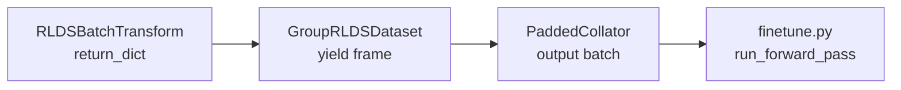

<!-- Generated by SpecStory, Markdown v2.1.0 -->

# 2026-05-17 00:25:58Z

<!-- Cursor IDE Session 91383b57-7cfb-4210-9a2a-2a097ed66ce1 (2026-05-17 00:25:58Z) -->

_**User**_

@datasets.py (148-150) 
我在调试的时候发现proprio没有在rlds_batch["observation"]里面，这是怎么回事呀？

---

_**Agent (default)**_

<think><details><summary>Thought Process</summary>
The user is trying to understand why the key `proprio` is missing from `rlds_batch["observation"]` during debugging.
</details></think>

_**Agent (default)**_

正在追踪 `proprio` 在数据流水线中的来源与写入位置。


_**Agent (default)**_

<tool-use data-tool-type="read" data-tool-name="read_file_v2"><details>
<summary>Tool use: **read_file_v2** • Read file: /home/byang/Project/VLA-Adapter/prismatic/vla/datasets/datasets.py</summary>

</details></tool-use>

_**Agent (default)**_

<tool-use data-tool-type="unknown" data-tool-name="ripgrep_raw_search"><details>
<summary>Tool use: **ripgrep_raw_search**</summary>

Parameters:

```json
{
  "caseInsensitive": false,
  "path": "/home/byang/Project/VLA-Adapter",
  "pattern": "proprio"
}
```
Additional data:

```json
{
  "isPruned": true,
  "outputMode": "content",
  "path": "/home/byang/Project/VLA-Adapter",
  "pattern": "proprio",
  "topFiles": [
    {
      "matchCount": 25,
      "uri": "./pretrained_models/configs/config.json"
    },
    {
      "matchCount": 25,
      "uri": "./pretrained_models/configs/config.json.back.20260517_085159"
    },
    {
      "matchCount": 25,
      "uri": "./pretrained_models/configs/config.json.back.20260515_172858"
    },
    {
      "matchCount": 7,
      "uri": "./prismatic/vla/datasets/datasets.py"
    },
    {
      "matchCount": 25,
      "uri": "./pretrained_models/configs/config.json.back.20260515_165051"
    },
    {
      "matchCount": 25,
      "uri": "./pretrained_models/configs/config.json.back.20260515_151107"
    },
    {
      "matchCount": 25,
      "uri": "./pretrained_models/configs/config.json.back.20260515_133819"
    },
    {
      "matchCount": 25,
      "uri": "./pretrained_models/configs/config.json.back.20260515_112717"
    },
    {
      "matchCount": 25,
      "uri": "./pretrained_models/configs/config.json.back.20260515_104912"
    },
    {
      "matchCount": 19,
      "uri": "./prismatic/vla/datasets/rlds/dataset.py"
    },
    {
      "matchCount": 25,
      "uri": "./pretrained_models/configs/config.json.back.20260515_102418"
    },
    {
      "matchCount": 25,
      "uri": "./pretrained_models/configs/config.json.back.20260515_090208"
    },
    {
      "matchCount": 25,
      "uri": "./pretrained_models/configs/config.json.back.20260514_144020"
    },
    {
      "matchCount": 25,
      "uri": "./pretrained_models/configs/config.json.back.20260514_141138"
    },
    {
      "matchCount": 31,
      "uri": "./vla-scripts/finetune.py"
    },
    {
      "matchCount": 25,
      "uri": "./pretrained_models/configs/config.json.back.20260513_175335"
    },
    {
      "matchCount": 25,
      "uri": "./pretrained_models/configs/config.json.back.20260512_155529"
    },
    {
      "matchCount": 25,
      "uri": "./pretrained_models/configs/config.json.back.20260512_143441"
    },
    {
      "matchCount": 25,
      "uri": "./pretrained_models/configs/config.json.back.20260512_140149"
    },
    {
      "matchCount": 25,
      "uri": "./pretrained_models/configs/config.json.back.20260512_111212"
    }
  ],
  "totalFiles": 78,
  "totalMatches": 1472
}
```
Status: **completed**

</details></tool-use>

_**Agent (default)**_

<tool-use data-tool-type="read" data-tool-name="read_file_v2"><details>
<summary>Tool use: **read_file_v2** • Read file: /home/byang/Project/VLA-Adapter/prismatic/vla/datasets/rlds/dataset.py</summary>

</details></tool-use>

_**Agent (default)**_

<tool-use data-tool-type="unknown" data-tool-name="ripgrep_raw_search"><details>
<summary>Tool use: **ripgrep_raw_search**</summary>

Parameters:

```json
{
  "caseInsensitive": false,
  "path": "/home/byang/Project/VLA-Adapter/prismatic/vla/datasets",
  "pattern": "load_proprio|state_obs_keys"
}
```
Additional data:

```json
{
  "isPruned": true,
  "outputMode": "content",
  "path": "/home/byang/Project/VLA-Adapter/prismatic/vla/datasets",
  "pattern": "load_proprio|state_obs_keys",
  "topFiles": [
    {
      "matchCount": 2,
      "uri": "prismatic/vla/datasets/datasets.py"
    },
    {
      "matchCount": 6,
      "uri": "prismatic/vla/datasets/rlds/dataset.py"
    },
    {
      "matchCount": 6,
      "uri": "prismatic/vla/datasets/rlds/oxe/materialize.py"
    },
    {
      "matchCount": 78,
      "uri": "prismatic/vla/datasets/rlds/oxe/configs.py"
    }
  ],
  "totalFiles": 4,
  "totalMatches": 92
}
```
Status: **completed**

</details></tool-use>

_**Agent (default)**_

<tool-use data-tool-type="unknown" data-tool-name="ripgrep_raw_search"><details>
<summary>Tool use: **ripgrep_raw_search**</summary>

Parameters:

```json
{
  "caseInsensitive": false,
  "path": "/home/byang/Project/VLA-Adapter/vla-scripts/finetune.py",
  "pattern": "load_proprio|use_proprio"
}
```
Additional data:

```json
{
  "isPruned": true,
  "outputMode": "content",
  "path": "/home/byang/Project/VLA-Adapter/vla-scripts/finetune.py",
  "pattern": "load_proprio|use_proprio",
  "topFiles": [
    {
      "matchCount": 16,
      "uri": "vla-scripts/finetune.py"
    }
  ],
  "totalFiles": 1,
  "totalMatches": 16
}
```
Status: **completed**

</details></tool-use>

_**Agent (default)**_

<tool-use data-tool-type="read" data-tool-name="read_file_v2"><details>
<summary>Tool use: **read_file_v2** • Read file: /home/byang/Project/VLA-Adapter/prismatic/vla/datasets/rlds/oxe/materialize.py</summary>

</details></tool-use>

_**Agent (default)**_

<tool-use data-tool-type="unknown" data-tool-name="ripgrep_raw_search"><details>
<summary>Tool use: **ripgrep_raw_search**</summary>

Parameters:

```json
{
  "caseInsensitive": false,
  "contextAfter": 5,
  "contextBefore": 2,
  "path": "/home/byang/Project/VLA-Adapter/vla-scripts/finetune.py",
  "pattern": "RLDSDataset|load_proprio"
}
```
Additional data:

```json
{
  "isPruned": true,
  "outputMode": "content",
  "path": "/home/byang/Project/VLA-Adapter/vla-scripts/finetune.py",
  "pattern": "RLDSDataset|load_proprio",
  "topFiles": [
    {
      "matchCount": 40,
      "uri": "vla-scripts/finetune.py"
    }
  ],
  "totalFiles": 1,
  "totalMatches": 5
}
```
Status: **completed**

</details></tool-use>

_**Agent (default)**_

<tool-use data-tool-type="read" data-tool-name="read_file_v2"><details>
<summary>Tool use: **read_file_v2** • Read file: /home/byang/Project/VLA-Adapter/vla-scripts/finetune.py</summary>

</details></tool-use>

_**Agent (default)**_

<tool-use data-tool-type="read" data-tool-name="read_file_v2"><details>
<summary>Tool use: **read_file_v2** • Read file: /home/byang/Project/VLA-Adapter/prismatic/vla/datasets/rlds/dataset.py</summary>

</details></tool-use>

_**Agent (default)**_

<think><details><summary>Thought Process</summary>
The user has presented an issue, but the specific details are not provided in the current thinking chunk. A clearer understanding of the problem is needed to proceed effectively.

The issue stems from `proprio` being conditionally added to `observation` in the RLDS pipeline only when `state_obs_keys` is non-empty. Since `state_obs_keys` is derived from OXE dataset configs, it gets removed when `load_proprio=False` is set during materialization. However, `RLDSDataset` defaults to `load_proprio=False`, which may lead to unexpected behavior if `proprio` is expected but not loaded.

The root cause of the issue is that `load_proprio` defaults to `False` when creating `RLDSDataset` and `GroupRLDSDataset` in `finetune.py`. This prevents `proprio` from being included in the observation, even if `use_proprio=True` is set elsewhere. As a result, `state_obs_keys` are removed from dataset kwargs, and `proprio` is not created during restructure.

The user needs to explicitly pass `load_proprio=True` when creating the dataset to ensure `proprio` is loaded. The flag `use_proprio` in `RLDSBatchTransform` only controls copying proprio from the batch, not loading it. These two flags must be aligned. Other potential issues include custom datasets not in OXE configs or `state_obs_keys` being all None due to padding-only observations.
</details></think>

_**Agent (default)**_

<tool-use data-tool-type="unknown" data-tool-name="ripgrep_raw_search"><details>
<summary>Tool use: **ripgrep_raw_search**</summary>

Parameters:

```json
{
  "caseInsensitive": false,
  "glob": "*.py",
  "path": "/home/byang/Project/VLA-Adapter",
  "pattern": "load_proprio"
}
```
Additional data:

```json
{
  "isPruned": true,
  "outputMode": "content",
  "path": "/home/byang/Project/VLA-Adapter",
  "pattern": "load_proprio",
  "topFiles": [
    {
      "matchCount": 2,
      "uri": "./prismatic/vla/datasets/datasets.py"
    },
    {
      "matchCount": 1,
      "uri": "./vla-scripts/inspect_libero_rlds.py"
    },
    {
      "matchCount": 5,
      "uri": "./prismatic/vla/datasets/rlds/oxe/materialize.py"
    }
  ],
  "totalFiles": 3,
  "totalMatches": 8
}
```
Status: **completed**

</details></tool-use>

_**Agent (default)**_

<think><details><summary>Thought Process</summary>
Only inspect_libero_rlds.py passes load_proprio=True.
</details></think>

_**Agent (default)**_

<tool-use data-tool-type="read" data-tool-name="read_file_v2"><details>
<summary>Tool use: **read_file_v2** • Read file: /home/byang/Project/VLA-Adapter/vla-scripts/inspect_libero_rlds.py</summary>

</details></tool-use>

_**Agent (default)**_

`proprio` 不在 `rlds_batch["observation"]` 里，通常不是调试器的问题，而是**数据管线根本没有生成这个字段**。整条链路里有两个彼此独立的开关，容易只开其中一个。

## `proprio` 是怎么来的？

原始 RLDS 里一般没有名为 `proprio` 的键。它是在 `make_dataset_from_rlds` 的 `restructure` 里，根据 `state_obs_keys` **拼接**出来的：

```159:170:prismatic/vla/datasets/rlds/dataset.py
        if state_obs_keys:
            new_obs["proprio"] = tf.concat(
                [
                    (
                        tf.zeros((traj_len, 1), dtype=tf.float32)  # padding
                        if key is None
                        else tf.cast(old_obs[key], tf.float32)
                    )
                    for key in state_obs_keys
                ],
                axis=1,
            )
```

只有 `state_obs_keys` **非空**时，才会在 `observation` 里出现 `proprio`。否则 `observation` 里通常只有 `image_*`、`timestep` 等。

`state_obs_keys` 来自各数据集的 OXE 配置（`oxe/configs.py`），例如 LIBERO 类数据集是 `["EEF_state", "gripper_state"]`。

## 最可能的原因：`load_proprio=False`（默认）

`RLDSDataset` 默认 **`load_proprio=False`**：

```169:192:prismatic/vla/datasets/datasets.py
        load_proprio=False,
    ) -> None:
        ...
        per_dataset_kwargs, weights = get_oxe_dataset_kwargs_and_weights(
            ...
            load_proprio=load_proprio,
```

当 `load_proprio=False` 时，会从数据集配置里**删掉** `state_obs_keys`：

```65:66:prismatic/vla/datasets/rlds/oxe/materialize.py
    if not load_proprio:
        dataset_kwargs.pop("state_obs_keys")
```

因此下游 `restructure` 不会创建 `proprio`。

在 `finetune.py` 里创建数据集时**没有传** `load_proprio`，所以一直用默认的 `False`：

```1007:1017:vla-scripts/finetune.py
    train_dataset = GroupRLDSDataset(
                cfg.data_root_dir,
                cfg.dataset_name,
                batch_transform,
                ...
                group_size=cfg.group_size,
    )
```

对比：`inspect_libero_rlds.py` 里显式写了 `load_proprio=True`，那种情况下 batch 里才会有 `proprio`。

## 第二个开关：`use_proprio` 只负责“拷贝”，不负责“加载”

`RLDSBatchTransform.use_proprio` 只决定：若 batch 里已有 `proprio`，是否写入 `return_dict`：

```148:150:prismatic/vla/datasets/datasets.py
        if self.use_proprio and "proprio" in rlds_batch["observation"]:
            proprio = rlds_batch["observation"]["proprio"]
            return_dict["proprio"] = proprio
```

即使 `cfg.use_proprio=True`，若数据集侧 `load_proprio=False`，`rlds_batch["observation"]` 里仍然没有 `proprio`，这段代码不会执行。

| 开关 | 作用 |
|------|------|
| `load_proprio`（`RLDSDataset`） | 是否在 RLDS 管线里生成 `observation["proprio"]` |
| `use_proprio`（`RLDSBatchTransform` / `cfg.use_proprio`） | 是否把已有的 `proprio` 放进最终 batch |

要真正用上 proprio，一般需要**两个都为 True**。

## 调试时建议检查

1. 打印 `list(rlds_batch["observation"].keys())`  
   - 没有 `proprio` → 多半是 `load_proprio=False` 或数据集未配置 `state_obs_keys`  
   - 有 `proprio` 但 `return_dict` 没有 → 检查 `batch_transform.use_proprio`

2. 确认创建数据集时传入：
   ```python
   load_proprio=cfg.use_proprio  # 或 load_proprio=True
   ```
   训练集 `GroupRLDSDataset` 和验证集 `RLDSDataset` 都要传。

3. 确认 `cfg.use_proprio=True`（`finetune.py` 里默认是 `False`）。

4. 若用的是自定义 RLDS、不在 `OXE_DATASET_CONFIGS` 里，需要在配置里正确设置 `state_obs_keys`，指向标准化后 `observation` 里真实存在的 1D 状态字段。

## 小结

你在 148–150 行看不到 `proprio`，是因为 **`rlds_batch` 进入 `RLDSBatchTransform` 之前，RLDS 管线就没有生成它**；最常见原因是 `RLDSDataset(..., load_proprio=False)`（默认），而 `finetune.py` 当前没有覆盖这个默认值。把 `load_proprio` 与 `use_proprio` 对齐后，`observation` 里应会出现 `proprio`（形状大致为 `[window_size, PROPRIO_DIM]`）。

若需要我直接在仓库里改 `finetune.py` 传参，可切换到 Agent 模式。

---

_**User**_

loss = torch.nn.L1Loss()(predicted_actions, ground_truth_actions) 我经过调试发现这个ground_truth_actions的维度是2,16,7，然后pretrained_models的维度是2,8,7，为什么会这样呀？我该怎么改正代码？

---

_**Agent (default)**_

正在追踪 `ground_truth_actions` 与 `predicted_actions` 的维度来源。


_**Agent (default)**_

<tool-use data-tool-type="unknown" data-tool-name="ripgrep_raw_search"><details>
<summary>Tool use: **ripgrep_raw_search**</summary>

Parameters:

```json
{
  "caseInsensitive": false,
  "glob": "*.py",
  "path": "/home/byang/Project/VLA-Adapter",
  "pattern": "ground_truth_actions|predicted_actions|L1Loss"
}
```
Additional data:

```json
{
  "isPruned": true,
  "outputMode": "content",
  "path": "/home/byang/Project/VLA-Adapter",
  "pattern": "ground_truth_actions|predicted_actions|L1Loss",
  "topFiles": [
    {
      "matchCount": 9,
      "uri": "./vla-scripts/finetune.py"
    }
  ],
  "totalFiles": 1,
  "totalMatches": 9
}
```
Status: **completed**

</details></tool-use>

_**Agent (default)**_

<tool-use data-tool-type="unknown" data-tool-name="ripgrep_raw_search"><details>
<summary>Tool use: **ripgrep_raw_search**</summary>

Parameters:

```json
{
  "caseInsensitive": false,
  "glob": "*.py",
  "path": "/home/byang/Project/VLA-Adapter",
  "pattern": "NUM_ACTIONS_CHUNK|future_action_window"
}
```
Additional data:

```json
{
  "isPruned": true,
  "outputMode": "content",
  "path": "/home/byang/Project/VLA-Adapter",
  "pattern": "NUM_ACTIONS_CHUNK|future_action_window",
  "topFiles": [
    {
      "matchCount": 3,
      "uri": "./prismatic/vla/datasets/datasets.py"
    },
    {
      "matchCount": 8,
      "uri": "./prismatic/vla/datasets/rlds/traj_transforms.py"
    },
    {
      "matchCount": 6,
      "uri": "./prismatic/vla/datasets/rlds/dataset.py"
    },
    {
      "matchCount": 4,
      "uri": "./vla-scripts/finetune.py"
    },
    {
      "matchCount": 3,
      "uri": "./vla-scripts/inspect_libero_rlds.py"
    },
    {
      "matchCount": 5,
      "uri": "./prismatic/models/action_heads.py"
    },
    {
      "matchCount": 1,
      "uri": "./vla-scripts/deploy.py"
    },
    {
      "matchCount": 1,
      "uri": "./prismatic/vla/datasets/rlds/oxe/materialize.py"
    },
    {
      "matchCount": 6,
      "uri": "./prismatic/vla/constants.py"
    },
    {
      "matchCount": 1,
      "uri": "./prismatic/training/strategies/base_strategy.py"
    },
    {
      "matchCount": 5,
      "uri": "./prismatic/extern/hf/modeling_prismatic.py"
    },
    {
      "matchCount": 5,
      "uri": "./pretrained_models/configs/modeling_prismatic.py"
    },
    {
      "matchCount": 4,
      "uri": "./experiments/robot/libero/run_libero_eval.py"
    }
  ],
  "totalFiles": 13,
  "totalMatches": 52
}
```
Status: **completed**

</details></tool-use>

_**Agent (default)**_

<tool-use data-tool-type="read" data-tool-name="read_file_v2"><details>
<summary>Tool use: **read_file_v2** • Read file: /home/byang/Project/VLA-Adapter/vla-scripts/finetune.py</summary>

</details></tool-use>

_**Agent (default)**_

<tool-use data-tool-type="read" data-tool-name="read_file_v2"><details>
<summary>Tool use: **read_file_v2** • Read file: /home/byang/Project/VLA-Adapter/vla-scripts/finetune.py</summary>

</details></tool-use>

_**Agent (default)**_

<tool-use data-tool-type="read" data-tool-name="read_file_v2"><details>
<summary>Tool use: **read_file_v2** • Read file: /home/byang/Project/VLA-Adapter/prismatic/vla/constants.py</summary>

</details></tool-use>

_**Agent (default)**_

<tool-use data-tool-type="read" data-tool-name="read_file_v2"><details>
<summary>Tool use: **read_file_v2** • Read file: /home/byang/Project/VLA-Adapter/vla-scripts/train.sh</summary>

</details></tool-use>

_**Agent (default)**_

<think><details><summary>Thought Process</summary>
The user has specified a future action window size of 15 in the FinetuneConfig.

The data pipeline processes 16 actions per batch (1 current + 15 future), while the model predicts 8 actions. This mismatch occurs because the future action window size is set to 15, but the model's action head uses a chunk size of 8. To resolve this, the future action window size should be adjusted to 7 to match the total number of actions predicted by the model.
</details></think>

_**Agent (default)**_

<tool-use data-tool-type="read" data-tool-name="read_file_v2"><details>
<summary>Tool use: **read_file_v2** • Read file: /home/byang/Project/VLA-Adapter/prismatic/models/action_heads.py</summary>

</details></tool-use>

_**Agent (default)**_

<tool-use data-tool-type="read" data-tool-name="read_file_v2"><details>
<summary>Tool use: **read_file_v2** • Read file: /home/byang/Project/VLA-Adapter/prismatic/vla/datasets/rlds/traj_transforms.py</summary>

</details></tool-use>

_**Agent (default)**_

<tool-use data-tool-type="unknown" data-tool-name="ripgrep_raw_search"><details>
<summary>Tool use: **ripgrep_raw_search**</summary>

Parameters:

```json
{
  "caseInsensitive": false,
  "glob": "*.{py,sh,json}",
  "path": "/home/byang/Project/VLA-Adapter",
  "pattern": "future_action_window_size|NUM_ACTIONS_CHUNK"
}
```
Additional data:

```json
{
  "isPruned": true,
  "outputMode": "content",
  "path": "/home/byang/Project/VLA-Adapter",
  "pattern": "future_action_window_size|NUM_ACTIONS_CHUNK",
  "topFiles": [
    {
      "matchCount": 3,
      "uri": "./prismatic/vla/datasets/datasets.py"
    },
    {
      "matchCount": 8,
      "uri": "./prismatic/vla/datasets/rlds/traj_transforms.py"
    },
    {
      "matchCount": 6,
      "uri": "./prismatic/vla/datasets/rlds/dataset.py"
    },
    {
      "matchCount": 4,
      "uri": "./vla-scripts/finetune.py"
    },
    {
      "matchCount": 3,
      "uri": "./vla-scripts/inspect_libero_rlds.py"
    },
    {
      "matchCount": 5,
      "uri": "./prismatic/models/action_heads.py"
    },
    {
      "matchCount": 1,
      "uri": "./vla-scripts/deploy.py"
    },
    {
      "matchCount": 1,
      "uri": "./prismatic/vla/datasets/rlds/oxe/materialize.py"
    },
    {
      "matchCount": 6,
      "uri": "./prismatic/vla/constants.py"
    },
    {
      "matchCount": 1,
      "uri": "./prismatic/training/strategies/base_strategy.py"
    },
    {
      "matchCount": 5,
      "uri": "./prismatic/extern/hf/modeling_prismatic.py"
    },
    {
      "matchCount": 5,
      "uri": "./pretrained_models/configs/modeling_prismatic.py"
    },
    {
      "matchCount": 4,
      "uri": "./experiments/robot/libero/run_libero_eval.py"
    }
  ],
  "totalFiles": 13,
  "totalMatches": 52
}
```
Status: **completed**

</details></tool-use>

_**Agent (default)**_

<tool-use data-tool-type="read" data-tool-name="read_file_v2"><details>
<summary>Tool use: **read_file_v2** • Read file: /home/byang/Project/VLA-Adapter/prismatic/models/action_heads.py</summary>

</details></tool-use>

_**Agent (default)**_

<tool-use data-tool-type="read" data-tool-name="read_file_v2"><details>
<summary>Tool use: **read_file_v2** • Read file: /home/byang/Project/VLA-Adapter/vla-scripts/finetune.py</summary>

</details></tool-use>

_**Agent (default)**_

<think><details><summary>Thought Process</summary>
The model needs to process input shaped as (batch, NUM_ACTIONS_CHUNK, action_dim * hidden_dim) but the forward function expects (batch_size, input_dim). The input dimensions need to be properly handled to match the expected format for the MLPResNet.

The input to MLPResNet is reshaped as (batch, NUM_ACTIONS_CHUNK, action_dim * hidden_dim), but the model expects (batch_size, input_dim) where input_dim = 4096 * 7 = 28672 per chunk element. The forward pass uses rearranged_actions_hidden_states with proper dimensionality for the MLPResNet layer norm.

The model iterates over 24 time steps in the action chunk, requiring a sequence length of at least 25. The input to MLPResNet is reshaped as (batch, 8, 7 * hidden_dim). The forward pass applies layer normalization on the full input dimension. The reshaping before the model call is unclear yet.

The user's query clarifies that ground truth actions have 16 timesteps (1 + 15), while predicted actions have 8 chunks. The model processes inputs as (batch, seq_len, dim) where seq_len=8. The forward pass uses `h_a[:, i+1, :]` which suggests processing each timestep separately. The discrepancy lies in how input dimensions are handledeither flattening or per-step processing is needed to match expectations. Fixing this requires aligning the input structure with the models expectations.

To resolve the mismatch between ground truth and predicted action dimensions, the default value of `future_action_window_size` should be changed from 15 to `NUM_ACTIONS_CHUNK - 1` (which is 7 for LIBERO). The ground truth actions should be sliced to match the number of action chunks: `ground_truth_actions = batch["actions"][:, :NUM_ACTIONS_CHUNK]`. This ensures consistency between the two. The inspect script already follows this correct pattern. Additionally, note that `NUM_TOKENS=64` differs from `NUM_ACTIONS_CHUNK=8`, particularly in minivlm mode where hidden states are reshaped using `NUM_TOKENS` rather than action chunks, indicating a distinction between token-based and action-based processing paths.
</details></think>

_**Agent (default)**_

<tool-use data-tool-type="read" data-tool-name="read_file_v2"><details>
<summary>Tool use: **read_file_v2** • Read file: /home/byang/Project/VLA-Adapter/prismatic/models/action_heads.py</summary>

</details></tool-use>

_**Agent (default)**_

<tool-use data-tool-type="unknown" data-tool-name="ripgrep_raw_search"><details>
<summary>Tool use: **ripgrep_raw_search**</summary>

Parameters:

```json
{
  "caseInsensitive": false,
  "path": "/home/byang/Project/VLA-Adapter/prismatic/models/action_heads.py",
  "pattern": "actions_hidden_states|h_a"
}
```
Additional data:

```json
{
  "isPruned": true,
  "outputMode": "content",
  "path": "/home/byang/Project/VLA-Adapter/prismatic/models/action_heads.py",
  "pattern": "actions_hidden_states|h_a",
  "topFiles": [
    {
      "matchCount": 29,
      "uri": "prismatic/models/action_heads.py"
    }
  ],
  "totalFiles": 1,
  "totalMatches": 29
}
```
Status: **completed**

</details></tool-use>

_**Agent (default)**_

<think><details><summary>Thought Process</summary>
The MLPResNet processes input x through T timesteps. The output from fc2 has shape (batch, output_dim), where output_dim equals the action dimension (7), as specified during head initialization.

The user is questioning whether the output shape is (B, T, 7) or (B, 7) when input x has T=8 timesteps. The forward pass applies layer normalization on x, and then fc2 produces (batch_size, output_dim). If fc2 is applied per token, the output shape could be (B, T, output_dim) = (B, 8, 7). This depends on how the linear layer processes the 3D input (B, T, C).

The output shape matches the prediction of [2, 8, 7]. The ground truth from the data loader is [2, 16, 7]. The discrepancy arises because `future_action_window_size` needs to align with `NUM_ACTIONS_CHUNK - 1`. The default value in `train.sh` is 15, leading to an action chunk length of 16 in RLDS. The recommended default in `FinetuneConfig` should reflect this alignment. An optional defensive slice in loss computation is suggested. The user did not mention `load_proprio` but it may be relevant from prior conversations.
</details></think>

_**Agent (default)**_

根因是：**数据侧加载了 16 步 action，模型 / action head 只预测 8 步**，中间维度没有对齐。

## 维度从哪来？

### `ground_truth_actions` → `[2, 16, 7]`

来自 `batch["actions"]`，由 RLDS 的 `chunk_act_obs` 决定长度：

```19:21:prismatic/vla/datasets/rlds/traj_transforms.py
    "action" is given a new axis (at index 1) of size
    `window_size + future_action_window_size` containing `window_size - 1` actions from the past, the current
    action, and `future_action_window_size` actions from the future.
```

`RLDSDataset` 里 `window_size=1`，而 `finetune.py` 默认：

```142:142:vla-scripts/finetune.py
    future_action_window_size: int = 15 # Action chunking, predicting future actions + current action
```

因此 action 长度 = **1 + 15 = 16**；`batch_size=2` → `[2, 16, 7]`。

### `predicted_actions` → `[2, 8, 7]`

`action_head` 固定按 **`NUM_ACTIONS_CHUNK`** 输出（LIBERO 为 8）：

```136:147:prismatic/models/action_heads.py
            rearranged_actions_hidden_states = self.mem_init_proj(mem_vec).view(
                batch_size, NUM_ACTIONS_CHUNK, self.action_dim * self.hidden_dim
            )
        ...
            rearranged_actions_hidden_states = cond_actions_hidden_states.reshape(
                batch_size, NUM_ACTIONS_CHUNK, -1
            )  # (batch, chunk_len, action_dim * hidden_dim)
```

`NUM_ACTIONS_CHUNK` 在 `constants.py` 里对 LIBERO 为 **8**，预训练 action head 也是按 8 步 chunk 设计的。

`train.sh` 没有覆盖 `future_action_window_size`，所以一直用默认 **15**，和模型的 **8** 不一致。

---

## 推荐改法（优先改数据配置）

与 `inspect_libero_rlds.py` 一致，让数据 chunk 长度等于 `NUM_ACTIONS_CHUNK`：

```python
future_action_window_size = NUM_ACTIONS_CHUNK - 1  # LIBERO: 7 → 共 8 步
```

### 方式 1：命令行（最快验证）

在 `train.sh` 里加：

```bash
--future_action_window_size 7
```

（LIBERO / CALVIN 用 7；Bridge 用 4；ALOHA 用 24，需与对应 `NUM_ACTIONS_CHUNK` 一致。）

### 方式 2：改 `FinetuneConfig` 默认值

把 `future_action_window_size: int = 15` 改成与平台绑定，例如：

```python
from prismatic.vla.constants import NUM_ACTIONS_CHUNK

future_action_window_size: int = NUM_ACTIONS_CHUNK - 1
```

这样 `GroupRLDSDataset(..., future_action_window_size=cfg.future_action_window_size)` 会加载 `[B, 8, 7]`，与 `predicted_actions` 对齐。

---

## 备选：在 loss 处截断（治标）

若暂时不能改数据管线，可在算 loss 前截断 GT：

```python
ground_truth_actions = batch["actions"].to(device_id).to(torch.bfloat16)
ground_truth_actions = ground_truth_actions[:, :NUM_ACTIONS_CHUNK]  # [B, 8, 7]

loss = torch.nn.L1Loss()(predicted_actions, ground_truth_actions)
```

下面用于 logging 的 `[:, 0]`、`[:, 1:]` 也会因此与预测一致。更稳妥仍是改 `future_action_window_size`，避免 dataloader 多加载 8 步用不到的 action。

---

## 不建议的做法

把 action head / 预训练改成输出 16 步：与 `NUM_ACTIONS_CHUNK=8`、checkpoint 结构和推理（如 `run_libero_eval.py` 的 open-loop 步数）都不一致，改动面大。

---

## 自检清单

| 项目 | 应对值（LIBERO） |
|------|------------------|
| `NUM_ACTIONS_CHUNK` | 8 |
| `future_action_window_size` | 7 |
| `batch["actions"].shape[1]` | 8 |
| `predicted_actions.shape[1]` | 8 |

训练启动时若看到 `Using LIBERO constants: NUM_ACTIONS_CHUNK = 8`，则 `future_action_window_size` 应为 **7**，不是 15。

---

**总结**：16 来自 `1 + 15` 的数据 chunk；8 来自 `NUM_ACTIONS_CHUNK` 和预训练 action head。把 `future_action_window_size` 设为 `NUM_ACTIONS_CHUNK - 1`（LIBERO 为 7）即可对齐；或在 loss 前对 GT 做 `[:, :NUM_ACTIONS_CHUNK]` 作为临时方案。

我当前是 Ask 模式，不能直接改仓库；需要我帮你改 `finetune.py` / `train.sh` 可切换到 Agent 模式。

---

_**User**_

@vla-scripts/finetune.py:427-431 为什么我的batch里面没有memory_episode_id这些？

---

_**Agent (default)**_

<think><details><summary>Thought Process</summary>
The user wants to know why their batch is missing the `memory_episode_id` and related fields.
</details></think>

_**Agent (default)**_

追踪 `memory_episode_id` 在数据流水线中的生成与传递路径。


_**Agent (default)**_

<tool-use data-tool-type="unknown" data-tool-name="ripgrep_raw_search"><details>
<summary>Tool use: **ripgrep_raw_search**</summary>

Parameters:

```json
{
  "caseInsensitive": false,
  "glob": "*.py",
  "path": "/home/byang/Project/VLA-Adapter",
  "pattern": "memory_episode_id|memory_timestep"
}
```
Additional data:

```json
{
  "isPruned": true,
  "outputMode": "content",
  "path": "/home/byang/Project/VLA-Adapter",
  "pattern": "memory_episode_id|memory_timestep",
  "topFiles": [
    {
      "matchCount": 3,
      "uri": "./vla-scripts/finetune.py"
    }
  ],
  "totalFiles": 1,
  "totalMatches": 3
}
```
Status: **completed**

</details></tool-use>

_**Agent (default)**_

<tool-use data-tool-type="read" data-tool-name="read_file_v2"><details>
<summary>Tool use: **read_file_v2** • Read file: /home/byang/Project/VLA-Adapter/vla-scripts/finetune.py</summary>

</details></tool-use>

_**Agent (default)**_

<think><details><summary>Thought Process</summary>
Memory_episode_id is only found in finetune.py at the specified grep locations.
</details></think>

_**Agent (default)**_

<tool-use data-tool-type="unknown" data-tool-name="ripgrep_raw_search"><details>
<summary>Tool use: **ripgrep_raw_search**</summary>

Parameters:

```json
{
  "caseInsensitive": false,
  "glob": "*.py",
  "path": "/home/byang/Project/VLA-Adapter",
  "pattern": "episode_id|memory_"
}
```
Additional data:

```json
{
  "isPruned": true,
  "outputMode": "content",
  "path": "/home/byang/Project/VLA-Adapter",
  "pattern": "episode_id|memory_",
  "topFiles": [
    {
      "matchCount": 20,
      "uri": "./vla-scripts/finetune.py"
    },
    {
      "matchCount": 4,
      "uri": "./prismatic/vla/datasets/datasets.py"
    },
    {
      "matchCount": 29,
      "uri": "./prismatic/models/action_heads.py"
    },
    {
      "matchCount": 23,
      "uri": "./prismatic/vla/memory_bank.py"
    },
    {
      "matchCount": 4,
      "uri": "./experiments/robot/libero/run_libero_eval.py"
    }
  ],
  "totalFiles": 5,
  "totalMatches": 80
}
```
Status: **completed**

</details></tool-use>

_**Agent (default)**_

<tool-use data-tool-type="unknown" data-tool-name="ripgrep_raw_search"><details>
<summary>Tool use: **ripgrep_raw_search**</summary>

Parameters:

```json
{
  "caseInsensitive": false,
  "path": "/home/byang/Project/VLA-Adapter",
  "pattern": "use_action_head_memory"
}
```
Additional data:

```json
{
  "isPruned": true,
  "outputMode": "content",
  "path": "/home/byang/Project/VLA-Adapter",
  "pattern": "use_action_head_memory",
  "topFiles": [
    {
      "matchCount": 3,
      "uri": "./vla-scripts/finetune.py"
    }
  ],
  "totalFiles": 1,
  "totalMatches": 3
}
```
Status: **completed**

</details></tool-use>

_**Agent (default)**_

<think><details><summary>Thought Process</summary>
The key finding is that `memory_episode_id` and `memory_timestep` are only used for reading batches in finetune.py and are never written to anywhere in the codebase.
</details></think>

_**Agent (default)**_

<tool-use data-tool-type="unknown" data-tool-name="ripgrep_raw_search"><details>
<summary>Tool use: **ripgrep_raw_search**</summary>

Parameters:

```json
{
  "caseInsensitive": false,
  "path": "/home/byang/Project/VLA-Adapter/vla-scripts/finetune.py",
  "pattern": "episode_ids|timesteps|collator|DataLoader"
}
```
Additional data:

```json
{
  "isPruned": true,
  "outputMode": "content",
  "path": "/home/byang/Project/VLA-Adapter/vla-scripts/finetune.py",
  "pattern": "episode_ids|timesteps|collator|DataLoader",
  "topFiles": [
    {
      "matchCount": 10,
      "uri": "vla-scripts/finetune.py"
    }
  ],
  "totalFiles": 1,
  "totalMatches": 10
}
```
Status: **completed**

</details></tool-use>

_**Agent (default)**_

<tool-use data-tool-type="unknown" data-tool-name="ripgrep_raw_search"><details>
<summary>Tool use: **ripgrep_raw_search**</summary>

Parameters:

```json
{
  "caseInsensitive": false,
  "glob": "*.py",
  "path": "/home/byang/Project/VLA-Adapter/prismatic",
  "pattern": "episode_ids|timesteps"
}
```
Additional data:

```json
{
  "isPruned": true,
  "outputMode": "content",
  "path": "/home/byang/Project/VLA-Adapter/prismatic",
  "pattern": "episode_ids|timesteps",
  "topFiles": [
    {
      "matchCount": 4,
      "uri": "prismatic/vla/datasets/datasets.py"
    },
    {
      "matchCount": 1,
      "uri": "prismatic/vla/datasets/rlds/dataset.py"
    },
    {
      "matchCount": 8,
      "uri": "prismatic/models/action_heads.py"
    },
    {
      "matchCount": 15,
      "uri": "prismatic/vla/memory_bank.py"
    }
  ],
  "totalFiles": 4,
  "totalMatches": 28
}
```
Status: **completed**

</details></tool-use>

_**Agent (default)**_

<tool-use data-tool-type="unknown" data-tool-name="ripgrep_raw_search"><details>
<summary>Tool use: **ripgrep_raw_search**</summary>

Parameters:

```json
{
  "caseInsensitive": false,
  "path": "/home/byang/Project/VLA-Adapter",
  "pattern": "PaddedCollatorForActionPrediction"
}
```
Additional data:

```json
{
  "isPruned": true,
  "outputMode": "content",
  "path": "/home/byang/Project/VLA-Adapter",
  "pattern": "PaddedCollatorForActionPrediction",
  "topFiles": [
    {
      "matchCount": 2,
      "uri": "./vla-scripts/finetune.py"
    },
    {
      "matchCount": 3,
      "uri": "./prismatic/vla/materialize.py"
    },
    {
      "matchCount": 1,
      "uri": "./prismatic/util/data_utils.py"
    },
    {
      "matchCount": 2,
      "uri": "./prismatic/training/strategies/base_strategy.py"
    }
  ],
  "totalFiles": 4,
  "totalMatches": 8
}
```
Status: **completed**

</details></tool-use>

_**Agent (default)**_

<tool-use data-tool-type="read" data-tool-name="read_file_v2"><details>
<summary>Tool use: **read_file_v2** • Read file: /home/byang/Project/VLA-Adapter/vla-scripts/finetune.py</summary>

</details></tool-use>

_**Agent (default)**_

<tool-use data-tool-type="read" data-tool-name="read_file_v2"><details>
<summary>Tool use: **read_file_v2** • Read file: /home/byang/Project/VLA-Adapter/prismatic/vla/datasets/datasets.py</summary>

</details></tool-use>

_**Agent (default)**_

<tool-use data-tool-type="read" data-tool-name="read_file_v2"><details>
<summary>Tool use: **read_file_v2** • Read file: /home/byang/Project/VLA-Adapter/prismatic/util/data_utils.py</summary>

</details></tool-use>

_**Agent (default)**_

<tool-use data-tool-type="read" data-tool-name="read_file_v2"><details>
<summary>Tool use: **read_file_v2** • Read file: /home/byang/Project/VLA-Adapter/vla-scripts/finetune.py</summary>

</details></tool-use>

_**Agent (default)**_

<tool-use data-tool-type="read" data-tool-name="read_file_v2"><details>
<summary>Tool use: **read_file_v2** • Read file: /home/byang/Project/VLA-Adapter/prismatic/util/data_utils.py</summary>

</details></tool-use>

_**Agent (default)**_

<tool-use data-tool-type="read" data-tool-name="read_file_v2"><details>
<summary>Tool use: **read_file_v2** • Read file: /home/byang/Project/VLA-Adapter/prismatic/vla/datasets/datasets.py</summary>

</details></tool-use>

_**Agent (default)**_

<think><details><summary>Thought Process</summary>
Now I have a clear picture: 1.

The action head supports memory banks, but the data pipeline never passes episode IDs or timesteps as memory episode IDs or memory timesteps. Even when enabling `use_action_head_memory=True`, `use_mem` remains false due to missing `memory_episode_id` in the batch. The dataset provides `timesteps` and `episode_ids`, but the collator removes them. To fix this, ensure the collator preserves these fields for memory bank functionality.
</details></think>

_**Agent (default)**_

<tool-use data-tool-type="read" data-tool-name="read_file_v2"><details>
<summary>Tool use: **read_file_v2** • Read file: /home/byang/Project/VLA-Adapter/vla-scripts/finetune.py</summary>

</details></tool-use>

_**Agent (default)**_

<tool-use data-tool-type="read" data-tool-name="read_file_v2"><details>
<summary>Tool use: **read_file_v2** • Read file: /home/byang/Project/VLA-Adapter/prismatic/vla/memory_bank.py</summary>

</details></tool-use>

_**Agent (default)**_

<think><details><summary>Thought Process</summary>
Let me verify the timesteps shape from RLDS to determine if it's windowed.

For window_size=1, the timestep at index 0 corresponds to the current timestep value. In datasets.py, timesteps are extracted as `rlds_batch['observation']['timestep']`, which is passed entirely and may require indexing with `[0]` when using `tree_map` in GroupRLDSDataset. Since `tree_map` slices per index `i`, each frame receives `timesteps[i]` from the chunked observation. However, the collator does not pass timesteps.
</details></think>

_**Agent (default)**_

原因很简单：**`memory_episode_id` / `memory_timestep` 在整个仓库里从未被写入 batch**，`finetune.py` 只是在读它们，数据管线没有把 episode 信息接到这两个字段上。

## 1. 这两个 key 根本不存在

全仓库搜索可知，`memory_episode_id` 和 `memory_timestep` **只在** `finetune.py` 里被读取，没有任何地方创建或赋值：

```427:434:vla-scripts/finetune.py
        use_mem = (
            cfg is not None
            and getattr(cfg, "use_action_head_memory", False)
            and "memory_episode_id" in batch
        )
        ...
        eids = batch["memory_episode_id"].detach().cpu().numpy() if use_mem else None
        tss = batch["memory_timestep"].detach().cpu().numpy() if use_mem else None
```

因此调试时 batch 里没有它们是**预期行为**，不是 dataloader 漏了一步。

## 2. 数据侧实际有什么？

### `GroupRLDSDataset` 会写 `episode_ids`（注意命名）

```267:275:prismatic/vla/datasets/datasets.py
    def __iter__(self) -> Dict[str, Any]:
        episode_id = -1
        for rlds_batch in self.dataset.as_numpy_iterator():
            episode_id += 1
            ...
                frame = self.batch_transform(tree_map(lambda x: x[i], rlds_batch))
                frame["episode_ids"] = np.array([episode_id])
                yield frame
```

是 **`episode_ids`**，不是 `memory_episode_id`。

### `RLDSBatchTransform` 会写 `timesteps`

```130:136:prismatic/vla/datasets/datasets.py
        return_dict = dict(...,
                            timesteps=timesteps, 
                            episode_ids=None, 
                            )
```

单帧里有 `timesteps`，同样**不是** `memory_timestep`。

### `PaddedCollatorForActionPrediction` 会把它们丢掉

Collator 最终 batch 只有这些字段：

```165:175:prismatic/util/data_utils.py
        output = dict(
            pixel_values=pixel_values,
            proprio=proprio,
            input_ids=input_ids,
            attention_mask=attention_mask,
            labels=labels,
            actions=actions,
        )
```

没有 `episode_ids`、`timesteps`，更没有 `memory_*`。  
所以即使 dataset 单条样本里有 `episode_ids` / `timesteps`，进训练循环的 `batch` 里也没有。

## 3. `use_mem` 为何一直是 False？

要启用 memory，需同时满足：

| 条件 | 你当前情况 |
|------|------------|
| `cfg.use_action_head_memory == True` | 默认 `False` |
| `"memory_episode_id" in batch` | 永远不满足（字段未实现） |

因此 `use_mem` 几乎总是 `False`，action head 的 memory bank 不会走 `mem_init_proj` 那条路径。

## 4. 和 memory bank 真正需要的字段

`memory_bank.process_batch` 要的是 **`episode_ids`** 和 **`timesteps`**（numpy），不是 `memory_*`：

```228:237:prismatic/vla/memory_bank.py
    def process_batch(
        self,
        tokens: torch.Tensor,
        episode_ids: np.array,
        timesteps: np.array,
    ) -> torch.Tensor:
        assert episode_ids is not None, "episode_ids must be provided during training"
        ...
            assert timesteps is not None, "timesteps must be provided during training"
```

`finetune.py` 与数据层在**字段命名和 collator 透传**上对不齐，属于未接完的接线。

## 5. 若要用 episode memory，需要补什么（思路）

在 **Ask 模式**下只能给改法建议，不能直接改代码：

**方案 A：改 collator（推荐）**  
在 `PaddedCollatorForActionPrediction.__call__` 里，若 `instances[0]` 含 `episode_ids` / `timesteps`，则 stack 后进 batch，例如：

```python
# 伪代码
if "episode_ids" in instances[0]:
    output["memory_episode_id"] = torch.tensor(
        np.stack([inst["episode_ids"] for inst in instances])
    ).long().squeeze(-1)  # [B]
if "timesteps" in instances[0]:
    # timesteps 可能是 chunked，取当前步标量，例如 inst["timesteps"][0]
    output["memory_timestep"] = torch.tensor([...]).long()  # [B]
```

**方案 B：改 `finetune.py` 读已有字段**  
在 collator 先透传 `episode_ids`、`timesteps` 的前提下：

```python
and "episode_ids" in batch
eids = batch["episode_ids"].detach().cpu().numpy()
tss = batch["timesteps"][:, 0].detach().cpu().numpy()  # 视 timesteps 形状调整
```

**其它注意点：**

- 训练需用 **`GroupRLDSDataset`**（你已在用），否则没有 `episode_ids`。
- 设 **`use_action_head_memory=True`**。
- **`memory_group_size`** 宜与 **`group_size`** 一致（默认都是 16），否则 memory bank 按 group 清 cache 的逻辑可能对不上 batch 顺序。
- 若用普通 **`RLDSDataset`**（验证集），`episode_ids` 一直是 `None`，memory 无法按 episode 工作。

## 小结

| 你找的字段 | 实际情况 |
|-----------|----------|
| `memory_episode_id` | 未实现，batch 里不会有 |
| `memory_timestep` | 未实现，batch 里不会有 |
| `episode_ids` | `GroupRLDSDataset` 有，但被 collator 丢掉 |
| `timesteps` | transform 有，但被 collator 丢掉 |

当前行为是：**memory 相关逻辑只写了一半**——action head / `finetune` 侧有接口，数据 collator 没有把 episode 信息送进 batch。需要我直接在仓库里接好这条链路，可切换到 Agent 模式。

---

_**User**_

@prismatic/vla/datasets/datasets.py 我明明在这里写了代码会在rlds_batch里面加入timesteps和episode_ids，但是为什么我在训练的过程中 @vla-scripts/finetune.py:427-434 这里的batch里就没有这两个数据呢？

---

_**Agent (default)**_

<think><details><summary>Thought Process</summary>
The user wants to know why timesteps and episode_ids added in datasets.py do not appear in the batch during training at finetune.py lines 427-434.
</details></think>

_**Agent (default)**_

再看一下你当前的 `datasets.py` 和 collator 的完整数据流。


_**Agent (default)**_

<tool-use data-tool-type="read" data-tool-name="read_file_v2"><details>
<summary>Tool use: **read_file_v2** • Read file: /home/byang/Project/VLA-Adapter/prismatic/vla/datasets/datasets.py</summary>

</details></tool-use>

_**Agent (default)**_

<tool-use data-tool-type="read" data-tool-name="read_file_v2"><details>
<summary>Tool use: **read_file_v2** • Read file: /home/byang/Project/VLA-Adapter/prismatic/util/data_utils.py</summary>

</details></tool-use>

_**Agent (default)**_

<tool-use data-tool-type="read" data-tool-name="read_file_v2"><details>
<summary>Tool use: **read_file_v2** • Read file: /home/byang/Project/VLA-Adapter/vla-scripts/finetune.py</summary>

</details></tool-use>

_**Agent (default)**_

<think><details><summary>Thought Process</summary>
I now have a complete understanding and will trace the full data flow clearly for the user.
</details></think>

_**Agent (default)**_

问题不在 `datasets.py`「没写进去」，而在 **Dataset 单条样本 → Collator 组 batch → `finetune.py` 读字段** 这条链路上，中间断了两处，而且字段名也不一致。

## 数据实际走了 3 步



你在 `datasets.py` 里改的是 **A/B**；训练里 `batch` 来自 **C**；`finetune.py` 读的是 **D** 里的 key。

---

## 第 1 步：`datasets.py` 里确实有，但是「单条样本」

### `timesteps` — 在 `return_dict` 里

```131:137:prismatic/vla/datasets/datasets.py
        return_dict = dict(pixel_values=pixel_values, 
                                                            ...
                                                            timesteps=timesteps, 
                                                            episode_ids=None, 
                                                            )
```

来源是 `rlds_batch['observation']['timestep']`（在 transform 里读，不是直接往 `rlds_batch` 根上挂 key）。  
**单条 `frame` 里会有 `timesteps`。**

### `episode_ids` — transform 里是 `None`，Group 里才赋值

`RLDSBatchTransform` 里写死 `episode_ids=None`。  
只有 `GroupRLDSDataset` 在 yield 前覆盖：

```274:276:prismatic/vla/datasets/datasets.py
                frame = self.batch_transform(tree_map(lambda x: x[i], rlds_batch))
                frame["episode_ids"] = np.array([episode_id])
                yield frame
```

所以：**训练用 `GroupRLDSDataset` 时，单条样本可以有 `timesteps` + `episode_ids`；用普通 `RLDSDataset` 时 `episode_ids` 一直是 `None`。**

到这里为止，若你在 `__iter__` / `batch_transform` 后打断点，应该能看到这两个字段。

---

## 第 2 步：Collator 把它们丢掉了（最关键）

`DataLoader` 会用 `PaddedCollatorForActionPrediction` 把多条 `frame` 合成 `batch`。  
Collator **只** 输出这些 key：

```165:175:prismatic/util/data_utils.py
        output = dict(
            pixel_values=pixel_values,
            proprio=proprio,
            input_ids=input_ids,
            attention_mask=attention_mask,
            labels=labels,
            actions=actions,
        )
```

没有 `timesteps`，没有 `episode_ids`，也没有 `memory_*`。  
和 `proprio` 对比：`proprio` 在 collator 里有专门处理（158–163 行），`timesteps` / `episode_ids` 没有类似逻辑。

因此：**Dataset 里写了 ≠ 训练循环里的 `batch` 里有。** 断点应打在 collator **之后**，而不是只在 `datasets.py`。

---

## 第 3 步：`finetune.py` 找的 key 名也不一样

训练代码查的是：

```427:434:vla-scripts/finetune.py
        use_mem = (
            ...
            and "memory_episode_id" in batch
        )
        eids = batch["memory_episode_id"]...
        tss = batch["memory_timestep"]...
```

而 dataset 提供的是 **`episode_ids`** 和 **`timesteps`**，不是 `memory_episode_id` / `memory_timestep`。

即使 collator 透传了 `episode_ids`，`"memory_episode_id" in batch` 仍为 `False`，`use_mem` 也不会开。

---

## 对照表

| 阶段 | `timesteps` | `episode_ids` | `memory_episode_id` | `memory_timestep` |
|------|-------------|---------------|---------------------|-------------------|
| `RLDSBatchTransform` return_dict | ✅ | ❌（固定 `None`） | ❌ | ❌ |
| `GroupRLDSDataset` yield 的 frame | ✅ | ✅ | ❌ | ❌ |
| `PaddedCollator` 的 batch | ❌ 被丢弃 | ❌ 被丢弃 | ❌ | ❌ |
| `finetune.py` 读取 | ❌ | ❌ | 期望有 | 期望有 |

---

## 该怎么改（思路，Ask 模式不能直接改代码）

需要同时做两件事：

**1. 在 `PaddedCollatorForActionPrediction` 里透传并 stack**

```python
# 伪代码示意
if "episode_ids" in instances[0]:
    output["memory_episode_id"] = torch.tensor(
        [int(np.asarray(inst["episode_ids"]).reshape(-1)[0]) for inst in instances],
        dtype=torch.long,
    )
if "timesteps" in instances[0]:
    # timesteps 可能是 chunk 后的数组，取当前步，例如 [0]
    output["memory_timestep"] = torch.tensor(
        [int(np.asarray(inst["timesteps"]).reshape(-1)[0]) for inst in instances],
        dtype=torch.long,
    )
```

**2. 二选一统一命名**

- 要么 collator 输出 `memory_episode_id` / `memory_timestep`（与 `finetune.py` 一致）  
- 要么改 `finetune.py` 读 `batch["episode_ids"]` / `batch["timesteps"]`

另外记得：

- `use_action_head_memory=True` 才会走 memory 分支  
- 训练要用 `GroupRLDSDataset`，否则没有 `episode_ids`  
- `memory_group_size` 建议与 `group_size` 一致（默认 16）

---

## 调试建议

在三个位置各打一次 `print(sample.keys())` 或 `print(batch.keys())`：

1. `GroupRLDSDataset.__iter__` 里 `yield frame` 之前 → 应有 `timesteps`、`episode_ids`  
2. `PaddedCollatorForActionPrediction` 的 `return output` 之前 → 目前只有 6–7 个 key  
3. `run_forward_pass` 里 `batch` → 同样没有；且不会有 `memory_*` 除非 collator 已改

**结论**：你在 `datasets.py` 写的 `timesteps` / `episode_ids` 只存在于 **Dataset 单样本**；**Collator 没把它们放进 batch**，**finetune 又用了另一套名字**，所以 427–434 行看不到。要打通整条链路，必须改 collator（并统一字段名）。

需要我直接在仓库里改 collator + `finetune.py` 的话，切换到 Agent 模式即可。
