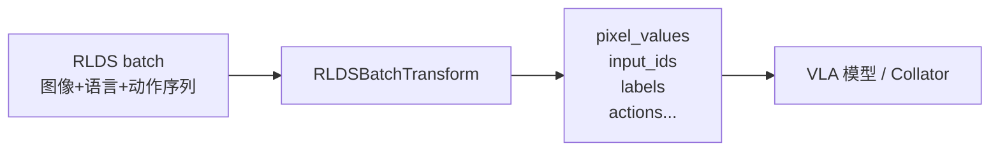
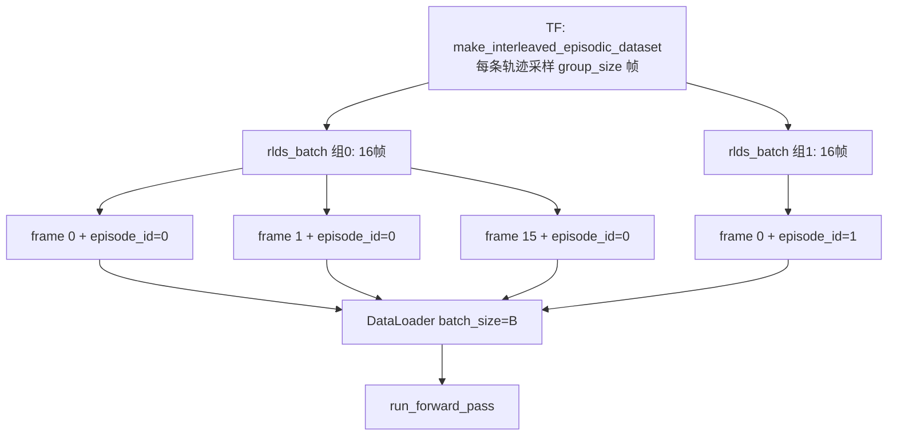

<!-- Generated by SpecStory, Markdown v2.1.0 -->

# 2026-05-19 03:43:20Z

<!-- Cursor IDE Session 95a82330-56c7-4451-8576-a7a2cf4f4cde (2026-05-19 03:43:20Z) -->

_**User**_

@prismatic/vla/datasets/datasets.py:30-153 这段代码是干什么用的，给我详细讲解一下 

---

_**Agent (default)**_

正在阅读完整文件及相关依赖，以便准确讲解这段代码。


_**Agent (default)**_

<tool-use data-tool-type="read" data-tool-name="read_file_v2"><details>
<summary>Tool use: **read_file_v2** • Read file: /home/byang/Project/VLA-Adapter/prismatic/vla/datasets/datasets.py</summary>

</details></tool-use>

_**Agent (default)**_

<tool-use data-tool-type="unknown" data-tool-name="ripgrep_raw_search"><details>
<summary>Tool use: **ripgrep_raw_search**</summary>

Parameters:

```json
{
  "caseInsensitive": false,
  "path": "/home/byang/Project/VLA-Adapter",
  "pattern": "NUM_TOKENS|IGNORE_INDEX|RLDSBatchTransform"
}
```
Additional data:

```json
{
  "isPruned": true,
  "outputMode": "content",
  "path": "/home/byang/Project/VLA-Adapter",
  "pattern": "NUM_TOKENS|IGNORE_INDEX|RLDSBatchTransform",
  "topFiles": [
    {
      "matchCount": 4,
      "uri": "./vla-scripts/finetune.py"
    },
    {
      "matchCount": 2,
      "uri": "./prismatic/models/action_heads.py"
    },
    {
      "matchCount": 6,
      "uri": "./prismatic/util/data_utils.py"
    },
    {
      "matchCount": 10,
      "uri": "./prismatic/vla/datasets/datasets.py"
    },
    {
      "matchCount": 1,
      "uri": "./prismatic/vla/datasets/rlds/dataset.py"
    },
    {
      "matchCount": 1,
      "uri": "./prismatic/vla/datasets/__init__.py"
    },
    {
      "matchCount": 1,
      "uri": "./vla-scripts/inspect_libero_rlds.py"
    },
    {
      "matchCount": 1,
      "uri": "./vla-scripts/deploy.py"
    },
    {
      "matchCount": 2,
      "uri": "./prismatic/vla/materialize.py"
    },
    {
      "matchCount": 1,
      "uri": "./prismatic/vla/datasets/rlds/oxe/materialize.py"
    },
    {
      "matchCount": 2,
      "uri": "./prismatic/vla/constants.py"
    },
    {
      "matchCount": 8,
      "uri": "./prismatic/preprocessing/datasets/datasets.py"
    },
    {
      "matchCount": 5,
      "uri": "./prismatic/training/train_utils.py"
    },
    {
      "matchCount": 2,
      "uri": "./prismatic/training/strategies/base_strategy.py"
    },
    {
      "matchCount": 4,
      "uri": "./prismatic/models/vlms/prismatic.py"
    },
    {
      "matchCount": 8,
      "uri": "./prismatic/extern/hf/modeling_prismatic.py"
    },
    {
      "matchCount": 8,
      "uri": "./pretrained_models/configs/modeling_prismatic.py"
    }
  ],
  "totalFiles": 17,
  "totalMatches": 66
}
```
Status: **completed**

</details></tool-use>

_**Agent (default)**_

<tool-use data-tool-type="unknown" data-tool-name="ripgrep_raw_search"><details>
<summary>Tool use: **ripgrep_raw_search**</summary>

Parameters:

```json
{
  "caseInsensitive": false,
  "path": "/home/byang/Project/VLA-Adapter",
  "pattern": "class ActionTokenizer"
}
```
Additional data:

```json
{
  "isPruned": true,
  "outputMode": "content",
  "path": "/home/byang/Project/VLA-Adapter",
  "pattern": "class ActionTokenizer",
  "topFiles": [
    {
      "matchCount": 1,
      "uri": "./prismatic/vla/action_tokenizer.py"
    }
  ],
  "totalFiles": 1,
  "totalMatches": 1
}
```
Status: **completed**

</details></tool-use>

_**Agent (default)**_

<tool-use data-tool-type="read" data-tool-name="read_file_v2"><details>
<summary>Tool use: **read_file_v2** • Read file: /home/byang/Project/VLA-Adapter/prismatic/vla/action_tokenizer.py</summary>

</details></tool-use>

_**Agent (default)**_

<tool-use data-tool-type="read" data-tool-name="read_file_v2"><details>
<summary>Tool use: **read_file_v2** • Read file: /home/byang/Project/VLA-Adapter/prismatic/vla/constants.py</summary>

</details></tool-use>

_**Agent (default)**_

<tool-use data-tool-type="read" data-tool-name="read_file_v2"><details>
<summary>Tool use: **read_file_v2** • Read file: /home/byang/Project/VLA-Adapter/vla-scripts/finetune.py</summary>

</details></tool-use>

_**Agent (default)**_

<tool-use data-tool-type="read" data-tool-name="read_file_v2"><details>
<summary>Tool use: **read_file_v2** • Read file: /home/byang/Project/VLA-Adapter/vla-scripts/finetune.py</summary>

</details></tool-use>

_**Agent (default)**_

<think><details><summary>Thought Process</summary>
I now have a good understanding.
</details></think>

_**Agent (default)**_

<tool-use data-tool-type="unknown" data-tool-name="ripgrep_raw_search"><details>
<summary>Tool use: **ripgrep_raw_search**</summary>

Parameters:

```json
{
  "caseInsensitive": false,
  "path": "/home/byang/Project/VLA-Adapter",
  "pattern": "current_action_mask|next_actions_mask"
}
```
Additional data:

```json
{
  "isPruned": true,
  "outputMode": "content",
  "path": "/home/byang/Project/VLA-Adapter",
  "pattern": "current_action_mask|next_actions_mask",
  "topFiles": [
    {
      "matchCount": 9,
      "uri": "./vla-scripts/finetune.py"
    },
    {
      "matchCount": 2,
      "uri": "./prismatic/training/train_utils.py"
    },
    {
      "matchCount": 8,
      "uri": "./prismatic/training/strategies/base_strategy.py"
    },
    {
      "matchCount": 5,
      "uri": "./prismatic/extern/hf/modeling_prismatic.py"
    },
    {
      "matchCount": 5,
      "uri": "./pretrained_models/configs/modeling_prismatic.py"
    }
  ],
  "totalFiles": 5,
  "totalMatches": 29
}
```
Status: **completed**

</details></tool-use>

_**Agent (default)**_

<tool-use data-tool-type="read" data-tool-name="read_file_v2"><details>
<summary>Tool use: **read_file_v2**</summary>
File not found
</details></tool-use>

_**Agent (default)**_

<tool-use data-tool-type="read" data-tool-name="read_file_v2"><details>
<summary>Tool use: **read_file_v2** • Read file: /home/byang/Project/VLA-Adapter/prismatic/training/train_utils.py</summary>

</details></tool-use>

_**Agent (default)**_

<tool-use data-tool-type="search" data-tool-name="glob_file_search"><details>
<summary>Tool use: **glob_file_search** • Searched codebase "" • **0** results in **1** directory</summary>

Directory: **`/home/byang/Project/VLA-Adapter`** (0 files)
</details></tool-use>

_**Agent (default)**_

<tool-use data-tool-type="unknown" data-tool-name="ripgrep_raw_search"><details>
<summary>Tool use: **ripgrep_raw_search**</summary>

Parameters:

```json
{
  "caseInsensitive": false,
  "path": "/home/byang/Project/VLA-Adapter",
  "pattern": "class PurePromptBuilder|class QwenPromptBuilder"
}
```
Additional data:

```json
{
  "isPruned": true,
  "outputMode": "content",
  "path": "/home/byang/Project/VLA-Adapter",
  "pattern": "class PurePromptBuilder|class QwenPromptBuilder",
  "topFiles": [
    {
      "matchCount": 1,
      "uri": "./prismatic/models/backbones/llm/prompting/base_prompter.py"
    },
    {
      "matchCount": 1,
      "uri": "./prismatic/models/backbones/llm/prompting/qwen_prompter.py"
    }
  ],
  "totalFiles": 2,
  "totalMatches": 2
}
```
Status: **completed**

</details></tool-use>

_**Agent (default)**_

<tool-use data-tool-type="read" data-tool-name="read_file_v2"><details>
<summary>Tool use: **read_file_v2** • Read file: /home/byang/Project/VLA-Adapter/vla-scripts/finetune.py</summary>

</details></tool-use>

_**Agent (default)**_

<tool-use data-tool-type="read" data-tool-name="read_file_v2"><details>
<summary>Tool use: **read_file_v2** • Read file: /home/byang/Project/VLA-Adapter/prismatic/models/backbones/llm/prompting/base_prompter.py</summary>

</details></tool-use>

_**Agent (default)**_

<tool-use data-tool-type="read" data-tool-name="read_file_v2"><details>
<summary>Tool use: **read_file_v2** • Read file: /home/byang/Project/VLA-Adapter/prismatic/models/backbones/llm/prompting/qwen_prompter.py</summary>

</details></tool-use>

_**Agent (default)**_

<think><details><summary>Thought Process</summary>
I now have a comprehensive understanding.

Let me understand the action chunk in RLDSDataset where future_action_window_size is used, so each batch includes current and future actions. In the non-minivlm branch, all actions (current + future) are tokenized into action_chunk_string, but only the first character/token of this string is used as the GPT value in the conversation. Additionally, action_chunk_len is set to 1, overriding the actual computed length. This results in the labels mask considering only one action token for LLM loss calculation during training. 

This approach appears to limit the model's exposure to multiple action tokens within the action chunk, potentially constraining its ability to learn from full action sequences. However, I need to re-read the code to fully grasp how this affects the overall training process and whether there's a specific reason for this design choice.

The implementation seems to intentionally restrict the action sequence to just the first token for training purposes, which may be related to how the model processes action sequences or how

In the standard OpenVLA path, the action chunk consists of the current and future actions concatenated into a single string. Although the full string length is calculated initially, only the first character of this string is used in the conversation prompt, with the action chunk length adjusted to one token. As a result, the model's loss is computed solely on this single action token, while the complete action sequence remains available for the action head through return_dict["actions"].
</details></think>

_**Agent (default)**_

<tool-use data-tool-type="read" data-tool-name="read_file_v2"><details>
<summary>Tool use: **read_file_v2** • Read file: /home/byang/Project/VLA-Adapter/prismatic/extern/hf/modeling_prismatic.py</summary>

</details></tool-use>

_**Agent (default)**_

<tool-use data-tool-type="read" data-tool-name="read_file_v2"><details>
<summary>Tool use: **read_file_v2** • Read file: /home/byang/Project/VLA-Adapter/prismatic/vla/datasets/rlds/dataset.py</summary>

</details></tool-use>

_**Agent (default)**_

# `RLDSBatchTransform` 详解

这段代码是 **VLA（Vision-Language-Action）训练流水线里的核心数据转换器**：把 RLDS（机器人轨迹数据集，TensorFlow 格式）的一个 batch，转成 OpenVLA / VLA-Adapter 模型能直接吃的 PyTorch 样本。

它在 `RLDSDataset.__iter__` 里被调用：每从 TF 管道取一条 `rlds_batch`，就执行一次 `batch_transform(rlds_batch)`。

---

## 1. 整体角色



**输入**：`rlds_batch`（字典），典型字段包括：
- `observation`：主相机图、可选腕部相机、proprio、timestep
- `action`：当前步 + 未来若干步的动作（action chunk）
- `task.language_instruction`：自然语言任务描述
- `dataset_name`：数据集名称

**输出**：模型训练用的字典，至少包含 `pixel_values`、`input_ids`、`labels`，以及用于 action head 的 `actions`、`timesteps` 等。

---

## 2. 类字段含义

| 字段 | 作用 |
|------|------|
| `action_tokenizer` | 把连续动作离散化成 token（词表末尾 256 个 bin） |
| `base_tokenizer` | LLM 的 HuggingFace tokenizer |
| `image_transform` | 图像预处理（resize、normalize 等） |
| `prompt_builder_fn` | 构造对话式 prompt（如 `PurePromptBuilder`） |
| `predict_stop_token` | 是否对序列末尾 `</s>` 计算 loss |
| `use_wrist_image` | 是否加入腕部相机图像 |
| `use_proprio` | 是否加入本体感知状态 |
| `use_minivlm` | **两种截然不同的构造策略**（见下文） |

---

## 3. 公共预处理（第 44–54 行）

```44:54:prismatic/vla/datasets/datasets.py
        dataset_name, current_action = rlds_batch["dataset_name"], rlds_batch["action"][0]
        img = Image.fromarray(rlds_batch["observation"]["image_primary"][0])
        lang = rlds_batch["task"]["language_instruction"].decode().lower()
        actions = rlds_batch["action"]

        # Construct Chat-based Prompt =>> Input is default query + language instruction, output are the action tokens
        prompt_builder = self.prompt_builder_fn("openvla")

        # Get future action chunk
        future_actions = rlds_batch["action"][1:]
        timesteps = rlds_batch['observation']['timestep']
```

- **`current_action`**：`action[0]`，当前时刻要执行的动作（7 维等，取决于机器人平台）。
- **`future_actions`**：`action[1:]`，未来 `future_action_window_size` 步的动作，用于 **action chunking**（一次预测多步）。
- **`img`**：主视角 RGB，取时间维第 0 帧。
- **`lang`**：任务指令，转小写后嵌入 prompt。
- **`actions`**：完整动作序列原样保留，供后续 **L1 regression action head** 使用（不只在 token 里）。

Prompt 模板统一为：

> *"What action should the robot take to {lang}?"*

这是 OpenVLA 风格的视觉-语言-动作问答格式。

---

## 4. 动作离散化（`ActionTokenizer`）

`ActionTokenizer` 把连续动作 clip 到 `[-1, 1]`，均匀分 256 个 bin，再映射到 **词表最后 256 个 token**：

- `use_minivlm=False`：返回 **解码后的字符串**（一个字符可能对应一个 action token）。
- `use_minivlm=True`：返回 **token id 列表**（整数），不再走 decode 成字符。

这与 `constants.py` 里的 `ACTION_TOKEN_BEGIN_IDX`、`NUM_TOKENS=64` 配合，供后续 mask 和 action head 使用。

---

## 5. 分支 A：`use_minivlm=True`（MiniVLM / Qwen 路径）

这是 **VLA-Adapter 微调** 里 `cfg.use_minivlm=True` 时走的路径（见 `finetune.py`）。

### 5.1 构造完整 action token 序列

```60:65:prismatic/vla/datasets/datasets.py
            future_actions_string = self.action_tokenizer(future_actions,self.use_minivlm)
            current_action_string = self.action_tokenizer(current_action,self.use_minivlm)

            action_chunk_string = [current_action_string] + future_actions_string
            flattened_action_chunk_string = [item for sublist in action_chunk_string for item in sublist]
```

把当前动作 + 未来动作的 token id **展平成一个列表**（长度可能 > 64）。

### 5.2 Prompt：GPT 回复为空

```67:76:prismatic/vla/datasets/datasets.py
            conversation = [
                {"from": "human", "value": f"What action should the robot take to {lang}?"},
                {"from": "gpt", "value": ''},
            ]
            ...
            input_ids = self.base_tokenizer(prompt_builder.get_prompt(), add_special_tokens=True).input_ids
```

使用 `QwenPromptBuilder`（ChatML 格式），**不在文本里写动作**，动作 token 后面手动拼上去。

### 5.3 删掉 prompt 末尾 3 个 token

```78:81:prismatic/vla/datasets/datasets.py
            if len(input_ids) >= 3:
                del input_ids[-3] 
                del input_ids[-2] 
                del input_ids[-1] 
```

通常是为了去掉 tokenizer 自动加的占位符 / `</s>` 等，给后面的 64 个 action token 腾位置。

### 5.4 固定为 `NUM_TOKENS=64` 个 action token

```83:91:prismatic/vla/datasets/datasets.py
            if NUM_TOKENS<len(flattened_action_chunk_string):
                input_ids = input_ids + flattened_action_chunk_string[:NUM_TOKENS]
            else:
                remaining_length = NUM_TOKENS - len(flattened_action_chunk_string)
                extended_array = random.choices(flattened_action_chunk_string, k=remaining_length)
                
                input_ids = input_ids + flattened_action_chunk_string + extended_array
            labels = list(input_ids)
            action_chunk_len = NUM_TOKENS
```

- **太长**：截断到 64。
- **太短**：从已有 action token 里 **有放回随机采样** 补齐到 64。
- `action_chunk_len` 固定为 64，与 `modeling_prismatic.py` 里的 `action_queries`（64 个 embedding）和 `finetune.py` 里 `reshape(..., NUM_TOKENS, -1)` 对齐。

---

## 6. 分支 B：`use_minivlm=False`（经典 OpenVLA 路径）

```94:118:prismatic/vla/datasets/datasets.py
            future_actions_string = ''.join(self.action_tokenizer(future_actions, use_minivlm=False))
            current_action_string = self.action_tokenizer(current_action, use_minivlm=False)
            action_chunk_string = current_action_string + future_actions_string
            ...
            conversation = [
                {"from": "human", "value": f"What action should the robot take to {lang}?"},
                {"from": "gpt", "value": action_chunk_string[0]},
            ]
            ...
            action_chunk_len = 1
```

注意这里的 **关键设计**：

1. 虽然算出了完整 `action_chunk_string`（当前 + 未来所有动作的 token 字符），但放进 prompt 的 **只有第一个字符** `action_chunk_string[0]`。
2. `action_chunk_len` 被 **强制设为 1**，所以 LLM 的 cross-entropy loss **只对 1 个 action token**（外加可选的 stop token）计算。

注释掉的代码表明曾经考虑过 GPT 回复为空、动作全靠别的方式预测：

```105:109:prismatic/vla/datasets/datasets.py
            # conversation = [
            #     {"from": "human", "value": f"What action should the robot take to {lang}?"},
            #     {"from": "gpt", "value": ""},
            # ]
```

完整动作序列仍通过 `return_dict["actions"]` 交给 **连续 action head（L1 regression）**，而不是靠 LLM 逐 token 生成全部动作。

---

## 7. 标签掩码：只对动作 token 算 loss

```125:128:prismatic/vla/datasets/datasets.py
        labels[: -(action_chunk_len + 1)] = IGNORE_INDEX
        if not self.predict_stop_token:
            labels[-1] = IGNORE_INDEX
```

- `IGNORE_INDEX = -100`：HuggingFace 标准，这些位置不参与 loss。
- `labels[:-(action_chunk_len+1)]`：prompt 部分（图像对应位置在模型内部处理）、问题文本等 **全部 mask 掉**。
- 只有最后 `action_chunk_len` 个 token + 1 个（通常是 `</s>`）参与监督。
- `predict_stop_token=False` 时，连 stop token 也不监督。

这与注释一致：**只让模型学习预测动作 token，不学复述问题**。

---

## 8. 张量化与图像

```122:123:prismatic/vla/datasets/datasets.py
        input_ids, labels = torch.tensor(input_ids), torch.tensor(labels)
        pixel_values = self.image_transform(img)
```

- `input_ids` / `labels` 转成 `torch.Tensor`。
- `pixel_values` 经视觉 backbone 的 transform（如 Qwen-VL 的 `image_processor`）。

---

## 9. 可选模态扩展

### 腕部相机（`use_wrist_image`）

遍历 `observation` 里名字含 `"wrist"` 的键，分别做 `image_transform`，再 `torch.cat` 成 `pixel_values_wrist`。用于 `num_images_in_input > 1` 的多视角设置。

### 本体感知（`use_proprio`）

若 batch 里有 `observation["proprio"]`，原样放入 `return_dict["proprio"]`，供 `proprio_projector` 使用。

---

## 10. 返回值一览

| 键 | 含义 |
|----|------|
| `pixel_values` | 主相机图像张量 |
| `input_ids` | 文本 token 序列（含动作 token） |
| `labels` | 带 mask 的监督标签 |
| `dataset_name` | 用于反归一化 / 统计 |
| `actions` | 原始连续动作 chunk（给 action head） |
| `timesteps` | 轨迹内时间步 |
| `episode_ids` | 此处为 `None`（`GroupRLDSDataset` 会在外层补上） |
| `pixel_values_wrist` | 可选腕部图 |
| `proprio` | 可选关节/末端状态 |

---

## 11. 与训练流程的关系

在 `finetune.py` 中：

- **`use_minivlm=True`**：`input_ids` 里塞满 64 个 action token id → VLA 前向 → 从 hidden states 取出 64 个位置 → **L1 action head** 回归连续动作。
- **`use_minivlm=False` 且离散训练**：主要对 **1 个** action token 做 next-token prediction；完整 chunk 仍来自 `batch["actions"]`。
- `get_current_action_mask` / `get_next_actions_mask`（`train_utils.py`）按 `ACTION_DIM`（7）和 `ACTION_TOKEN_BEGIN_IDX` 区分当前步 vs 未来步的 token，用于 accuracy / L1 指标。

推理时，`OpenVLAForActionPrediction._prepare_input_for_action_prediction` 还会在序列末尾 **追加 64 个 placeholder action token + stop token**，与训练时 `NUM_TOKENS=64` 的设计一致。

---

## 12. 小结

`RLDSBatchTransform` 做的是：

1. **读** RLDS 的一帧：图 + 语言 + 动作 chunk；  
2. **写** OpenVLA 式 prompt（图 + “机器人该做什么动作？”）；  
3. **把连续动作变成离散 token**（两种编码方式）；  
4. **构造 `input_ids` / `labels`**，并 mask 掉非动作部分；  
5. **可选**加腕部图、proprio；  
6. **保留原始 `actions`** 给连续 action head。

`use_minivlm` 是分水岭：**True** 时走 Qwen + 64 个 action token id（VLA-Adapter 主路径）；**False** 时只在文本里放 1 个动作字符，更像原始 OpenVLA 的轻量 LLM 监督，重预测交给 action head。

若你想深入某一段（例如为何删最后 3 个 token、或 `random.choices` 补齐的影响），可以指定分支我继续拆。

---

_**User**_

@prismatic/vla/datasets/datasets.py:268-276 
这种__iter__函数是什么意思？怎么用的？给我详细讲解一下

---

_**Agent (default)**_

<think><details><summary>Thought Process</summary>
The user inquires about the `__iter__` method located in lines 268-276 of the `GroupRLDSDataset` class within datasets.py.
</details></think>

_**Agent (default)**_

正在阅读 `GroupRLDSDataset` 的完整实现及其在训练中的用法。


_**Agent (default)**_

<tool-use data-tool-type="read" data-tool-name="read_file_v2"><details>
<summary>Tool use: **read_file_v2** • Read file: /home/byang/Project/VLA-Adapter/prismatic/vla/datasets/datasets.py</summary>

</details></tool-use>

_**Agent (default)**_

<tool-use data-tool-type="unknown" data-tool-name="ripgrep_raw_search"><details>
<summary>Tool use: **ripgrep_raw_search**</summary>

Parameters:

```json
{
  "caseInsensitive": false,
  "path": "/home/byang/Project/VLA-Adapter/vla-scripts/finetune.py",
  "pattern": "GroupRLDSDataset|DataLoader|train_dataset"
}
```
Additional data:

```json
{
  "isPruned": true,
  "outputMode": "content",
  "path": "/home/byang/Project/VLA-Adapter/vla-scripts/finetune.py",
  "pattern": "GroupRLDSDataset|DataLoader|train_dataset",
  "topFiles": [
    {
      "matchCount": 14,
      "uri": "vla-scripts/finetune.py"
    }
  ],
  "totalFiles": 1,
  "totalMatches": 14
}
```
Status: **completed**

</details></tool-use>

_**Agent (default)**_

<tool-use data-tool-type="unknown" data-tool-name="ripgrep_raw_search"><details>
<summary>Tool use: **ripgrep_raw_search**</summary>

Parameters:

```json
{
  "caseInsensitive": false,
  "path": "/home/byang/Project/VLA-Adapter",
  "pattern": "make_interleaved_episodic_dataset|group_size"
}
```
Additional data:

```json
{
  "isPruned": true,
  "outputMode": "content",
  "path": "/home/byang/Project/VLA-Adapter",
  "pattern": "make_interleaved_episodic_dataset|group_size",
  "topFiles": [
    {
      "matchCount": 4,
      "uri": "./vla-scripts/finetune.py"
    },
    {
      "matchCount": 3,
      "uri": "./prismatic/models/action_heads.py"
    },
    {
      "matchCount": 5,
      "uri": "./prismatic/vla/datasets/datasets.py"
    },
    {
      "matchCount": 5,
      "uri": "./prismatic/vla/datasets/rlds/dataset.py"
    },
    {
      "matchCount": 1,
      "uri": "./prismatic/vla/datasets/rlds/__init__.py"
    },
    {
      "matchCount": 6,
      "uri": "./prismatic/vla/memory_bank.py"
    },
    {
      "matchCount": 1,
      "uri": "./LIBERO/notebooks/quick_guide_algo.ipynb"
    },
    {
      "matchCount": 2,
      "uri": "./LIBERO/libero/lifelong/main.py"
    },
    {
      "matchCount": 6,
      "uri": "./LIBERO/libero/lifelong/datasets.py"
    },
    {
      "matchCount": 1,
      "uri": "./LIBERO/libero/lifelong/algos/base.py"
    },
    {
      "matchCount": 1,
      "uri": "./LIBERO/libero/configs/data/default.yaml"
    }
  ],
  "totalFiles": 11,
  "totalMatches": 35
}
```
Status: **completed**

</details></tool-use>

_**Agent (default)**_

<tool-use data-tool-type="read" data-tool-name="read_file_v2"><details>
<summary>Tool use: **read_file_v2** • Read file: /home/byang/Project/VLA-Adapter/vla-scripts/finetune.py</summary>

</details></tool-use>

_**Agent (default)**_

<tool-use data-tool-type="read" data-tool-name="read_file_v2"><details>
<summary>Tool use: **read_file_v2** • Read file: /home/byang/Project/VLA-Adapter/prismatic/vla/datasets/rlds/dataset.py</summary>

</details></tool-use>

_**Agent (default)**_

<tool-use data-tool-type="unknown" data-tool-name="ripgrep_raw_search"><details>
<summary>Tool use: **ripgrep_raw_search**</summary>

Parameters:

```json
{
  "caseInsensitive": false,
  "path": "/home/byang/Project/VLA-Adapter",
  "pattern": "episode_ids"
}
```
Additional data:

```json
{
  "isPruned": true,
  "outputMode": "content",
  "path": "/home/byang/Project/VLA-Adapter",
  "pattern": "episode_ids",
  "topFiles": [
    {
      "matchCount": 3,
      "uri": "./vla-scripts/finetune.py"
    },
    {
      "matchCount": 4,
      "uri": "./prismatic/models/action_heads.py"
    },
    {
      "matchCount": 5,
      "uri": "./prismatic/util/data_utils.py"
    },
    {
      "matchCount": 2,
      "uri": "./prismatic/vla/datasets/datasets.py"
    },
    {
      "matchCount": 8,
      "uri": "./prismatic/vla/memory_bank.py"
    }
  ],
  "totalFiles": 5,
  "totalMatches": 22
}
```
Status: **completed**

</details></tool-use>

_**Agent (default)**_

<tool-use data-tool-type="read" data-tool-name="read_file_v2"><details>
<summary>Tool use: **read_file_v2** • Read file: /home/byang/Project/VLA-Adapter/prismatic/vla/datasets/rlds/dataset.py</summary>

</details></tool-use>

_**Agent (default)**_

<tool-use data-tool-type="read" data-tool-name="read_file_v2"><details>
<summary>Tool use: **read_file_v2** • Read file: /home/byang/Project/VLA-Adapter/prismatic/util/data_utils.py</summary>

</details></tool-use>

_**Agent (default)**_

<tool-use data-tool-type="read" data-tool-name="read_file_v2"><details>
<summary>Tool use: **read_file_v2** • Read file: /home/byang/Project/VLA-Adapter/prismatic/vla/memory_bank.py</summary>

</details></tool-use>

_**Agent (default)**_

<tool-use data-tool-type="unknown" data-tool-name="ripgrep_raw_search"><details>
<summary>Tool use: **ripgrep_raw_search**</summary>

Parameters:

```json
{
  "caseInsensitive": false,
  "path": "/home/byang/Project/VLA-Adapter/prismatic",
  "pattern": "def tree_map"
}
```
Additional data:

```json
{
  "isPruned": true,
  "outputMode": "content",
  "path": "/home/byang/Project/VLA-Adapter/prismatic",
  "pattern": "def tree_map",
  "topFiles": [
    {
      "matchCount": 2,
      "uri": "prismatic/util/data_utils.py"
    },
    {
      "matchCount": 1,
      "uri": "prismatic/vla/datasets/rlds/utils/data_utils.py"
    }
  ],
  "totalFiles": 2,
  "totalMatches": 3
}
```
Status: **completed**

</details></tool-use>

_**Agent (default)**_

<tool-use data-tool-type="read" data-tool-name="read_file_v2"><details>
<summary>Tool use: **read_file_v2** • Read file: /home/byang/Project/VLA-Adapter/prismatic/util/data_utils.py</summary>

</details></tool-use>

_**Agent (default)**_

# `GroupRLDSDataset.__iter__` 详解

这段代码定义的是 **Python 迭代器协议**：让 `GroupRLDSDataset` 能被 `for` 循环、`DataLoader` 等按顺序逐个取出训练样本。它继承自 `torch.utils.data.IterableDataset`，属于 **流式数据集**，不是按索引 `dataset[i]` 取样的那种。

---

## 1. `__iter__` 和 `yield` 是什么？

在 Python 里，写了 `__iter__` 且内部用 `yield` 的类，调用 `iter(dataset)` 时会得到一个 **生成器（generator）**：

```python
for frame in train_dataset:   # 等价于反复调用生成器的 next()
    ...
```

- **`yield frame`**：产出一个样本后 **暂停**，下次循环再从暂停处继续，不会一次性把整个数据集装进内存。
- 和 `return` 不同：`return` 会结束函数；`yield` 可以产出很多次。

`GroupRLDSDataset` 的 `__iter__` 每次 `yield` 的是 **一帧（一个 transition）** 的字典，不是整条轨迹。

---

## 2. 和父类 `RLDSDataset.__iter__` 的对比

父类（逐条 RLDS 样本，一条 batch 就是一帧）：

```242:244:prismatic/vla/datasets/datasets.py
    def __iter__(self) -> Dict[str, Any]:
        for rlds_batch in self.dataset.as_numpy_iterator():
            yield self.batch_transform(rlds_batch)
```

子类 `GroupRLDSDataset`（一条 RLDS batch 里有多帧，要拆开再逐帧 yield）：

```268:276:prismatic/vla/datasets/datasets.py
    def __iter__(self) -> Dict[str, Any]:
        episode_id = -1
        for rlds_batch in self.dataset.as_numpy_iterator():
            episode_id += 1
            indices = range(rlds_batch["action"].shape[0])
            for i in indices:
                frame = self.batch_transform(tree_map(lambda x: x[i], rlds_batch))
                frame["episode_ids"] = np.array([episode_id])
                yield frame
```

| | `RLDSDataset` | `GroupRLDSDataset` |
|---|---------------|-------------------|
| 底层数据 | `make_interleaved_dataset` | `make_interleaved_episodic_dataset`（带 `group_size`） |
| 每次从 TF 读出 | 通常 1 帧 | **一组** 帧（默认 16 帧，同一条轨迹采样） |
| `__iter__` 产出 | 1 次 transform → 1 次 yield | 对组内每一帧 transform → **多次 yield** |
| `episode_ids` | `None` | 每个 batch 组一个递增 id |

---

## 3. 逐行在做什么？

### 3.1 `for rlds_batch in self.dataset.as_numpy_iterator()`

- `self.dataset` 是 TensorFlow / RLDS 的 `dl.DLataset` 管道。
- `as_numpy_iterator()` 把 TF 张量转成 NumPy，在 Python 里遍历。
- 在 `GroupRLDSDataset` 里，由于 `make_interleaved_episodic_dataset` 的 `group_sample`，**每个 `rlds_batch` 是同一条轨迹里抽出的 `group_size` 帧**（不足则 pad 最后一帧，见 `dataset.py` 577–595 行）。

因此 `rlds_batch["action"].shape[0]` 一般等于 `group_size`（例如 16）。

### 3.2 `episode_id += 1`

每从 TF 管道读出一个 **group**，`episode_id` 加 1。  
注意：这是 **数据流里的组编号**，不是 RLDS 里真实的 trajectory id，但足够让 memory bank 区分「这一组 16 帧属于同一段逻辑 episode」。

### 3.3 `tree_map(lambda x: x[i], rlds_batch)`

`rlds_batch` 是嵌套字典（`observation`、`action`、`task` 等）。`tree_map` 对 **每个叶子数组** 做 `x[i]`，取出第 `i` 帧，得到 **单帧** 的 `rlds_batch`：

```18:20:prismatic/util/data_utils.py
def tree_map(fn: Callable, tree: dict) -> dict:
    """Maps a function over a nested dictionary."""
    return {k: tree_map(fn, v) if isinstance(v, dict) else fn(v) for k, v in tree.items()}
```

例如 `action` 从 shape `(16, 7, …)` 变成 `(7, …)`，再交给 `RLDSBatchTransform` 做成 `pixel_values`、`input_ids` 等。

### 3.4 `frame["episode_ids"] = np.array([episode_id])`

给每一帧打上 **组 id**。`finetune.py` 里若开启 `use_action_head_memory`，会把它传给 action head / memory bank，用于：

- 同 `episode_id` 的帧共享历史 hidden state；
- 每满 `group_size` 帧清掉上一组的 memory（见 `memory_bank.py` 256–259 行）。

### 3.5 `yield frame`

向 PyTorch 暴露 **一个训练样本**。

---

## 4. 数据流示意



一个 `rlds_batch` → **16 次** `yield`；`DataLoader` 再每 `batch_size` 个 frame 拼成一个训练 batch。

---

## 5. 在训练里怎么用？

`finetune.py` 里典型用法：

```1012:1048:vla-scripts/finetune.py
    train_dataset = GroupRLDSDataset(
        ...
        group_size=cfg.group_size,
    )
    ...
    dataloader = DataLoader(
        train_dataset,
        batch_size=cfg.batch_size,
        sampler=None,
        collate_fn=collator,
        num_workers=0,
    )
    ...
    for batch_idx, batch in enumerate(dataloader):
        loss, metrics = run_forward_pass(..., batch=batch, ...)
```

要点：

1. **`IterableDataset` 不能配 `shuffle=True` 的 RandomSampler**（这里 `sampler=None`，顺序由 TF 管道里的 `shuffle` 决定）。
2. **`num_workers=0`**：RLDS 自己在 TF 里并行，避免多进程重复读 TF 数据集出问题。
3. **`PaddedCollatorForActionPrediction`** 把多个 `frame`  pad/stack 成 batch，并拼接 `episode_ids`、`timesteps`：

```110:113:prismatic/util/data_utils.py
        if "episode_ids" in instances[0]:
            episode_ids = np.concatenate([
                instance["episode_ids"] for instance in instances
            ], axis=0)
```

4. 训练循环里就是普通的 `for batch in dataloader`，**不需要**手动调用 `__iter__`；`DataLoader` 内部会 `iter(train_dataset)` 并反复 `next()`。

---

## 6. 为什么要这样设计？

1. **Episodic / group 采样**：同组 16 帧来自同一条轨迹，适合 **时序 memory**（action head 记住该 episode 前几步的表示）。
2. **接口统一**：底层一次读 16 帧（高效），对上仍是一帧一个样本，和原来的 `DataLoader` + collator 兼容。
3. **`episode_ids`**：让 memory bank 知道 batch 里哪些样本属于同一组，何时 `clear_episode`。

若用普通 `RLDSDataset`，`episode_ids` 为 `None`，且帧与帧之间没有这种「成组同轨迹」的保证。

---

## 7. 和 `__getitem__` 的区别

同文件里 map-style 数据集用 `__getitem__(idx)`；这里显式禁止：

```249:251:prismatic/vla/datasets/datasets.py
    def __getitem__(self, idx: int) -> None:
        raise NotImplementedError("IterableDataset does not implement map-style __getitem__; see __iter__ instead!")
```

`IterableDataset` 没有固定随机索引，数据是 **无限/打乱后的流**，只能顺序（或由 TF shuffle）消费。

---

## 8. 小结

| 概念 | 含义 |
|------|------|
| `__iter__` | 定义「如何遍历这个数据集」 |
| `yield` | 每次吐出一个训练帧，惰性、省内存 |
| 外层 `for rlds_batch` | 从 RLDS 读 **一组** 同轨迹帧 |
| 内层 `for i in indices` | 拆成单帧并做 `RLDSBatchTransform` |
| `episode_ids` | 标记组号，供 memory bank 做 episode 级缓存 |
| 使用者 | `DataLoader(train_dataset, ...)` → `for batch in dataloader` |

一句话：**`__iter__` 把 TF 吐出的「16 帧一包」拆成「一帧一个样本」流式交给 PyTorch，并给每帧打上组 id，供带记忆的 action head 使用。**
