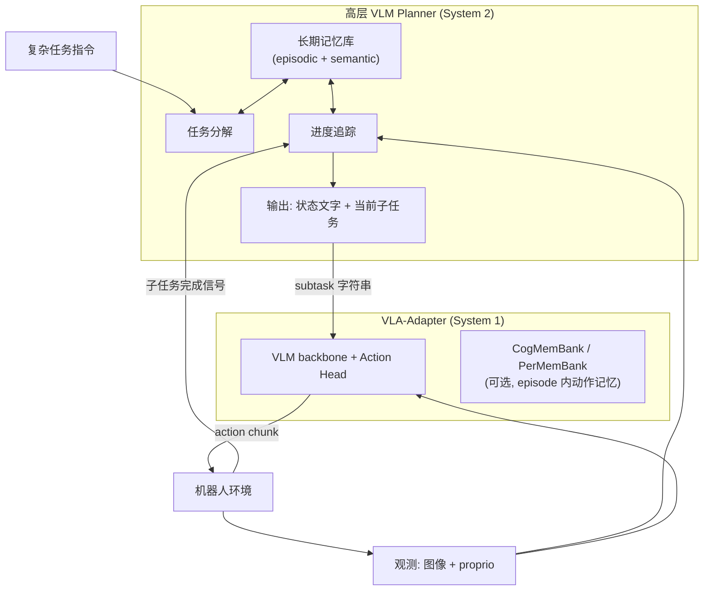
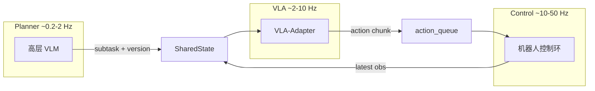

<!-- Generated by SpecStory, Markdown v2.1.0 -->

# 2026-06-29 09:26:49Z

<!-- Cursor IDE Session 33be4c27-5832-4e19-b2e3-80fcc209d2bf (2026-06-29 09:26:49Z) -->

_**User**_

@\mnt\Projects\VLA-Adapter\ 我现在这个VLA模型怎么才能再接一个高层的VLM模型，这个模型负责将复杂的任务分解成子任务，同时形成长期记忆，这个模块负责看当前任务进行到哪一步，要输出文字信息，然后输出子任务让当前的VLA模型来执行

---

_**Agent (default)**_

<think><details><summary>Thought Process</summary>
正在分析如何将高层VLM模型接入现有的VLA架构。该模块需要负责任务分解、长期记忆维护，以及向当前VLA模型输出子任务和进度信息。
</details></think>

_**Agent (default)**_

我先梳理你这套 VLA-Adapter 的架构，以及是否已有记忆、任务分解或高层规划相关模块，再据此说明如何接入高层 VLM。


_**Agent (default)**_

<tool-use data-tool-type="unknown" data-tool-name="semantic_search_full"><details>
<summary>Tool use: **semantic_search_full**</summary>

Parameters:

```json
{
  "explanation": "",
  "query": "How does the VLA model process tasks and actions?",
  "topK": 10
}
```
Result:

```json
{
  "codeResults": [
    {
      "codeBlock": {
        "detailedLines": [
          {
            "isSignature": true,
            "lineNumber": 751,
            "text": "def get_vla_action("
          },
          {
            "isSignature": true,
            "lineNumber": 752,
            "text": "    cfg: Any,"
          },
          {
            "isSignature": true,
            "lineNumber": 753,
            "text": "    vla: torch.nn.Module,"
          },
          {
            "isSignature": true,
            "lineNumber": 754,
            "text": "    processor: Any,"
          },
          {
            "isSignature": true,
            "lineNumber": 755,
            "text": "    obs: Dict[str, Any],"
          },
          {
            "isSignature": true,
            "lineNumber": 756,
            "text": "    task_label: str,"
          },
          {
            "isSignature": true,
            "lineNumber": 757,
            "text": "    action_head: Optional[torch.nn.Module] = None,"
          },
          {
            "isSignature": true,
            "lineNumber": 758,
            "text": "    proprio_projector: Optional[torch.nn.Module] = None,"
          },
          {
            "isSignature": true,
            "lineNumber": 759,
            "text": "    noisy_action_projector: Optional[torch.nn.Module] = None,"
          },
          {
            "isSignature": true,
            "lineNumber": 760,
            "text": "    use_film: bool = False,"
          },
          {
            "isSignature": true,
            "lineNumber": 761,
            "text": "    use_minivlm: bool = False,"
          },
          {
            "isSignature": true,
            "lineNumber": 762,
            "text": ") -\u003e List[np.ndarray]:"
          },
          {
            "lineNumber": 779,
            "text": "\"\"\""
          },
          {
            "lineNumber": 780,
            "text": "    with torch.inference_mode():"
          },
          {
  
… (output truncated)
```
Status: **completed**

</details></tool-use>

_**Agent (default)**_

<tool-use data-tool-type="read" data-tool-name="read_file_v2"><details>
<summary>Tool use: **read_file_v2** • Read file: /mnt/Projects/VLA-Adapter/prismatic/vla/memory_bank.py</summary>

</details></tool-use>

_**Agent (default)**_

<tool-use data-tool-type="search" data-tool-name="glob_file_search"><details>
<summary>Tool use: **glob_file_search** • Searched codebase "" • **216** results in **1** directory</summary>

Directory: **`/mnt/Projects/VLA-Adapter`** (216 files)

| File |
|------|
| `fractal-rlds-data/README.md` |
| `bridge-rlds-data/README.md` |
| `prismatic/vla/memory_bank.py` |
| `vla-scripts/finetune.py` |
| `prismatic/util/data_utils.py` |
| `prismatic/models/action_heads.py` |
| `experiments/robot/openvla_utils.py` |
| `experiments/robot/libero/run_libero_eval.py` |
| `vla-scripts/merge_lora_weights_and_save.py` |
| `prismatic/vla/datasets/__init__.py` |
| `prismatic/vla/datasets/rlds/obs_transforms.py` |
| `prismatic/vla/datasets/rlds/traj_transforms.py` |
| `prismatic/vla/datasets/datasets.py` |
| `prismatic/vla/datasets/rlds/__init__.py` |
| `prismatic/vla/datasets/rlds/dataset.py` |
| `pretrained_models/configs/processing_prismatic.py` |
| `pretrained_models/configs/modeling_prismatic.py` |
| `pretrained_models/configs/configuration_prismatic.py` |
| `pretrained_models/prism-qwen25-extra-dinosiglip-224px-0_5b/README.md` |
| `pretrained_models/vit_large_patch14_reg4_dinov2/README.md` |
| `LIBERO/templates/problem_class_template.py` |
| `LIBERO/setup.py` |
| `LIBERO/scripts/create_template.py` |
| `LIBERO/scripts/get_dataset_info.py` |
| `LIBERO/scripts/create_libero_task_example.py` |
| `LIBERO/scripts/init_path.py` |
| `LIBERO/scripts/get_affordance_info.py` |
| `LIBERO/scripts/libero_100_collect_demonstrations.py` |
| `LIBERO/scripts/collect_demonstration.py` |
| `LIBERO/scripts/check_dataset_integrity.py` |
| `LIBERO/scripts/config_copy.py` |
| `LIBERO/scripts/create_dataset.py` |
| `LIBERO/libero/lifelong/utils.py` |
| `LIBERO/libero/lifelong/models/policy_head.py` |
| `LIBERO/libero/lifelong/models/bc_vilt_policy.py` |
| `LIBERO/libero/lifelong/models/modules/rgb_modules.py` |
| `LIBERO/libero/lifelong/models/modules/language_modules.py` |
| `LIBERO/libero/lifelong/models/modules/transformer_modules.py` |
| `LIBERO/libero/lifelong/models/modules/data_augmentation.py` |
| `LIBERO/libero/lifelong/evaluate.py` |
| `LIBERO/libero/lifelong/init_path.py` |
| `LIBERO/libero/lifelong/datasets.py` |
| `LIBERO/libero/lifelong/algos/base.py` |
| `LIBERO/libero/lifelong/algos/multitask.py` |
| `LIBERO/libero/lifelong/algos/ewc.py` |
| `LIBERO/libero/lifelong/algos/er.py` |
| `LIBERO/libero/lifelong/algos/__init__.py` |
| `LIBERO/libero/lifelong/algos/single_task.py` |
| `LIBERO/libero/lifelong/algos/packnet.py` |
| `LIBERO/libero/lifelong/models/__init__.py` |
| `LIBERO/libero/lifelong/algos/agem.py` |
| `LIBERO/libero/lifelong/models/bc_transformer_policy.py` |
| `LIBERO/libero/lifelong/models/bc_rnn_policy.py` |
| `LIBERO/libero/lifelong/main.py` |
| `LIBERO/libero/lifelong/metric.py` |
| `LIBERO/libero/lifelong/models/base_policy.py` |
| `LIBERO/libero/libero/utils/task_generation_utils.py` |
| `LIBERO/libero/libero/utils/object_utils.py` |
| `LIBERO/libero/libero/utils/video_utils.py` |
| `LIBERO/libero/libero/utils/utils.py` |
| `LIBERO/libero/libero/utils/time_utils.py` |
| `LIBERO/libero/libero/utils/dataset_utils.py` |
| `LIBERO/libero/libero/utils/log_utils.py` |
| `LIBERO/libero/libero/utils/download_utils.py` |
| `LIBERO/libero/libero/utils/mu_utils.py` |
| `LIBERO/libero/libero/utils/bddl_generation_utils.py` |
| `LIBERO/libero/libero/utils/__init__.py` |
| `LIBERO/libero/libero/envs/robots/mounted_panda.py` |
| `LIBERO/libero/libero/envs/robots/on_the_ground_panda.py` |
| `LIBERO/libero/libero/envs/robots/__init__.py` |
| `LIBERO/libero/libero/envs/utils.py` |
| `LIBERO/libero/libero/envs/regions/workspace_region_sampler.py` |
| `LIBERO/libero/libero/envs/regions/object_property_sampler.py` |
| `LIBERO/libero/libero/envs/regions/base_region_sampler.py` |
| `LIBERO/libero/libero/envs/venv.py` |
| `LIBERO/libero/libero/envs/textures.py` |
| `LIBERO/libero/libero/envs/objects/turbosquid_objects.py` |
| `LIBERO/libero/libero/envs/objects/site_object.py` |
| `LIBERO/libero/libero/envs/arenas/table_arena.py` |
| `LIBERO/libero/libero/envs/objects/articulated_objects.py` |
| `LIBERO/libero/libero/envs/objects/hope_objects.py` |
| `LIBERO/libero/libero/envs/bddl_utils.py` |
| `LIBERO/libero/libero/envs/objects/target_zones.py` |
| `LIBERO/libero/libero/envs/objects/google_scanned_objects.py` |
| `LIBERO/libero/libero/envs/objects/__init__.py` |
| `LIBERO/libero/libero/envs/env_wrapper.py` |
| `LIBERO/libero/libero/envs/problems/libero_tabletop_manipulation.py` |
| `LIBERO/libero/libero/envs/problems/libero_living_room_tabletop_manipulation.py` |
| `LIBERO/libero/libero/envs/regions/__init__.py` |
| `LIBERO/libero/libero/envs/problems/libero_study_tabletop_manipulation.py` |
| `LIBERO/libero/libero/envs/problems/libero_kitchen_tabletop_manipulation.py` |
| `LIBERO/libero/libero/envs/bddl_base_domain.py` |
| `LIBERO/libero/libero/envs/predicates/__init__.py` |
| `LIBERO/libero/libero/envs/predicates/base_predicates.py` |
| `LIBERO/libero/libero/envs/problems/__init__.py` |
| `LIBERO/libero/libero/envs/base_object.py` |
| `LIBERO/libero/libero/envs/problems/libero_floor_manipulation.py` |
| `LIBERO/libero/libero/envs/problems/libero_coffee_table_manipulation.py` |
| `LIBERO/libero/libero/envs/object_states/base_object_states.py` |
| `LIBERO/libero/libero/envs/object_states/__init__.py` |
| `LIBERO/libero/libero/envs/arenas/study_arena.py` |
| `LIBERO/libero/libero/envs/arenas/kitchen_arena.py` |
| `LIBERO/libero/libero/envs/arenas/living_room_arena.py` |
| `LIBERO/libero/libero/envs/arenas/coffee_table_arena.py` |
| `LIBERO/libero/libero/envs/arenas/empty_arena.py` |
| `LIBERO/libero/libero/envs/arenas/style.py` |
| `LIBERO/libero/libero/envs/arenas/__init__.py` |
| `LIBERO/libero/libero/envs/__init__.py` |
| `LIBERO/libero/libero/benchmark/libero_suite_task_map.py` |
| `LIBERO/libero/libero/benchmark/mu_creation.py` |
| `LIBERO/libero/libero/benchmark/__init__.py` |
| `LIBERO/libero/libero/__init__.py` |
| `LIBERO/README.md` |
| `LIBERO/benchmark_scripts/shasum_files.py` |
| `LIBERO/benchmark_scripts/check_task_suites.py` |
| `LIBERO/benchmark_scripts/init_path.py` |
| `LIBERO/benchmark_scripts/render_single_task.py` |
| `LIBERO/benchmark_scripts/download_libero_datasets.py` |
| `vla-scripts/train.py` |
| `vla-scripts/vla_evaluation.py` |
| `scripts/preprocess.py` |
| `scripts/pretrain.py` |
| `vla-scripts/evaluate_calvin.py` |
| `scripts/generate.py` |
| `scripts/extern/verify_prismatic.py` |
| `vla-scripts/deploy.py` |
| `vla-scripts/extern/convert_openvla_weights_to_hf.py` |
| `vla-scripts/extern/verify_openvla.py` |
| `vla-scripts/calvin_env_wrapper.py` |
| `scripts/extern/convert_prismatic_weights_to_hf.py` |
| `scripts/additional-datasets/lvis_instruct_4v.py` |
| `scripts/additional-datasets/lrv_instruct.py` |
| `prismatic/vla/materialize.py` |
| `prismatic/vla/datasets/rlds/oxe/configs.py` |
| `prismatic/vla/datasets/rlds/oxe/materialize.py` |
| `prismatic/vla/datasets/rlds/oxe/transforms.py` |
| `prismatic/vla/datasets/rlds/oxe/mixtures.py` |
| `prismatic/vla/datasets/rlds/oxe/utils/droid_utils.py` |
| `prismatic/vla/datasets/rlds/utils/data_utils.py` |
| `prismatic/vla/datasets/rlds/utils/goal_relabeling.py` |
| `prismatic/vla/datasets/rlds/utils/task_augmentation.py` |
| `prismatic/vla/constants.py` |
| `prismatic/vla/datasets/rlds/oxe/__init__.py` |
| `prismatic/preprocessing/materialize.py` |
| `prismatic/preprocessing/datasets/datasets.py` |
| `prismatic/preprocessing/datasets/__init__.py` |
| `prismatic/preprocessing/download.py` |
| `prismatic/preprocessing/__init__.py` |
| `prismatic/training/materialize.py` |
| `prismatic/training/metrics.py` |
| `prismatic/util/batching_utils.py` |
| `prismatic/util/nn_utils.py` |
| `prismatic/util/torch_utils.py` |
| `prismatic/util/__init__.py` |
| `prismatic/training/strategies/ddp.py` |
| `prismatic/training/strategies/fsdp.py` |
| `prismatic/training/strategies/base_strategy.py` |
| `prismatic/training/strategies/__init__.py` |
| `prismatic/training/__init__.py` |
| `prismatic/training/train_utils.py` |
| `prismatic/vla/action_tokenizer.py` |
| `prismatic/vla/__init__.py` |
| `prismatic/overwatch/overwatch.py` |
| `prismatic/overwatch/__init__.py` |
| `prismatic/models/vlms/prismatic.py` |
| `prismatic/models/materialize.py` |
| `prismatic/models/load.py` |
| `prismatic/models/registry.py` |
| `prismatic/models/projectors.py` |
| `prismatic/models/vlas/__init__.py` |
| `prismatic/models/film_vit_wrapper.py` |
| `prismatic/models/vlas/openvla.py` |
| `prismatic/models/vlms/base_vlm.py` |
| `prismatic/models/backbones/vision/dinov2_vit.py` |
| `prismatic/models/backbones/vision/dinosiglip_vit.py` |
| `prismatic/models/transformer_utils.py` |
| `prismatic/models/vlms/__init__.py` |
| `prismatic/models/backbones/vision/in1k_vit.py` |
| `prismatic/models/backbones/vision/clip_vit.py` |
| `prismatic/models/backbones/vision/dinoclip_vit.py` |
| `prismatic/models/backbones/vision/siglip_vit.py` |
| `prismatic/models/backbones/vision/__init__.py` |
| `prismatic/models/backbones/vision/base_vision.py` |
| `prismatic/models/backbones/llm/prompting/mistral_instruct_prompter.py` |
| `prismatic/models/backbones/llm/prompting/base_prompter.py` |
| `prismatic/models/backbones/llm/prompting/phi_prompter.py` |
| `prismatic/models/backbones/llm/qwen25.py` |
| `prismatic/models/backbones/llm/prompting/llama2_chat_prompter.py` |
| `prismatic/models/backbones/llm/prompting/qwen_prompter.py` |
| `prismatic/models/backbones/llm/prompting/vicuna_v15_prompter.py` |
| `prismatic/models/__init__.py` |
| `prismatic/conf/models.py` |
| `prismatic/conf/vla.py` |
| `prismatic/extern/hf/configuration_prismatic.py` |
| `prismatic/models/backbones/llm/phi.py` |
| `prismatic/extern/hf/processing_prismatic.py` |
| `prismatic/extern/hf/modeling_prismatic.py` |
| `prismatic/models/backbones/llm/mistral.py` |
| `prismatic/models/backbones/llm/llama2.py` |
| `prismatic/models/backbones/llm/base_llm.py` |
| `prismatic/models/backbones/llm/__init__.py` |
| `prismatic/models/backbones/llm/prompting/__init__.py` |
| `prismatic/conf/datasets.py` |
| `prismatic/__init__.py` |
| `prismatic/conf/__init__.py` |
| `experiments/robot/robot_utils.py` |
| `experiments/robot/server_deploy/deploy.py` |
| `experiments/robot/libero/libero_utils.py` |
| `experiments/robot/libero/regenerate_libero_dataset.py` |
| `experiments/robot/aloha/run_fake_cobot_client.py` |
| `experiments/robot/aloha/train_files/materialize_local_vision.py` |
| `experiments/robot/aloha/train_files/qwen25.py` |
| `experiments/robot/aloha/train_files/dinosiglip_vit_local_vision.py` |
| `experiments/robot/aloha/run_cobot_client.py` |
| `experiments/robot/aloha/README.md` |
| `README.md` |
</details></tool-use>

_**Agent (default)**_

<tool-use data-tool-type="unknown" data-tool-name="ripgrep_raw_search"><details>
<summary>Tool use: **ripgrep_raw_search**</summary>

Parameters:

```json
{
  "caseInsensitive": false,
  "path": "/mnt/Projects/VLA-Adapter",
  "pattern": "memory_bank|MemoryBank"
}
```
Additional data:

```json
{
  "isPruned": true,
  "outputMode": "content",
  "path": "/mnt/Projects/VLA-Adapter",
  "pattern": "memory_bank|MemoryBank",
  "topFiles": [
    {
      "matchCount": 1,
      "uri": "./prismatic/models/action_heads.py"
    }
  ],
  "totalFiles": 1,
  "totalMatches": 1
}
```
Status: **completed**

</details></tool-use>

_**Agent (default)**_

<tool-use data-tool-type="read" data-tool-name="read_file_v2"><details>
<summary>Tool use: **read_file_v2** • Read file: /mnt/Projects/VLA-Adapter/prismatic/vla/memory_bank.py</summary>

</details></tool-use>

_**Agent (default)**_

<tool-use data-tool-type="unknown" data-tool-name="semantic_search_full"><details>
<summary>Tool use: **semantic_search_full**</summary>

Parameters:

```json
{
  "explanation": "",
  "query": "task instruction prompt language input to VLA",
  "topK": 10
}
```
Result:

```json
{
  "codeResults": [
    {
      "codeBlock": {
        "detailedLines": [
          {
            "isSignature": true,
            "lineNumber": 24,
            "text": "class OpenVLA(PrismaticVLM):"
          },
          {
            "lineNumber": 34
          },
          {
            "lineNumber": 35
          },
          {
            "lineNumber": 36,
            "text": "    @torch.inference_mode()"
          },
          {
            "lineNumber": 37,
            "text": "    def predict_action("
          },
          {
            "lineNumber": 38,
            "text": "        self, image: Union[Img, List[Img]], instruction: str, unnorm_key: Optional[str] = None, **kwargs: str"
          },
          {
            "lineNumber": 39,
            "text": "    ) -\u003e np.ndarray:"
          },
          {
            "lineNumber": 40,
            "text": "        \"\"\""
          },
          {
            "lineNumber": 41,
            "text": "        Core function for VLA inference; maps input image and task instruction to continuous action (de-tokenizes)."
          },
          {
            "lineNumber": 42
          },
          {
            "lineNumber": 43,
            "text": "        @param image: PIL Image as [height, width, 3]"
          },
          {
            "lineNumber": 44,
            "text": "        @param instruction: Task instruction string"
          },
          {
            "lineNumber": 45,
            "text": "        @param unnorm_key: Optional dataset name for retrieving un-normalizing statistics; if None, checks that model"
          },
          {
            "lineNumber": 46,
            "text": "                           was trained only on a single dataset, and retrieves those statistics."
          },
          {
            "lineNumber": 47
          },
          {
            "lineNumber": 48,
            "text": "        @return Unnormalized (continuous) action vector --\u003e end-effector deltas."
          
… (output truncated)
```
Status: **completed**

</details></tool-use>

_**Agent (default)**_

<tool-use data-tool-type="read" data-tool-name="read_file_v2"><details>
<summary>Tool use: **read_file_v2** • Read file: /mnt/Projects/VLA-Adapter/prismatic/models/action_heads.py</summary>

</details></tool-use>

_**Agent (default)**_

<tool-use data-tool-type="read" data-tool-name="read_file_v2"><details>
<summary>Tool use: **read_file_v2** • Read file: /mnt/Projects/VLA-Adapter/experiments/robot/libero/run_libero_eval.py</summary>

</details></tool-use>

_**Agent (default)**_

<tool-use data-tool-type="unknown" data-tool-name="ripgrep_raw_search"><details>
<summary>Tool use: **ripgrep_raw_search**</summary>

Parameters:

```json
{
  "caseInsensitive": false,
  "glob": "*.py",
  "path": "/mnt/Projects/VLA-Adapter",
  "pattern": "task_label|instruction|subtask|planner|hierarchical"
}
```
Additional data:

```json
{
  "isPruned": true,
  "outputMode": "content",
  "path": "/mnt/Projects/VLA-Adapter",
  "pattern": "task_label|instruction|subtask|planner|hierarchical",
  "topFiles": [
    {
      "matchCount": 4,
      "uri": "./experiments/robot/openvla_utils.py"
    },
    {
      "matchCount": 1,
      "uri": "./prismatic/vla/datasets/rlds/traj_transforms.py"
    },
    {
      "matchCount": 6,
      "uri": "./prismatic/vla/datasets/datasets.py"
    },
    {
      "matchCount": 6,
      "uri": "./prismatic/vla/datasets/rlds/dataset.py"
    },
    {
      "matchCount": 2,
      "uri": "./LIBERO/scripts/get_dataset_info.py"
    },
    {
      "matchCount": 7,
      "uri": "./LIBERO/scripts/libero_100_collect_demonstrations.py"
    },
    {
      "matchCount": 1,
      "uri": "./LIBERO/scripts/create_dataset.py"
    },
    {
      "matchCount": 4,
      "uri": "./LIBERO/scripts/collect_demonstration.py"
    },
    {
      "matchCount": 2,
      "uri": "./LIBERO/libero/libero/utils/dataset_utils.py"
    },
    {
      "matchCount": 6,
      "uri": "./LIBERO/libero/libero/envs/bddl_utils.py"
    },
    {
      "matchCount": 1,
      "uri": "./LIBERO/libero/libero/envs/env_wrapper.py"
    }
  ],
  "totalFiles": 11,
  "totalMatches": 173
}
```
Status: **completed**

</details></tool-use>

_**Agent (default)**_

<tool-use data-tool-type="read" data-tool-name="read_file_v2"><details>
<summary>Tool use: **read_file_v2** • Read file: /mnt/Projects/VLA-Adapter/experiments/robot/libero/run_libero_eval.py</summary>

</details></tool-use>

_**Agent (default)**_

<tool-use data-tool-type="read" data-tool-name="read_file_v2"><details>
<summary>Tool use: **read_file_v2** • Read file: /mnt/Projects/VLA-Adapter/vla-scripts/deploy.py</summary>

</details></tool-use>

_**Agent (default)**_

<tool-use data-tool-type="search" data-tool-name="glob_file_search"><details>
<summary>Tool use: **glob_file_search** • Searched codebase "" • **7** results in **1** directory</summary>

Directory: **`/mnt/Projects/VLA-Adapter`** (7 files)

| File |
|------|
| `fractal-rlds-data/README.md` |
| `bridge-rlds-data/README.md` |
| `pretrained_models/prism-qwen25-extra-dinosiglip-224px-0_5b/README.md` |
| `pretrained_models/vit_large_patch14_reg4_dinov2/README.md` |
| `LIBERO/README.md` |
| `experiments/robot/aloha/README.md` |
| `README.md` |
</details></tool-use>

_**Agent (default)**_

<tool-use data-tool-type="read" data-tool-name="read_file_v2"><details>
<summary>Tool use: **read_file_v2** • Read file: /mnt/Projects/VLA-Adapter/README.md</summary>

</details></tool-use>

_**Agent (default)**_

<tool-use data-tool-type="read" data-tool-name="read_file_v2"><details>
<summary>Tool use: **read_file_v2** • Read file: /mnt/Projects/VLA-Adapter/prismatic/models/action_heads.py</summary>

</details></tool-use>

_**Agent (default)**_

<tool-use data-tool-type="unknown" data-tool-name="ripgrep_raw_search"><details>
<summary>Tool use: **ripgrep_raw_search**</summary>

Parameters:

```json
{
  "caseInsensitive": false,
  "path": "/mnt/Projects/VLA-Adapter",
  "pattern": "use_episode_memory|CogMemBank"
}
```
Additional data:

```json
{
  "isPruned": true,
  "outputMode": "content",
  "path": "/mnt/Projects/VLA-Adapter",
  "pattern": "use_episode_memory|CogMemBank",
  "topFiles": [
    {
      "matchCount": 2,
      "uri": "./prismatic/vla/memory_bank.py"
    },
    {
      "matchCount": 1,
      "uri": "./vla-scripts/finetune.py"
    },
    {
      "matchCount": 6,
      "uri": "./prismatic/models/action_heads.py"
    },
    {
      "matchCount": 1,
      "uri": "./experiments/robot/openvla_utils.py"
    }
  ],
  "totalFiles": 4,
  "totalMatches": 10
}
```
Status: **completed**

</details></tool-use>

_**Agent (default)**_

<think><details><summary>Thought Process</summary>
正在检查README中是否提及"双系统"架构。这与用户的需求一致：高层VLM作为计划器负责任务分解和长期记忆，底层VLA作为执行器负责具体操作。

现有架构仅支持单步图像指令与连续动作输出。记忆库为单轨迹短时存储，不支持跨任务规划。需要新增独立的高层VLM模块来实现任务分解、长期记忆和进度跟踪。
</details></think>

_**Agent (default)**_

<tool-use data-tool-type="unknown" data-tool-name="ripgrep_raw_search"><details>
<summary>Tool use: **ripgrep_raw_search**</summary>

Parameters:

```json
{
  "caseInsensitive": true,
  "path": "/mnt/Projects/VLA-Adapter",
  "pattern": "dual.system|planner|decompos|high.level"
}
```
Additional data:

```json
{
  "isPruned": true,
  "outputMode": "content",
  "path": "/mnt/Projects/VLA-Adapter",
  "pattern": "dual.system|planner|decompos|high.level",
  "topFiles": [
    {
      "matchCount": 4,
      "uri": "./pretrained_models/configs/tokenizer.json"
    },
    {
      "matchCount": 1,
      "uri": "./pretrained_models/configs/vocab.json"
    },
    {
      "matchCount": 1,
      "uri": "./vla-scripts/enrich_lang_annotations.json"
    },
    {
      "matchCount": 1,
      "uri": "./README.md"
    }
  ],
  "totalFiles": 4,
  "totalMatches": 7
}
```
Status: **completed**

</details></tool-use>

_**Agent (default)**_

<tool-use data-tool-type="read" data-tool-name="read_file_v2"><details>
<summary>Tool use: **read_file_v2** • Read file: /mnt/Projects/VLA-Adapter/vla-scripts/finetune.py</summary>

</details></tool-use>

_**Agent (default)**_

<think><details><summary>Thought Process</summary>
正在梳理现有架构与高层规划模块的衔接方案。准备从当前系统结构、缺失环节分析入手，给出具体的模块接入与任务分解流程设计。
</details></think>

_**Agent (default)**_

你这个需求本质上是 **双系统（Dual-System）分层架构**：高层 VLM 做规划与记忆，低层 VLA 做动作执行。结合你当前 VLA-Adapter 代码，下面说明现状、推荐架构，以及具体该接在哪里。

---

## 1. 当前 VLA-Adapter 的能力边界

你现在的模型是 **单指令 → 单步/短 chunk 动作** 的执行器，不是任务规划器。

**输入接口**：一条自然语言指令 + 图像（+ 可选 proprio）

```793:797:experiments/robot/openvla_utils.py
        # Build VLA prompt
        if not use_minivlm:
            prompt = f"In: What action should the robot take to {task_label.lower()}?\nOut:"
        else:
            prompt = f'<|im_start|>system\nYou are Qwen, created by Alibaba Cloud. You are a helpful assistant.<|im_end|>\n<|im_start|>user\nWhat action should the robot take to {task_label.lower()}?<|im_end|>\n<|im_start|>assistant\n'
```

**输出**：连续 7-DoF 动作 chunk（`num_open_loop_steps` 步 open-loop 执行后再 query）

**已有 memory bank 的定位**：`CogMemBank` / `PerMemBank` 是 **action head 内部的 episode 级短时记忆**，用于同一轨迹内检索历史 hidden states，帮助预测动作——**不是**你要的「任务分解 + 长期语义记忆」：

```176:187:prismatic/vla/memory_bank.py
class CogMemBank(nn.Module):
    def __init__(self,
                 dataloader_type: str,
                 group_size: int,
                 token_size: int,
                 mem_length: int = 16,
                 ...
```

README 里也写了 dual-system 还在探索中，说明 **仓库目前没有现成的高层规划模块**，需要你在推理层外挂或新建。

---

## 2. 推荐整体架构



**职责划分**：

| 模块 | 职责 | 输出 |
|------|------|------|
| 高层 VLM | 分解任务、维护长期记忆、判断进度 | 文字状态 + 当前子任务 |
| 低层 VLA | 执行原子操作 | 机器人动作 |

---

## 3. 在你代码里怎么接（最小改动路径）

### 3.1 核心接入点：`task_label`

VLA 只认一个字符串指令。高层 VLM 的输出里，**把当前子任务填进 `task_label`** 即可，无需改 VLA 权重。

现有调用链：

```
run_episode() → get_action() → get_vla_action(..., task_label=task_description)
deploy.py     → get_vla_action(..., instruction=observation["instruction"])
```

LIBERO 评估里目前是固定 `task_description`：

```343:349:experiments/robot/libero/run_libero_eval.py
            if len(action_queue) == 0:
                # Query model to get action
                actions = get_action(
                    cfg,
                    model,
                    observation,
                    task_description,
```

你要做的是：在 `run_episode` 外层（或内部）加一层 **Planner Loop**，用 `current_subtask` 替代固定的 `task_description`。

### 3.2 建议新增 `TaskOrchestrator`（伪代码结构）

```python
class TaskOrchestrator:
    def __init__(self, planner_vlm, vla_cfg, vla_model, processor, ...):
        self.planner = planner_vlm          # 高层 VLM (Qwen2-VL / GPT-4V / 自训)
        self.memory = LongTermMemory()        # 见下文
        self.vla_cfg = vla_cfg
        self.vla = vla_model
        ...

    def reset(self, high_level_task: str):
        self.memory.clear_episode()
        plan = self.planner.decompose(high_level_task, image=...)
        self.memory.store("plan", plan)
        self.current_step = 0

    def step(self, obs) -> dict:
        # 1. 高层：看当前画面 + 记忆，判断进度
        status = self.planner.track_progress(
            image=obs["full_image"],
            memory=self.memory.retrieve(),
            plan=self.memory.get("plan"),
        )
        # status = {"narration": "...", "subtask": "pick up the red block", "done": False}

        # 2. 低层：用 subtask 驱动 VLA
        if status["subtask_changed"]:
            self.vla_action_head.cog_mem_bank.reset()  # 可选：换子任务时清 episode memory

        actions = get_vla_action(
            self.vla_cfg, self.vla, self.processor, obs,
            task_label=status["subtask"],  # 关键：动态子任务
            ...
        )

        # 3. 子任务完成检测 → 更新长期记忆
        if status["subtask_done"]:
            self.memory.store_event(status)
            self.current_step += 1

        return {"actions": actions, "status_text": status["narration"]}
```

### 3.3 部署层

`deploy.py` 现在是单 `/act` 端点。可以：

- **方案 A**：新增 `/plan_and_act`，内部先 planner 再 VLA  
- **方案 B**：Planner 独立服务，客户端维护状态，VLA 仍用 `/act` 只收 `instruction=subtask`

方案 B 更解耦，也更符合你「VLA 只执行子任务」的设计。

---

## 4. 长期记忆怎么设计（与现有 CogMemBank 分开）

现有 `CogMemBank` 存的是 **tensor 特征**，长度约 16 步，按 `episode_id` 管理——适合动作预测，不适合跨任务规划。

高层 VLM 建议用 **结构化 + 向量混合记忆**：

```python
# 长期记忆结构示例
{
    "goal": "把厨房台面上的碗放进洗碗机",
    "plan": [
        {"id": 0, "subtask": "open the dishwasher door", "status": "done"},
        {"id": 1, "subtask": "pick up the bowl", "status": "in_progress"},
        {"id": 2, "subtask": "place bowl in dishwasher", "status": "pending"},
    ],
    "episodic_log": [
        {"t": 120, "event": "成功打开洗碗机", "image_embedding": [...]},
        {"t": 340, "event": "抓取失败，碗滑落", "image_embedding": [...]},
    ],
    "semantic_facts": ["碗在台面左侧", "洗碗机门已开"],
}
```

**实现选项**：

1. **纯文本上下文**：Planner prompt 里塞 plan + log（简单，适合 7B 以下 VLM）  
2. **RAG**：关键帧 embedding 存 FAISS/Chroma，按相似度检索  
3. **可学习 memory module**：类似 MemGPT / Generative Agents，但需额外训练  

Planner 每次调用建议输出 **结构化 JSON**（便于解析）：

```json
{
  "narration": "洗碗机门已打开，正在尝试抓取碗",
  "current_subtask": "pick up the bowl from the counter",
  "subtask_done": false,
  "plan_update": [{"id": 1, "status": "in_progress"}],
  "new_facts": ["bowl is on the left side of the counter"]
}
```

---

## 5. 控制循环：何时调用 Planner vs VLA

Planner 不必每帧跑（慢、贵）；VLA 可以高频跑。

```
每 N 步 或 子任务边界:
  Planner(image, memory, plan) → 更新 subtask + narration

每 num_open_loop_steps 步（或 action queue 空）:
  VLA(image, proprio, subtask) → action chunk
```

**子任务完成判定**（三选一或组合）：

1. **VLM 视觉判断**：Planner 看新图像说 `subtask_done: true`  
2. **环境 predicate**：LIBERO 有 BDDL 谓词（`on`, `in` 等），仿真里可直接查  
3. **VLA 失败检测**：连续 L 步无进展 → 触发 replan  

---

## 6. 高层 VLM 选型与 Prompt 设计

### 模型选择

| 方案 | 优点 | 缺点 |
|------|------|------|
| 商用 API (GPT-4V, Gemini) | 规划能力强，零训练 | 延迟、成本、无 proprio |
| 开源 VLM (Qwen2-VL-7B, InternVL) | 可本地部署、可微调 | 需自己训规划能力 |
| 与 VLA 共享 backbone | 省显存 | 规划与动作耦合，难维护 |

建议：**Planner 用更大 VLM（7B+），Executor 保持现有 VLA-Adapter 0.5B**，双模型分工。

### Planner System Prompt 要点

```
你是机器人任务规划器。输入：高层任务、当前图像、历史计划与事件。
输出 JSON：
- narration: 当前状态描述（给用户看）
- current_subtask: 给底层 VLA 的原子指令（英文、动词开头、与训练分布接近）
- subtask_done: 当前子任务是否完成
- plan: 更新后的子任务列表

规则：
1. 子任务粒度要匹配 VLA 能力（如 "pick up the red block"，不要 "完成整个厨房清理"）
2. 子任务语言风格接近 LIBERO/Bridge 数据集（短句、具体物体名）
3. 失败时 replan，不要重复无效动作
```

**子任务语言分布很重要**：VLA 在 `"pick up the bowl"` 这类短句上训练，Planner 输出要尽量对齐，否则成功率会掉。

---

## 7. 训练层面（若不想只靠 Prompt）

纯 Prompt 工程可以跑通 demo；要稳定需要数据：

### 7.1 规划数据

- **LIBERO-100 / CALVIN**：本身是多步任务，可从 demo 轨迹反推子任务序列（关键帧 + 语言标注）  
- **人工标注**：每条长轨迹切分为 (subtask, start_frame, end_frame)  
- **LLM 合成**：用 GPT 对现有 `language_instruction` 做 decomposition

### 7.2 微调 Planner

- SFT：`(image, high_level_task, history) → (plan_json, narration)`  
- 可选 RL：以子任务成功率 / 最终 task success 为 reward  

### 7.3 VLA 侧

- **通常不需要改 VLA 权重**，继续用原子子任务微调即可  
- 若子任务粒度比 LIBERO 更细，可补充对应 demo 做 finetune  
- `use_action_head_memory=True` 可在 **同一子任务内** 帮助动作连贯，但换子任务时建议 `reset()` memory bank  

---

## 8. 三种实现路径（由易到难）

### 路径 1：零训练 Orchestrator（最快验证）

- Planner：Qwen2-VL / GPT-4V + JSON 输出  
- Memory：Python dict + 文本 log  
- VLA：现有 checkpoint，`task_label=current_subtask`  
- 改 `run_libero_eval.py` 的 episode 循环即可  

适合先验证「复杂 LIBERO-10 任务能否通过分解提升成功率」。

### 路径 2：Planner 微调 + 结构化记忆

- 用 LIBERO 长任务轨迹训练 decomposition  
- 加 RAG 存关键帧  
- VLA 不动  

### 路径 3：端到端联合（研究向）

- Planner 与 VLA 共享视觉 encoder 或 cross-attention  
- 类似 HiP、RoboFlamingo 的分层 policy  
- 工作量大，README 里的 dual-system 探索属于这一档  

---

## 9. 与现有组件的关系（避免混淆）

| 组件 | 层级 | 作用 |
|------|------|------|
| `CogMemBank` / `PerMemBank` | 低层 VLA 内部 | 单 episode 内动作 hidden state 检索 |
| 高层 LongTermMemory | Planner 外部 | 跨子任务、跨时间的计划与事件 |
| `task_label` / `instruction` | 两层的接口 | Planner → VLA 的唯一语言通道 |
| `num_open_loop_steps` | 低层 | 控制 VLA 调用频率 |

---

## 10. 实施建议（按优先级）

1. **先不改 VLA 训练**，写 `TaskOrchestrator`，在 LIBERO-10 上测 decomposition + replan  
2. **子任务粒度**对齐 LIBERO 单句指令（打开抽屉、抓物体、放物体）  
3. **Planner 调用频率**先设每 50–100 步或子任务边界，避免每帧调用  
4. **换子任务时**可选 reset `CogMemBank`，避免上一子任务的动作记忆干扰  
5. **输出 narration** 单独 log / 显示，不要塞进 VLA prompt（VLA prompt 保持现有格式最稳）  
6. 稳定后再考虑微调 Planner 或做 VLA-Adapter++ 的 dual-system 原生支持  

---

## 总结

你的 VLA-Adapter **已经具备「接收子任务字符串 → 输出动作」的执行接口**；缺的是 **Planner 层 + 长期记忆 + 控制循环**。最小可行方案是：

> **高层 VLM（规划/记忆/进度）→ 输出 `current_subtask` → 填入现有 `get_vla_action(..., task_label=...)` → 低层 VLA 执行**

这与 README 里提到的 dual-system 方向一致，且不需要先动 `finetune.py` 或 action head 结构。

如果你希望，我可以在 Agent 模式下帮你具体设计 `TaskOrchestrator` 的模块接口，或直接改 `run_libero_eval.py` / `deploy.py` 的接入骨架（Ask 模式下我只能给方案，不能直接改代码）。你也可以说一下：Planner 打算用本地 VLM 还是 API、以及目标任务环境（LIBERO / 真机 ALOHA），我可以把方案收窄到更具体的 prompt 和循环参数。

---

_**User**_

我还有一个问题那就是如果我顶层的模型跟下面的VLA模型运行的平率不一致呢？我该怎么让他们异步运行？

---

_**Agent (default)**_

<think><details><summary>Thought Process</summary>
用户询问当顶层VLM与底层VLA模型运行频率不一致时，如何实现异步执行。
</details></think>

_**Agent (default)**_

频率不一致是分层机器人系统里的常态：高层 VLM 慢、低层 VLA 要快。结合你仓库里已有的 `action_queue` 机制，说明如何做成真正的异步协作。


_**Agent (default)**_

<tool-use data-tool-type="read" data-tool-name="read_file_v2"><details>
<summary>Tool use: **read_file_v2** • Read file: /mnt/Projects/VLA-Adapter/experiments/robot/libero/run_libero_eval.py</summary>

</details></tool-use>

_**Agent (default)**_

<tool-use data-tool-type="unknown" data-tool-name="ripgrep_raw_search"><details>
<summary>Tool use: **ripgrep_raw_search**</summary>

Parameters:

```json
{
  "caseInsensitive": false,
  "path": "/mnt/Projects/VLA-Adapter",
  "pattern": "action label_queue|action_queue|num_open_loop"
}
```
Additional data:

```json
{
  "isPruned": true,
  "outputMode": "content",
  "path": "/mnt/Projects/VLA-Adapter",
  "pattern": "action label_queue|action_queue|num_open_loop",
  "topFiles": [
    {
      "matchCount": 1,
      "uri": "./experiments/robot/openvla_utils.py"
    },
    {
      "matchCount": 7,
      "uri": "./experiments/robot/libero/run_libero_eval.py"
    },
    {
      "matchCount": 1,
      "uri": "./vla-scripts/deploy.py"
    },
    {
      "matchCount": 5,
      "uri": "./vla-scripts/evaluate_calvin.py"
    },
    {
      "matchCount": 1,
      "uri": "./experiments/robot/server_deploy/deploy.py"
    },
    {
      "matchCount": 8,
      "uri": "./experiments/robot/aloha/run_fake_cobot_client.py"
    },
    {
      "matchCount": 9,
      "uri": "./experiments/robot/aloha/run_cobot_client.py"
    },
    {
      "matchCount": 1,
      "uri": "./experiments/robot/aloha/README.md"
    }
  ],
  "totalFiles": 8,
  "totalMatches": 33
}
```
Status: **completed**

</details></tool-use>

_**Agent (default)**_

<think><details><summary>Thought Process</summary>
用户已有基于 action_queue 的 VLA 消费者模式。我将说明如何在此基础上扩展为两层异步系统，让顶层与底层 VLA 模型以不同频率并行运行。
</details></think>

_**Agent (default)**_

频率不一致不是问题，反而是正常设计：**Planner 低频更新意图，VLA 高频输出动作，控制环最高频执行**。你仓库里其实已经有「半套」异步机制了。

---

## 1. 你现在已经有的异步模式

`run_libero_eval.py` 里是典型的 **生产者-消费者**：

```321:361:experiments/robot/libero/run_libero_eval.py
    action_queue = deque(maxlen=cfg.num_open_loop_steps)
    ...
            # If action queue is empty, requery model
            if len(action_queue) == 0:
                actions = get_action(...)
                action_queue.extend(actions) 

            # Get action from queue
            action = action_queue.popleft()
```

含义是：

- **VLA（慢）**：每 `num_open_loop_steps`（8~25 步）才 inference 一次  
- **控制环（快）**：每步从 `action_queue` 取一个 action 执行  

这就是「模型频率 ≠ 控制频率」。  
你要做的是 **再套一层**：Planner 比 VLA 还慢，VLA 比控制环还慢。

---

## 2. 推荐的三层异步架构



三个独立「时钟」：

| 层级 | 典型频率 | 职责 |
|------|----------|------|
| Planner | 0.2–2 Hz（每 0.5–5 s） | 更新子任务、长期记忆、状态描述 |
| VLA | 2–10 Hz（每 0.1–0.5 s） | 根据**当前**子任务出 action chunk |
| Control | 10–50 Hz（每 20–100 ms） | 从 queue 取 action，发机器人 |

---

## 3. 核心数据结构：带版本的共享状态

异步的关键不是「两个 while 循环」，而是 **线程安全的共享状态 + 版本号**，避免 Planner 改子任务时 VLA 还在用旧指令。

```python
import threading
from dataclasses import dataclass, field
from collections import deque
from typing import Optional
import copy

@dataclass
class PlannerOutput:
    subtask: str
    narration: str
    version: int          # 每次 Planner 更新 +1
    timestamp: float

class SharedTaskState:
    def __init__(self):
        self._lock = threading.Lock()
        self._planner_out: Optional[PlannerOutput] = None
        self._latest_obs = None
        self._episode_done = False

    def update_planner(self, out: PlannerOutput):
        with self._lock:
            self._planner_out = out

    def get_planner_snapshot(self) -> Optional[PlannerOutput]:
        with self._lock:
            return copy.copy(self._planner_out)  # 浅拷贝即可

    def set_obs(self, obs):
        with self._lock:
            self._latest_obs = obs

    def get_obs(self):
        with self._lock:
            return self._latest_obs
```

**原则**：

- Planner 只写 `PlannerOutput`  
- VLA 每次 inference 前 **读 snapshot**（`subtask` + `version`）  
- 控制环只写 `latest_obs`、只读 `action_queue`  

---

## 4. 三个线程怎么分工

### 线程 1：Control Loop（主线程，最高频）

```python
def control_loop(env, shared, action_queue, cfg):
    while not done:
        obs = env.get_obs()
        shared.set_obs(obs)                    # 供 Planner / VLA 读

        if len(action_queue) == 0:
            time.sleep(0.001)                  # 等 VLA 填 queue，别卡死
            continue

        action = action_queue.popleft()
        env.step(action)
```

和现有 LIBERO 评估逻辑几乎一样，只是 `get_action` 挪到别的线程。

### 线程 2：VLA Worker（中频）

```python
def vla_worker(shared, action_queue, vla, cfg, processor):
    last_version = -1
    local_mem_reset_version = -1

    while not shared.episode_done:
        if len(action_queue) > threshold:      # queue 还有货，先不推理
            time.sleep(0.01)
            continue

        snap = shared.get_planner_snapshot()
        if snap is None:
            time.sleep(0.05)
            continue

        obs = shared.get_obs()
        if obs is None:
            continue

        # 子任务变了 → 可选：清空 queue + reset CogMemBank
        if snap.version != last_version:
            action_queue.clear()
            if hasattr(action_head, "cog_mem_bank"):
                action_head.cog_mem_bank.reset()
            last_version = snap.version

        actions = get_vla_action(cfg, vla, processor, obs,
                                 task_label=snap.subtask, ...)
        action_queue.extend(actions)
```

要点：

- **queue 快空时才调 VLA**（和现在的 `len(action_queue)==0` 一样，只是加了 prefetch 阈值）  
- **子任务 version 变了就 invalidate**：清 queue、reset episode memory  

### 线程 3：Planner Worker（低频）

```python
def planner_worker(shared, planner, memory, planner_hz=1.0):
    interval = 1.0 / planner_hz
    version = 0

    while not shared.episode_done:
        t0 = time.time()
        obs = shared.get_obs()
        if obs is None:
            time.sleep(0.1)
            continue

        result = planner.plan(obs, memory)   # 慢，可能 0.5-3s
        version += 1
        shared.update_planner(PlannerOutput(
            subtask=result["current_subtask"],
            narration=result["narration"],
            version=version,
            timestamp=time.time(),
        ))
        memory.apply(result)

        elapsed = time.time() - t0
        time.sleep(max(0, interval - elapsed))  # 限速，避免疯狂调用
```

Planner **绝不阻塞**控制环；它在后台慢慢算，算完原子更新 `SharedTaskState`。

---

## 5. 频率不一致时的四个关键问题

### 5.1 Planner 还没算完，VLA 用什么？

启动时用 **默认子任务**（可以是高层任务的第一条分解结果，或整条任务描述）：

```python
shared.update_planner(PlannerOutput(
    subtask=initial_subtask_or_full_task,
    narration="Planning...",
    version=0,
    timestamp=time.time(),
))
```

VLA 不等待 Planner；Planner 第一次输出后再通过 `version` 切换。

### 5.2 Planner 中途改子任务，VLA 正在 open-loop 怎么办？

三种策略（按推荐顺序）：

| 策略 | 做法 | 适用 |
|------|------|------|
| **Hard invalidate（推荐）** | `version` 变化 → 清 `action_queue` + 立刻用新 subtask 重推理 | 子任务边界清晰 |
| **Soft handoff** | 当前 chunk 跑完再换 subtask | 动作连贯性要求高 |
| **Emergency stop** | Planner 输出 `abort=True` → 清 queue + 发 hold/stop | 检测到失败或危险 |

对你这种 manipulation，**Hard invalidate** 通常最稳，因为旧 subtask 的 action chunk 在新意图下往往有害。

### 5.3 VLA inference 很慢，控制环会饿死吗？

用 **prefetch + 有界 queue**：

```python
action_queue = deque(maxlen=32)   # 比 num_open_loop_steps 大

# VLA worker 触发条件
if len(action_queue) < prefetch_threshold:  # 例如 < 4
    # 异步填 queue
```

控制环永远优先；VLA 在后台「补货」。ALOHA client 也是这个思路（默认 25 步 open-loop）。

### 5.4 两个模型抢同一块 GPU？

**最好分开**：

- Planner：CPU 或小模型 / 另一张卡 / 云端 API  
- VLA：专用 GPU  

若必须同卡，用 **锁串行化 inference**（会降吞吐，但逻辑仍异步）：

```python
gpu_lock = threading.Lock()

with gpu_lock:
    actions = get_vla_action(...)
```

Planner 和 VLA **不要同时** `forward`；控制环仍可在 CPU 上跑。

---

## 6. 进程 vs 线程 vs 服务

| 方案 | 优点 | 缺点 |
|------|------|------|
| **多线程 + 共享内存** | 改现有 eval 循环最少 | 同进程 GIL；GPU 要加锁 |
| **多进程** | Planner/VLA 隔离，可绑不同 GPU | 观测要 pickle / shared memory |
| **双服务（最推荐生产）** | 完全解耦，各自扩缩 | 多一次网络延迟 |

你已有 `deploy.py` 的 `/act` 端点，很自然可以：

```
Planner Service (:8788/plan)  ← 低频 HTTP/gRPC
VLA Service     (:8777/act)   ← 中频（已有）
Robot Client                  ← 高频控制 + 两个 async worker
```

Client 里两个 worker 分别 ping 两个服务，**天然异步**，还避免 GIL/GPU 争用。

---

## 7. 和现有 `num_open_loop_steps` 怎么配合

两层 decimation：

```
Planner:     每 P 步 或 每 T_planner 秒 更新一次 subtask
VLA:         每 num_open_loop_steps 步（或 queue 低于阈值）推理一次
Control:     每 1 步 pop 一个 action
```

示意：

```
t=0:   Planner 输出 subtask_A (v=1)
t=0:   VLA 用 v=1 填 queue [a1..a8]
t=1-7: Control 消费 a1..a7
t=8:   VLA 再推理（仍 v=1）填 queue
t=50:  Planner 输出 subtask_B (v=2) → 清 queue
t=51:  VLA 用 v=2 重新推理
```

`num_open_loop_steps` 管 **VLA↔Control**  decimation；  
Planner 的 `planner_hz` 或 `planner_every_n_steps` 管 **Planner↔VLA** decimation。  
两层参数独立调。

---

## 8. 观测 staleness（异步特有坑）

Planner / VLA 读到的 `obs` 可能是 **几十到几百 ms 前的**，高速运动时会偏。

缓解：

1. **控制环始终用最新 obs 执行**（已有）  
2. VLA worker 推理前 **再读一次** `shared.get_obs()`  
3. Planner 对「进度判断」可容忍延迟；VLA 对「抓取瞬间」更敏感 → VLA 频率应高于 Planner  
4. 可选：obs 带 `timestamp`，VLA 丢弃过旧帧（如 >200ms）

---

## 9. 最小可行伪代码（单进程三线程）

```python
shared = SharedTaskState()
action_queue = deque(maxlen=32)
stop_event = threading.Event()

threading.Thread(target=planner_worker, args=(shared, planner, memory, stop_event), daemon=True).start()
threading.Thread(target=vla_worker, args=(shared, action_queue, vla, cfg, stop_event), daemon=True).start()

# 主线程 = control loop
try:
    control_loop(env, shared, action_queue, cfg)
finally:
    stop_event.set()
```

这就是在现有 `action_queue` 模式上 **多加一层 Planner worker + 带 version 的 subtask buffer**。

---

## 10. 总结

| 问题 | 答案 |
|------|------|
| 频率不一致怎么办？ | **不要同步等**；用 queue + 共享状态 + 版本号 |
| 谁等谁？ | 只有 control 在 queue 空时短暂等 VLA；Planner 从不阻塞 control |
| 子任务变了怎么办？ | `version++` → 清 action queue → VLA 用新 subtask 重推理 |
| 怎么实现？ | 三线程（或双服务 + client）；你已有 VLA 层 queue，Planner 层照抄即可 |
| 和 CogMemBank？ | 换 subtask 时 `reset()`；同一 subtask 内保留 episode memory |

一句话：**Planner 写「意图快照」，VLA 读快照产 action 填 queue，控制环只消费 queue**——三层各跑各的频率，靠 version 做一致性。

如果你愿意，我可以下一步按你的目标环境（LIBERO 仿真 / ALOHA 真机 / 双服务部署）给一版更贴近 `run_libero_eval.py` 或 `run_cobot_client.py` 的接口设计（仍保持 Ask 模式，只出设计不直接改代码）。

---

_**User**_

我该怎么训练这个上层的模型呢？

---

_**Agent (default)**_

<think><details><summary>Thought Process</summary>
用户询问如何训练其分层机器人系统中的上层规划器VLM模型。
</details></think>

_**Agent (default)**_

结合你仓库里的数据格式和训练流程，梳理上层 Planner 的可行训练方案。


_**Agent (default)**_

<tool-use data-tool-type="read" data-tool-name="read_file_v2"><details>
<summary>Tool use: **read_file_v2** • Read file: /mnt/Projects/VLA-Adapter/prismatic/vla/datasets/datasets.py</summary>

</details></tool-use>

_**Agent (default)**_

<tool-use data-tool-type="unknown" data-tool-name="ripgrep_raw_search"><details>
<summary>Tool use: **ripgrep_raw_search**</summary>

Parameters:

```json
{
  "caseInsensitive": false,
  "glob": "*.{py,json,md}",
  "path": "/mnt/Projects/VLA-Adapter",
  "pattern": "language_instruction|subtask|plan|decompos|annotation"
}
```
Additional data:

```json
{
  "isPruned": true,
  "outputMode": "content",
  "path": "/mnt/Projects/VLA-Adapter",
  "pattern": "language_instruction|subtask|plan|decompos|annotation",
  "topFiles": [
    {
      "matchCount": 1,
      "uri": "./fractal-rlds-data/0.1.0/features.json"
    },
    {
      "matchCount": 1,
      "uri": "./bridge-rlds-data/bridge_orig/1.0.0/features.json"
    },
    {
      "matchCount": 1,
      "uri": "./prismatic/util/data_utils.py"
    },
    {
      "matchCount": 1,
      "uri": "./prismatic/vla/datasets/rlds/traj_transforms.py"
    },
    {
      "matchCount": 1,
      "uri": "./prismatic/vla/datasets/datasets.py"
    },
    {
      "matchCount": 6,
      "uri": "./prismatic/vla/datasets/rlds/dataset.py"
    },
    {
      "matchCount": 29,
      "uri": "./pretrained_models/configs/tokenizer.json"
    }
  ],
  "totalFiles": 7,
  "totalMatches": 263
}
```
Status: **completed**

</details></tool-use>

_**Agent (default)**_

<tool-use data-tool-type="unknown" data-tool-name="semantic_search_full"><details>
<summary>Tool use: **semantic_search_full**</summary>

Parameters:

```json
{
  "explanation": "",
  "includePattern": "/mnt/Projects/VLA-Adapter",
  "query": "How is VLM fine-tuned for language or chat?",
  "topK": 10
}
```
Result:

```json
{
  "codeResults": [
    {
      "codeBlock": {
        "detailedLines": [
          {
            "lineNumber": 30,
            "text": "# === Abstract Base Class for arbitrary Vision-Language Models ==="
          },
          {
            "isSignature": true,
            "lineNumber": 31,
            "text": "class VLM(nn.Module, GenerationMixin, ABC):"
          },
          {
            "lineNumber": 32,
            "text": "    def __init__("
          },
          {
            "lineNumber": 33,
            "text": "        self,"
          },
          {
            "lineNumber": 34,
            "text": "        model_family: str,"
          },
          {
            "lineNumber": 35,
            "text": "        model_id: str,"
          },
          {
            "lineNumber": 36,
            "text": "        vision_backbone: VisionBackbone,"
          },
          {
            "lineNumber": 37,
            "text": "        llm_backbone: LLMBackbone,"
          },
          {
            "lineNumber": 38,
            "text": "        enable_mixed_precision_training: bool = True,"
          },
          {
            "lineNumber": 39,
            "text": "    ) -\u003e None:"
          },
          {
            "lineNumber": 40,
            "text": "        super().__init__()"
          },
          {
            "lineNumber": 41,
            "text": "        self.model_family, self.model_id = model_family, model_id"
          },
          {
            "lineNumber": 42,
            "text": "        self.vision_backbone, self.llm_backbone = vision_backbone, llm_backbone"
          },
          {
            "lineNumber": 43,
            "text": "        self.enable_mixed_precision_training = enable_mixed_precision_training"
          },
          {
            "lineNumber": 44
          },
          {
            "lineNumber": 45,
            "text": "        # Instance Attributes for a generic VLM"
          },
          {
            "lineNumber": 46
… (output truncated)
```
Status: **completed**

</details></tool-use>

_**Agent (default)**_

<tool-use data-tool-type="read" data-tool-name="read_file_v2"><details>
<summary>Tool use: **read_file_v2** • Read file: /mnt/Projects/VLA-Adapter/vla-scripts/evaluate_calvin.py</summary>

</details></tool-use>

_**Agent (default)**_

<tool-use data-tool-type="unknown" data-tool-name="ripgrep_raw_search"><details>
<summary>Tool use: **ripgrep_raw_search**</summary>

Parameters:

```json
{
  "caseInsensitive": false,
  "glob": "*.{py,md}",
  "path": "/mnt/Projects/VLA-Adapter",
  "pattern": "calvin|long.horizon|multi.task|sub.?task"
}
```
Additional data:

```json
{
  "isPruned": true,
  "outputMode": "content",
  "path": "/mnt/Projects/VLA-Adapter",
  "pattern": "calvin|long.horizon|multi.task|sub.?task",
  "topFiles": [
    {
      "matchCount": 5,
      "uri": "./vla-scripts/vla_evaluation.py"
    },
    {
      "matchCount": 3,
      "uri": "./vla-scripts/calvin_env_wrapper.py"
    },
    {
      "matchCount": 22,
      "uri": "./vla-scripts/evaluate_calvin.py"
    }
  ],
  "totalFiles": 3,
  "totalMatches": 64
}
```
Status: **completed**

</details></tool-use>

_**Agent (default)**_

<tool-use data-tool-type="read" data-tool-name="read_file_v2"><details>
<summary>Tool use: **read_file_v2** • Read file: /mnt/Projects/VLA-Adapter/vla-scripts/enrich_lang_annotations.json</summary>

</details></tool-use>

_**Agent (default)**_

<tool-use data-tool-type="read" data-tool-name="read_file_v2"><details>
<summary>Tool use: **read_file_v2** • Read file: /mnt/Projects/VLA-Adapter/vla-scripts/vla_evaluation.py</summary>

</details></tool-use>

_**Agent (default)**_

<tool-use data-tool-type="read" data-tool-name="read_file_v2"><details>
<summary>Tool use: **read_file_v2** • Read file: /mnt/Projects/VLA-Adapter/vla-scripts/evaluate_calvin.py</summary>

</details></tool-use>

_**Agent (default)**_

<think><details><summary>Thought Process</summary>
正在检查 rollout_hi3 的实现。发现 CALVIN 评估使用的是 oracle 子任务切换（task_checker），而非学习到的规划器。
</details></think>

_**Agent (default)**_

<tool-use data-tool-type="read" data-tool-name="read_file_v2"><details>
<summary>Tool use: **read_file_v2** • Read file: /mnt/Projects/VLA-Adapter/vla-scripts/evaluate_calvin.py</summary>

</details></tool-use>

_**Agent (default)**_

<tool-use data-tool-type="unknown" data-tool-name="ripgrep_raw_search"><details>
<summary>Tool use: **ripgrep_raw_search**</summary>

Parameters:

```json
{
  "caseInsensitive": false,
  "path": "/mnt/Projects/VLA-Adapter/LIBERO",
  "pattern": "language_instruction|bddl|task_suite"
}
```
Additional data:

```json
{
  "isPruned": true,
  "outputMode": "content",
  "path": "/mnt/Projects/VLA-Adapter/LIBERO",
  "pattern": "language_instruction|bddl|task_suite",
  "topFiles": [
    {
      "matchCount": 2,
      "uri": "LIBERO/scripts/get_dataset_info.py"
    },
    {
      "matchCount": 3,
      "uri": "LIBERO/templates/problem_class_template.py"
    },
    {
      "matchCount": 4,
      "uri": "LIBERO/scripts/create_libero_task_example.py"
    },
    {
      "matchCount": 11,
      "uri": "LIBERO/scripts/libero_100_collect_demonstrations.py"
    }
  ],
  "totalFiles": 4,
  "totalMatches": 340
}
```
Status: **completed**

</details></tool-use>

_**Agent (default)**_

<think><details><summary>Thought Process</summary>
正在准备一份针对 VLA-Adapter 代码库的详细回答，涵盖上层规划器模型的训练方法。
</details></think>

_**Agent (default)**_

上层 Planner 的训练和 VLA 是两条线：**VLA 学「看到子任务 → 出动作」；Planner 学「看到复杂任务 + 当前画面 + 历史 → 分解任务、追踪进度、输出下一个子任务」**。你仓库里的 `finetune.py` 只覆盖后者里的「动作」部分，Planner 需要单独建数据和训练流程。

---

## 1. 先明确 Planner 要学什么（训练目标）

建议把 Planner 定义成 **多任务 VLM**，一次 forward 预测结构化输出：

```json
{
  "narration": "抽屉已打开，正在抓取红色方块",
  "plan": [
    {"id": 0, "subtask": "open the top drawer", "status": "done"},
    {"id": 1, "subtask": "pick up the red block", "status": "in_progress"},
    {"id": 2, "subtask": "place the red block in the drawer", "status": "pending"}
  ],
  "current_subtask": "pick up the red block",
  "subtask_done": false
}
```

对应 **4 类监督信号**：

| 能力 | 训练什么 | 推理时用途 |
|------|----------|------------|
| 任务分解 | 高层任务 → 子任务列表 |  episode 开始时 |
| 进度追踪 | 图像 + 计划 → 更新 status | 低频异步调用 |
| 子任务选择 | 输出 `current_subtask` | 喂给 VLA 的 `task_label` |
| 状态描述 | 输出 `narration` | 给用户/日志/长期记忆 |

**不要**让 Planner 预测动作 token——那是 VLA 的事。

---

## 2. 你仓库里已有的数据线索

### CALVIN：最适合做 Planner 训练

`evaluate_calvin.py` 里已经有 **多步子任务序列** 的结构：

```260:261:vla-scripts/evaluate_calvin.py
    for subtask_i, subtask in enumerate(eval_sequence):
        success = rollout_hi3(env, model, task_checker, subtask, val_annotations, debug, eval_dir, subtask_i, sequence_i, ep_len)
```

- `eval_sequence`：如 `["open_drawer", "lift_red_block_drawer", "place_in_drawer"]`
- `val_annotations[subtask][0]`：每个原子任务的英文指令（和 VLA 训练分布一致）
- `task_oracle.get_task_info_for_set(...)`：子任务完成的 **自动标签**（仿真里可自动标注）

`enrich_lang_annotations.json` 还给每个原子任务提供了大量语言变体，可用于 **数据增强**。

当前 CALVIN 评估用的是 **Oracle 切换子任务**（代码里写死 sequence，不是学出来的 Planner）。训练 Planner 时，可以把同一套数据反过来当监督。

### LIBERO

- `libero_10`：一条 **长语言指令**（如 "put both the cream cheese box and the butter in the basket"）
- RLDS 里每条 trajectory 只有一个 `language_instruction`，**没有显式子任务标注**

需要从 demo 轨迹 **反推子任务边界**，或借助 BDDL 目标谓词做伪标签。

### VLA 训练数据（不要混用）

`RLDSBatchTransform` 的格式是：

```67:68:prismatic/vla/datasets/datasets.py
            conversation = [
                {"from": "human", "value": f"What action should the robot take to {lang}?"},
```

这是 **单步动作监督**，不能直接拿来训 Planner。Planner 需要 **episode 级、多步、带 plan 结构** 的数据。

---

## 3. 训练数据怎么构造（核心）

### 方案 A：CALVIN 风格（推荐起步）

从 CALVIN demo + task oracle 自动构建：

```
每条训练样本:
  输入:
    - high_level_goal:  整个 sequence 的自然语言描述（可 LLM 合成）
    - image_t:            第 t 帧静态相机图
    - history:            已完成子任务 + 事件 log（文本）
    - plan_so_far:        当前计划状态
  输出:
    - current_subtask
    - plan (更新后)
    - subtask_done:       oracle 判断子任务是否在 t 时刻刚完成
    - narration:          模板或 LLM 生成
```

**采样策略**：

- 在每个子任务 episode 内，按固定间隔（如每 10–20 步）采一帧
- 子任务边界处（开始/结束）多采样本
- 负样本：随机中间帧 + 错误 plan，让模型学 **纠正**

**伪代码逻辑**：

```python
for sequence in calvin_multistep_sequences:  # 5 步长序列
    high_level = synthesize_goal(sequence)   # "open drawer, pick block, place in drawer"
    plan = [{"subtask": s, "status": "pending"} for s in sequence]
    
    for subtask_idx, subtask in enumerate(sequence):
        for frame in rollout_frames(subtask):
            oracle_done = task_oracle.check(...)
            label = {
                "current_subtask": val_annotations[subtask][0],
                "plan": update_plan_status(plan, subtask_idx, oracle_done),
                "subtask_done": oracle_done_at_this_frame,
                "narration": template_narration(...),
            }
            yield (image, high_level, history_text, label)
```

仿真环境 + task oracle = **便宜、可 scale 的自动标注**，这是 CALVIN 比真机 demo 更适合训 Planner 的原因。

### 方案 B：LIBERO 长任务（进阶）

对 `libero_10` 每条 demo：

1. 用 BDDL 初始/目标状态拆成子目标（open drawer → pick X → place X → ...）
2. 用 proprio + 物体位姿变化检测 **阶段切换点**
3. 请 GPT-4V / 人工标注子任务语言（对齐 LIBERO 短句风格）

数据量比 CALVIN 少，但和现有 VLA checkpoint 分布更一致。

### 方案 C：LLM 合成 + 少量真数据（快速原型）

- 用 GPT-4 对 LIBERO/CALVIN 任务名做 decomposition
- 图像用 demo 关键帧
- 先 SFT 出 baseline，再用仿真 success rate 做 RL 微调

适合验证架构，长期仍建议方案 A/B 的 oracle 标签。

---

## 4. 训练范式：分三阶段

### 阶段 1：纯文本分解（无图像，1–2 天）

**目标**：学会把复杂任务拆成 VLA 能执行的原子子任务。

```
输入:  "Put the bowl in the dishwasher and close the door"
输出:  ["open dishwasher door", "pick up the bowl", "place bowl in dishwasher", "close dishwasher door"]
```

- 数据：LIBERO-100 任务描述 + CALVIN sequence + 人工/LLM 标注
- 模型：Qwen2.5-7B-Instruct（纯文本即可）
- 损失：标准 causal LM SFT

这一阶段 **不需要图像**，先把子任务粒度和语言风格对齐 VLA。

### 阶段 2：视觉进度追踪（VLM SFT，主力）

**目标**：看当前图像 + 计划 + 历史 → 更新 plan、输出 current_subtask。

```
输入 (多模态):
  [IMAGE]
  High-level task: ...
  Current plan: ...
  Completed: ...

输出:
  {"narration": "...", "current_subtask": "...", "plan": [...], "subtask_done": false}
```

**训练配置建议**：

| 项 | 建议 |
|----|------|
| 基座 | Qwen2-VL-7B / InternVL2-8B（比 VLA 的 0.5B 大） |
| 方法 | LoRA / QLoRA（rank 64–128） |
| 框架 | LLaMA-Factory、ms-swift、或 HuggingFace Trainer |
| 损失 | 只对 JSON/assistant 部分算 CE loss |
| batch | 小 batch + 梯度累积（图像占显存） |
| 序列长度 | 2048–4096（plan + history 会较长） |

**不要用** `vla-scripts/finetune.py`：它绑的是 `OpenVLAForActionPrediction` + `L1RegressionActionHead`，优化目标是动作 L1，不是文本 plan。

### 阶段 3：在线 RL / DPO 微调（可选）

SFT 之后用 **最终任务成功率** 优化 Planner：

- **Reward**：子任务 oracle 成功 + 整条 sequence 成功 + 惩罚 replan 次数过多
- **方法**：PPO（在仿真里 roll out）或 DPO（好 plan vs 坏 plan 偏好对）
- VLA **冻结**，只更新 Planner

CALVIN 的 `task_checker` 可直接当 reward 函数。

---

## 5. 长期记忆怎么训

长期记忆分两层，训练方式不同：

### 5.1 文本记忆（推荐先做）

把 memory 写进 prompt，训练时 **随机截断/打乱 history**，让模型学会：

- 从残缺 history 恢复进度
- 失败后再规划（history 里含 "grasp failed"）

```
Memory:
  - Facts: ["drawer is open", "red block on table"]
  - Events: ["step 120: failed to grasp bowl", "step 200: grasp succeeded"]
```

训练样本里一部分 **故意漏掉** 或 **插入错误 event**，监督输出仍是正确 plan——相当于教模型 **读写记忆**。

### 5.2 向量记忆（RAG，推理期为主）

- 关键帧 embedding 存 FAISS
- 训练期：检索到的片段拼进 prompt，监督不变
- 一般 **不必端到端训 retriever**，先用 CLIP/SigLIP 检索即可

### 5.3 与 CogMemBank 的关系

你打开的 `memory_bank.py` 是 **VLA action head 内的 tensor 记忆**，和 Planner 的语义记忆 **不是同一层**。Planner 的记忆用 **文本/JSON**；VLA 的 CogMemBank 继续负责单个子任务内的动作连贯性，两者分开训、分开管。

---

## 6. 一条具体训练样本长什么样

```json
{
  "messages": [
    {
      "role": "system",
      "content": "你是机器人任务规划器。根据图像、高层任务和记忆，输出 JSON：narration, plan, current_subtask, subtask_done。子任务必须是简短英文动词短语，适合低层 VLA 执行。"
    },
    {
      "role": "user",
      "content": [
        {"type": "image", "image": "frame_0342.jpg"},
        {"type": "text", "text": "High-level task: open the drawer, put the red block inside, then close the drawer\n\nMemory:\n- drawer was closed at start\n- drawer opened at step 80\n\nCurrent plan:\n[{\"id\":0,\"subtask\":\"open the top drawer\",\"status\":\"done\"},{\"id\":1,\"subtask\":\"pick up the red block\",\"status\":\"in_progress\"},{\"id\":2,\"subtask\":\"place the red block in the drawer\",\"status\":\"pending\"}]"}
      ]
    },
    {
      "role": "assistant",
      "content": "{\"narration\": \"Drawer is open. Robot arm is approaching the red block.\", \"current_subtask\": \"pick up the red block\", \"subtask_done\": false, \"plan\": [{\"id\":0,\"subtask\":\"open the top drawer\",\"status\":\"done\"},{\"id\":1,\"subtask\":\"pick up the red block\",\"status\":\"in_progress\"},{\"id\":2,\"subtask\":\"place the red block in the drawer\",\"status\":\"pending\"}]}"
    }
  ]
}
```

子任务文本尽量来自 `enrich_lang_annotations.json` 或 CALVIN `val_annotations`，和 VLA 指令分布一致。

---

## 7. 评估指标（训练过程中就要测）

| 指标 | 含义 |
|------|------|
| Plan Exact Match | 分解出的子任务序列与 GT 一致 |
| Current Subtask Acc | 当前帧预测的 subtask 是否正确 |
| Subtask Done F1 | `subtask_done` 与 oracle 一致 |
| **End-to-end Success** | Planner + 冻结 VLA 在 CALVIN/LIBERO-10 上的成功率 |
| Replan Rate | 单位时间 replan 次数（越少越好，但别牺牲成功率） |

最终标准永远是：**Planner + 你的 VLA-Adapter 一起跑，长任务成功率是否提升**。CALVIN 已有 `evaluate_sequence` 框架，把 oracle 子任务切换换成 Planner 输出即可。

---

## 8. 和 VLA 的联合训练要不要做？

| 策略 | 说明 |
|------|------|
| **冻结 VLA，只训 Planner（推荐）** | 简单、稳定；VLA 已是强 executor |
| 交替训练 | Planner 固定后 finetune VLA 在新 subtask 分布上；再固定 VLA 训 Planner |
| 端到端 RL | 难、贵；适合最后 5–10% 性能 squeeze |

你现有 VLA 在 LIBERO 上已针对 **单句短指令** 优化，Planner 输出的 subtask **必须落在同一语言流形上**——阶段 1 的文本分解 + CALVIN 原子 annotation 就是在做这件事。

---

## 9. 推荐实施路线（按优先级）

```
Week 1:  阶段 1 文本分解 SFT（Qwen2.5-7B）
         + CALVIN sequence 自动标注脚本（oracle 打标签）

Week 2:  阶段 2 视觉 SFT（Qwen2-VL-7B + LoRA）
         接 evaluate_calvin：Planner 替换 oracle 切换

Week 3:  LIBERO-10 伪标签数据 + 混合训练
         测 Planner+VLA 端到端

Week 4+: 仿真 RL 微调 / DPO；加 failure recovery 样本
```

**最小验证**：甚至不用训视觉——CALVIN 评估里用 **GT sequence + oracle 进度**，只把「当前该执行哪条 subtask」换成一个小 Planner 文本模型，先确认 VLA 能接住 Planner 的输出，再上加视觉进度追踪。

---

## 10. 常见坑

1. **子任务太抽象**：Planner 输出 "complete the task" → VLA 无法执行；应约束为 CALVIN 级原子技能。  
2. **和 VLA prompt 混用**：Planner 输出不要包进 `What action should the robot take to ...`，只输出裸 subtask 字符串。  
3. **用 finetune.py 训 Planner**：优化目标是 L1 action loss，会训歪。  
4. **没有 failure 样本**：只训成功轨迹，Planner 不会 replan；要加卡住、抓取失败等中间状态。  
5. **记忆无限变长**：训练时就要做 history 截断/摘要，否则推理 context 爆掉。

---

## 总结

训练上层模型的核心是：

1. **数据**：用 CALVIN 多步 sequence + task oracle 自动标 plan/progress（你仓库里评估代码已具备 oracle 逻辑）。  
2. **模型**：独立 VLM（7B 级），标准 VLM SFT，输出结构化 JSON。  
3. **流程**：文本分解 → 视觉进度追踪 →（可选）仿真 RL；VLA 保持冻结作 executor。  
4. **接口**：`current_subtask` 字符串 → 现有 `get_vla_action(..., task_label=...)`。

如果你接下来要落地，最值得先做的是 **CALVIN 自动标注 pipeline**（从 demo + oracle 生成 Planner JSONL）。需要的话我可以在 Agent 模式下帮你设计那个 dataset 的字段 schema 和采样脚本结构；Ask 模式下只能给到这一层设计。
