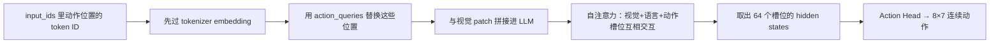

<!-- Generated by SpecStory, Markdown v2.1.0 -->

# 2026-07-09 10:09:33Z

<!-- Cursor IDE Session 516af08e-18cf-47f8-b85b-2704bcf42478 (2026-07-09 10:09:33Z) -->

_**User**_

@\home\byang\Project\VLA-Adapter\ 
我导师要让我展示这个VLA的整个数据流动处理和训练流程，他想更直观的看是怎么训练的，我该怎么展示呢？

---

_**Agent (default)**_

<think><details><summary>Thought Process</summary>
用户希望向导师直观展示VLA项目的完整数据流与训练流程。

需要先查看代码库中的数据加载、训练脚本和模型架构，再据此给出具体的可视化展示建议。
</details></think>

_**Agent (default)**_

先梳理项目的数据流与训练入口，再给你一套适合向导师展示的直观方案。


_**Agent (default)**_

<tool-use data-tool-type="search" data-tool-name="glob_file_search"><details>
<summary>Tool use: **glob_file_search** • Searched codebase "" • **255** results in **1** directory</summary>

Directory: **`/home/byang/Project/VLA-Adapter`** (255 files)

| File |
|------|
| `vla-scripts/train.sh` |
| `vla-scripts/eval.sh` |
| `prismatic/vla/memory_bank.py` |
| `eval_logs/parse_libero_eval_log.py` |
| `vla-scripts/finetune.py` |
| `experiments/robot/libero/run_libero_eval.py` |
| `experiments/robot/openvla_utils.py` |
| `experiments/robot/robot_utils.py` |
| `pretrained_models/configs/modeling_prismatic.py` |
| `prismatic/extern/hf/modeling_prismatic.py` |
| `prismatic/models/action_heads.py` |
| `prismatic/vla/datasets/datasets.py` |
| `prismatic/vla/datasets/rlds/__init__.py` |
| `prismatic/vla/datasets/rlds/dataset.py` |
| `prismatic/util/data_utils.py` |
| `prismatic/vla/datasets/rlds/traj_transforms.py` |
| `prismatic/vla/datasets/__init__.py` |
| `vla-scripts/inspect_libero_rlds.py` |
| `prismatic/models/backbones/vision/dinosiglip_vit.py` |
| `pretrained_models/vit_large_patch14_reg4_dinov2/README.md` |
| `LIBERO/templates/problem_class_template.py` |
| `LIBERO/setup.py` |
| `LIBERO/scripts/create_libero_task_example.py` |
| `LIBERO/scripts/get_affordance_info.py` |
| `LIBERO/scripts/create_template.py` |
| `LIBERO/scripts/libero_100_collect_demonstrations.py` |
| `LIBERO/scripts/get_dataset_info.py` |
| `LIBERO/scripts/init_path.py` |
| `LIBERO/scripts/check_dataset_integrity.py` |
| `LIBERO/scripts/collect_demonstration.py` |
| `LIBERO/scripts/create_dataset.py` |
| `LIBERO/scripts/config_copy.py` |
| `LIBERO/libero/lifelong/utils.py` |
| `LIBERO/libero/lifelong/models/modules/rgb_modules.py` |
| `LIBERO/libero/lifelong/models/modules/language_modules.py` |
| `LIBERO/libero/lifelong/models/modules/transformer_modules.py` |
| `LIBERO/libero/lifelong/models/modules/data_augmentation.py` |
| `LIBERO/libero/lifelong/models/policy_head.py` |
| `LIBERO/libero/lifelong/datasets.py` |
| `LIBERO/libero/lifelong/init_path.py` |
| `LIBERO/libero/lifelong/main.py` |
| `LIBERO/libero/lifelong/models/bc_vilt_policy.py` |
| `LIBERO/libero/lifelong/evaluate.py` |
| `LIBERO/libero/lifelong/models/bc_transformer_policy.py` |
| `LIBERO/libero/lifelong/models/__init__.py` |
| `LIBERO/libero/lifelong/models/bc_rnn_policy.py` |
| `LIBERO/libero/lifelong/models/base_policy.py` |
| `LIBERO/libero/lifelong/algos/single_task.py` |
| `LIBERO/libero/lifelong/algos/packnet.py` |
| `LIBERO/libero/lifelong/metric.py` |
| `LIBERO/libero/lifelong/algos/er.py` |
| `LIBERO/libero/lifelong/algos/ewc.py` |
| `LIBERO/libero/lifelong/algos/multitask.py` |
| `LIBERO/libero/lifelong/algos/__init__.py` |
| `LIBERO/libero/lifelong/algos/agem.py` |
| `LIBERO/libero/lifelong/algos/base.py` |
| `LIBERO/libero/libero/utils/dataset_utils.py` |
| `LIBERO/libero/libero/utils/utils.py` |
| `LIBERO/libero/libero/utils/video_utils.py` |
| `LIBERO/libero/libero/utils/task_generation_utils.py` |
| `LIBERO/libero/libero/utils/mu_utils.py` |
| `LIBERO/libero/libero/utils/bddl_generation_utils.py` |
| `LIBERO/libero/libero/utils/object_utils.py` |
| `LIBERO/libero/libero/utils/download_utils.py` |
| `LIBERO/libero/libero/utils/time_utils.py` |
| `LIBERO/libero/libero/utils/log_utils.py` |
| `LIBERO/libero/libero/utils/__init__.py` |
| `LIBERO/libero/libero/envs/venv.py` |
| `LIBERO/libero/libero/envs/textures.py` |
| `LIBERO/libero/libero/envs/utils.py` |
| `LIBERO/libero/libero/envs/robots/mounted_panda.py` |
| `LIBERO/libero/libero/envs/robots/__init__.py` |
| `LIBERO/libero/libero/envs/robots/on_the_ground_panda.py` |
| `LIBERO/libero/libero/envs/problems/libero_study_tabletop_manipulation.py` |
| `LIBERO/libero/libero/envs/problems/__init__.py` |
| `LIBERO/libero/libero/envs/problems/libero_tabletop_manipulation.py` |
| `LIBERO/libero/libero/envs/problems/libero_kitchen_tabletop_manipulation.py` |
| `LIBERO/libero/libero/envs/problems/libero_living_room_tabletop_manipulation.py` |
| `LIBERO/libero/libero/envs/problems/libero_coffee_table_manipulation.py` |
| `LIBERO/libero/libero/envs/problems/libero_floor_manipulation.py` |
| `LIBERO/libero/libero/envs/regions/__init__.py` |
| `LIBERO/libero/libero/envs/regions/object_property_sampler.py` |
| `LIBERO/libero/libero/envs/regions/workspace_region_sampler.py` |
| `LIBERO/libero/libero/envs/regions/base_region_sampler.py` |
| `LIBERO/libero/libero/envs/predicates/__init__.py` |
| `LIBERO/libero/libero/envs/predicates/base_predicates.py` |
| `LIBERO/libero/libero/envs/env_wrapper.py` |
| `LIBERO/libero/libero/envs/base_object.py` |
| `LIBERO/libero/libero/envs/arenas/table_arena.py` |
| `LIBERO/libero/libero/envs/arenas/style.py` |
| `LIBERO/libero/libero/envs/bddl_base_domain.py` |
| `LIBERO/libero/libero/envs/bddl_utils.py` |
| `LIBERO/libero/libero/envs/object_states/base_object_states.py` |
| `LIBERO/libero/libero/envs/object_states/__init__.py` |
| `LIBERO/libero/libero/envs/objects/__init__.py` |
| `LIBERO/libero/libero/envs/objects/target_zones.py` |
| `LIBERO/libero/libero/envs/objects/turbosquid_objects.py` |
| `LIBERO/libero/libero/envs/objects/google_scanned_objects.py` |
| `LIBERO/libero/libero/envs/objects/articulated_objects.py` |
| `LIBERO/libero/libero/envs/objects/site_object.py` |
| `LIBERO/libero/libero/envs/objects/hope_objects.py` |
| `LIBERO/libero/libero/benchmark/__init__.py` |
| `LIBERO/libero/libero/benchmark/mu_creation.py` |
| `LIBERO/libero/libero/benchmark/libero_suite_task_map.py` |
| `LIBERO/libero/libero/envs/arenas/__init__.py` |
| `LIBERO/libero/libero/envs/arenas/empty_arena.py` |
| `LIBERO/libero/libero/envs/arenas/kitchen_arena.py` |
| `LIBERO/libero/libero/envs/arenas/coffee_table_arena.py` |
| `LIBERO/libero/libero/envs/__init__.py` |
| `LIBERO/libero/libero/envs/arenas/study_arena.py` |
| `LIBERO/libero/libero/envs/arenas/living_room_arena.py` |
| `LIBERO/libero/libero/__init__.py` |
| `LIBERO/libero/configs/reproduce_experiment/default_experiment.yaml` |
| `LIBERO/libero/configs/train/scheduler/cosine_annealing.yaml` |
| `LIBERO/libero/configs/train/default.yaml` |
| `LIBERO/libero/configs/train/optimizer/adam_w.yaml` |
| `LIBERO/libero/configs/policy/position_encoding/sinusoidal_position_encoding.yaml` |
| `LIBERO/libero/configs/lifelong/ewc.yaml` |
| `LIBERO/libero/configs/lifelong/single_task.yaml` |
| `LIBERO/libero/configs/lifelong/er.yaml` |
| `LIBERO/libero/configs/lifelong/packnet.yaml` |
| `LIBERO/libero/configs/lifelong/multitask.yaml` |
| `LIBERO/libero/configs/policy/bc_vilt_policy.yaml` |
| `LIBERO/libero/configs/policy/image_encoder/patch_encoder.yaml` |
| `LIBERO/libero/configs/policy/image_encoder/resnet_encoder.yaml` |
| `LIBERO/libero/configs/policy/bc_transformer_policy.yaml` |
| `LIBERO/libero/configs/policy/data_augmentation/identity_aug.yaml` |
| `LIBERO/libero/configs/policy/data_augmentation/translation_aug.yaml` |
| `LIBERO/libero/configs/policy/data_augmentation/batch_wise_img_color_jitter_group_aug.yaml` |
| `LIBERO/libero/configs/policy/data_augmentation/translation_aug_group.yaml` |
| `LIBERO/libero/configs/policy/policy_head/gmm_head.yaml` |
| `LIBERO/libero/configs/policy/language_encoder/mlp_encoder.yaml` |
| `LIBERO/libero/configs/policy/bc_rnn_policy.yaml` |
| `LIBERO/libero/configs/policy/language_encoder/identity_encoder.yaml` |
| `LIBERO/libero/configs/policy/language_encoder/clip_encoder.yaml` |
| `LIBERO/libero/configs/policy/language_encoder/rnn_encoder.yaml` |
| `LIBERO/libero/configs/lifelong/agem.yaml` |
| `LIBERO/libero/configs/lifelong/base.yaml` |
| `LIBERO/libero/configs/config.yaml` |
| `LIBERO/libero/configs/eval/default.yaml` |
| `LIBERO/libero/configs/data/default.yaml` |
| `LIBERO/benchmark_scripts/init_path.py` |
| `LIBERO/benchmark_scripts/render_single_task.py` |
| `LIBERO/benchmark_scripts/check_task_suites.py` |
| `LIBERO/benchmark_scripts/download_libero_datasets.py` |
| `LIBERO/README.md` |
| `LIBERO/benchmark_scripts/shasum_files.py` |
| `pretrained_models/prism-qwen25-extra-dinosiglip-224px-0_5b/config.yaml` |
| `pretrained_models/prism-qwen25-extra-dinosiglip-224px-0_5b/README.md` |
| `vla-scripts/merge_lora_weights_and_save.py` |
| `vla-scripts/train.py` |
| `vla-scripts/vla_evaluation.py` |
| `vla-scripts/extern/verify_openvla.py` |
| `vla-scripts/extern/convert_openvla_weights_to_hf.py` |
| `vla-scripts/deploy.py` |
| `vla-scripts/evaluate_calvin.py` |
| `vla-scripts/calvin_env_wrapper.py` |
| `scripts/preprocess.py` |
| `scripts/generate.py` |
| `scripts/pretrain.py` |
| `scripts/extern/verify_prismatic.py` |
| `scripts/extern/convert_prismatic_weights_to_hf.py` |
| `prismatic/vla/materialize.py` |
| `prismatic/vla/datasets/rlds/utils/task_augmentation.py` |
| `prismatic/vla/datasets/rlds/utils/data_utils.py` |
| `prismatic/vla/datasets/rlds/utils/goal_relabeling.py` |
| `prismatic/vla/datasets/rlds/oxe/utils/droid_utils.py` |
| `scripts/additional-datasets/lrv_instruct.py` |
| `scripts/additional-datasets/lvis_instruct_4v.py` |
| `prismatic/vla/datasets/rlds/obs_transforms.py` |
| `prismatic/vla/datasets/rlds/oxe/materialize.py` |
| `prismatic/vla/datasets/rlds/oxe/configs.py` |
| `prismatic/vla/datasets/rlds/oxe/__init__.py` |
| `prismatic/vla/datasets/rlds/oxe/transforms.py` |
| `prismatic/vla/datasets/rlds/oxe/mixtures.py` |
| `prismatic/vla/__init__.py` |
| `prismatic/vla/constants.py` |
| `prismatic/vla/action_tokenizer.py` |
| `prismatic/util/torch_utils.py` |
| `prismatic/util/nn_utils.py` |
| `prismatic/util/__init__.py` |
| `prismatic/util/batching_utils.py` |
| `prismatic/preprocessing/materialize.py` |
| `prismatic/preprocessing/download.py` |
| `prismatic/preprocessing/datasets/__init__.py` |
| `prismatic/preprocessing/datasets/datasets.py` |
| `prismatic/training/train_utils.py` |
| `prismatic/training/materialize.py` |
| `prismatic/training/__init__.py` |
| `prismatic/training/metrics.py` |
| `prismatic/training/strategies/__init__.py` |
| `prismatic/training/strategies/fsdp.py` |
| `prismatic/training/strategies/ddp.py` |
| `prismatic/training/strategies/base_strategy.py` |
| `prismatic/overwatch/overwatch.py` |
| `prismatic/overwatch/__init__.py` |
| `prismatic/preprocessing/__init__.py` |
| `prismatic/models/materialize.py` |
| `prismatic/models/vlms/prismatic.py` |
| `prismatic/models/vlms/__init__.py` |
| `prismatic/models/vlms/base_vlm.py` |
| `prismatic/models/transformer_utils.py` |
| `prismatic/models/load.py` |
| `prismatic/models/film_vit_wrapper.py` |
| `prismatic/models/vlas/__init__.py` |
| `prismatic/models/registry.py` |
| `prismatic/models/vlas/openvla.py` |
| `prismatic/models/projectors.py` |
| `prismatic/models/backbones/vision/__init__.py` |
| `prismatic/models/backbones/llm/prompting/base_prompter.py` |
| `prismatic/models/backbones/vision/in1k_vit.py` |
| `prismatic/models/backbones/llm/prompting/llama2_chat_prompter.py` |
| `prismatic/models/backbones/vision/clip_vit.py` |
| `prismatic/models/backbones/vision/siglip_vit.py` |
| `prismatic/models/backbones/llm/prompting/phi_prompter.py` |
| `prismatic/models/backbones/vision/dinoclip_vit.py` |
| `prismatic/models/backbones/vision/base_vision.py` |
| `prismatic/models/backbones/vision/dinov2_vit.py` |
| `prismatic/models/backbones/llm/prompting/vicuna_v15_prompter.py` |
| `prismatic/models/backbones/llm/prompting/mistral_instruct_prompter.py` |
| `prismatic/models/backbones/llm/prompting/qwen_prompter.py` |
| `prismatic/models/backbones/llm/qwen25.py` |
| `prismatic/extern/hf/processing_prismatic.py` |
| `prismatic/extern/hf/configuration_prismatic.py` |
| `prismatic/models/__init__.py` |
| `prismatic/models/backbones/llm/prompting/__init__.py` |
| `prismatic/models/backbones/llm/llama2.py` |
| `prismatic/models/backbones/llm/__init__.py` |
| `prismatic/models/backbones/llm/phi.py` |
| `prismatic/models/backbones/llm/mistral.py` |
| `prismatic/models/backbones/llm/base_llm.py` |
| `prismatic/__init__.py` |
| `prismatic/conf/__init__.py` |
| `prismatic/conf/models.py` |
| `prismatic/conf/vla.py` |
| `prismatic/conf/datasets.py` |
| `pretrained_models/configs/processing_prismatic.py` |
| `pretrained_models/configs/configuration_prismatic.py` |
| `experiments/robot/server_deploy/deploy.py` |
| `experiments/robot/libero/libero_utils.py` |
| `experiments/robot/libero/regenerate_libero_dataset.py` |
| `experiments/robot/aloha/run_fake_cobot_client.py` |
| `experiments/robot/aloha/run_cobot_client.py` |
| `experiments/robot/aloha/train_files/download_models.sh` |
| `experiments/robot/aloha/train_files/dinosiglip_vit_local_vision.py` |
| `experiments/robot/aloha/train_files/materialize_local_vision.py` |
| `experiments/robot/aloha/train_files/train_aloha.sh` |
| `experiments/robot/aloha/train_files/qwen25.py` |
| `experiments/robot/aloha/train_files/setup_training.sh` |
| `experiments/robot/aloha/eval_files/deploy_server.sh` |
| `experiments/robot/aloha/eval_files/run_eval_client.sh` |
| `experiments/robot/aloha/eval_files/run_eval_client_fake.sh` |
| `experiments/robot/aloha/README.md` |
| `README.md` |
| `.pre-commit-config.yaml` |
</details></tool-use>

_**Agent (default)**_

<tool-use data-tool-type="read" data-tool-name="read_file_v2"><details>
<summary>Tool use: **read_file_v2** • Read file: /home/byang/Project/VLA-Adapter/vla-scripts/train.sh</summary>

</details></tool-use>

_**Agent (default)**_

<tool-use data-tool-type="unknown" data-tool-name="ripgrep_raw_search"><details>
<summary>Tool use: **ripgrep_raw_search**</summary>

Parameters:

```json
{
  "caseInsensitive": false,
  "glob": "*.py",
  "path": "/home/byang/Project/VLA-Adapter",
  "pattern": "def train|main\\(|DataLoader|dataset"
}
```
Additional data:

```json
{
  "isPruned": true,
  "outputMode": "content",
  "path": "/home/byang/Project/VLA-Adapter",
  "pattern": "def train|main\\(|DataLoader|dataset",
  "topFiles": [
    {
      "matchCount": 2,
      "uri": "./eval_logs/parse_libero_eval_log.py"
    },
    {
      "matchCount": 32,
      "uri": "./vla-scripts/finetune.py"
    },
    {
      "matchCount": 3,
      "uri": "./experiments/robot/libero/run_libero_eval.py"
    },
    {
      "matchCount": 3,
      "uri": "./pretrained_models/configs/modeling_prismatic.py"
    }
  ],
  "totalFiles": 4,
  "totalMatches": 1171
}
```
Status: **completed**

</details></tool-use>

_**Agent (default)**_

<think><details><summary>Thought Process</summary>
正在查看项目中的关键文件，以梳理完整的数据流与训练流程。

已锁定五个核心文件：finetune.py、datasetspy、action_heads.py、modeling_prismatic.py 和 data_utils.py。准备并行读取，逐层拆解数据加载、模型前向传播与动作预测的完整链路。
</details></think>

_**Agent (default)**_

<tool-use data-tool-type="read" data-tool-name="read_file_v2"><details>
<summary>Tool use: **read_file_v2** • Read file: /home/byang/Project/VLA-Adapter/vla-scripts/finetune.py</summary>

</details></tool-use>

_**Agent (default)**_

<tool-use data-tool-type="read" data-tool-name="read_file_v2"><details>
<summary>Tool use: **read_file_v2** • Read file: /home/byang/Project/VLA-Adapter/prismatic/vla/datasets/datasets.py</summary>

</details></tool-use>

_**Agent (default)**_

<tool-use data-tool-type="read" data-tool-name="read_file_v2"><details>
<summary>Tool use: **read_file_v2** • Read file: /home/byang/Project/VLA-Adapter/prismatic/util/data_utils.py</summary>

</details></tool-use>

_**Agent (default)**_

<tool-use data-tool-type="search" data-tool-name="glob_file_search"><details>
<summary>Tool use: **glob_file_search** • Searched codebase "" • **5** results in **1** directory</summary>

Directory: **`/home/byang/Project/VLA-Adapter`** (5 files)

| File |
|------|
| `pretrained_models/vit_large_patch14_reg4_dinov2/README.md` |
| `LIBERO/README.md` |
| `pretrained_models/prism-qwen25-extra-dinosiglip-224px-0_5b/README.md` |
| `experiments/robot/aloha/README.md` |
| `README.md` |
</details></tool-use>

_**Agent (default)**_

<think><details><summary>Thought Process</summary>
正在阅读 finetune.py 的训练循环、模型前向传播、README 和 action_heads，以便梳理完整的数据流与训练流程。
</details></think>

_**Agent (default)**_

<tool-use data-tool-type="read" data-tool-name="read_file_v2"><details>
<summary>Tool use: **read_file_v2** • Read file: /home/byang/Project/VLA-Adapter/vla-scripts/finetune.py</summary>

</details></tool-use>

_**Agent (default)**_

<tool-use data-tool-type="read" data-tool-name="read_file_v2"><details>
<summary>Tool use: **read_file_v2** • Read file: /home/byang/Project/VLA-Adapter/README.md</summary>

</details></tool-use>

_**Agent (default)**_

<tool-use data-tool-type="read" data-tool-name="read_file_v2"><details>
<summary>Tool use: **read_file_v2** • Read file: /home/byang/Project/VLA-Adapter/prismatic/models/action_heads.py</summary>

</details></tool-use>

_**Agent (default)**_

<tool-use data-tool-type="unknown" data-tool-name="ripgrep_raw_search"><details>
<summary>Tool use: **ripgrep_raw_search**</summary>

Parameters:

```json
{
  "caseInsensitive": false,
  "glob": "**/finetune.py",
  "path": "/home/byang/Project/VLA-Adapter",
  "pattern": "def forward|run_forward|training_step"
}
```
Additional data:

```json
{
  "isPruned": true,
  "outputMode": "content",
  "path": "/home/byang/Project/VLA-Adapter",
  "pattern": "def forward|run_forward|training_step",
  "topFiles": [
    {
      "matchCount": 3,
      "uri": "./vla-scripts/finetune.py"
    }
  ],
  "totalFiles": 1,
  "totalMatches": 3
}
```
Status: **completed**

</details></tool-use>

_**Agent (default)**_

<think><details><summary>Thought Process</summary>
正在查看 finetune.py 的训练循环与前向传播函数，以及 inspect 脚本和模型代码，以梳理完整的数据流和训练流程。
</details></think>

_**Agent (default)**_

<tool-use data-tool-type="read" data-tool-name="read_file_v2"><details>
<summary>Tool use: **read_file_v2** • Read file: /home/byang/Project/VLA-Adapter/vla-scripts/finetune.py</summary>

</details></tool-use>

_**Agent (default)**_

<tool-use data-tool-type="read" data-tool-name="read_file_v2"><details>
<summary>Tool use: **read_file_v2** • Read file: /home/byang/Project/VLA-Adapter/vla-scripts/finetune.py</summary>

</details></tool-use>

_**Agent (default)**_

<tool-use data-tool-type="read" data-tool-name="read_file_v2"><details>
<summary>Tool use: **read_file_v2** • Read file: /home/byang/Project/VLA-Adapter/vla-scripts/inspect_libero_rlds.py</summary>

</details></tool-use>

_**Agent (default)**_

<tool-use data-tool-type="unknown" data-tool-name="ripgrep_raw_search"><details>
<summary>Tool use: **ripgrep_raw_search**</summary>

Parameters:

```json
{
  "caseInsensitive": false,
  "glob": "**/modeling_prismatic.py",
  "path": "/home/byang/Project/VLA-Adapter/prismatic/extern/hf",
  "pattern": "def forward|action_queries|predict_action"
}
```
Additional data:

```json
{
  "isPruned": true,
  "outputMode": "content",
  "path": "/home/byang/Project/VLA-Adapter/prismatic/extern/hf",
  "pattern": "def forward|action_queries|predict_action",
  "topFiles": [
    {
      "matchCount": 16,
      "uri": "prismatic/extern/hf/modeling_prismatic.py"
    }
  ],
  "totalFiles": 1,
  "totalMatches": 16
}
```
Status: **completed**

</details></tool-use>

_**Agent (default)**_

<think><details><summary>Thought Process</summary>
已理解 VLA-Adapter 的完整数据流与训练流程。

正在进一步了解 GroupRLDSDataset 与评估流程，以便提供完整的演示指南。
</details></think>

_**Agent (default)**_

<tool-use data-tool-type="read" data-tool-name="read_file_v2"><details>
<summary>Tool use: **read_file_v2** • Read file: /home/byang/Project/VLA-Adapter/prismatic/vla/datasets/datasets.py</summary>

</details></tool-use>

_**Agent (default)**_

<tool-use data-tool-type="read" data-tool-name="read_file_v2"><details>
<summary>Tool use: **read_file_v2** • Read file: /home/byang/Project/VLA-Adapter/prismatic/vla/constants.py</summary>

</details></tool-use>

_**Agent (default)**_

<tool-use data-tool-type="read" data-tool-name="read_file_v2"><details>
<summary>Tool use: **read_file_v2** • Read file: /home/byang/Project/VLA-Adapter/prismatic/extern/hf/modeling_prismatic.py</summary>

</details></tool-use>

_**Agent (default)**_

<tool-use data-tool-type="read" data-tool-name="read_file_v2"><details>
<summary>Tool use: **read_file_v2** • Read file: /home/byang/Project/VLA-Adapter/vla-scripts/eval.sh</summary>

</details></tool-use>

_**Agent (default)**_

<think><details><summary>Thought Process</summary>
正在检查 GroupRLDSDataset 和记忆库功能。这是 VLA-Adapter 的关键创新。
</details></think>

_**Agent (default)**_

<tool-use data-tool-type="unknown" data-tool-name="ripgrep_raw_search"><details>
<summary>Tool use: **ripgrep_raw_search**</summary>

Parameters:

```json
{
  "caseInsensitive": false,
  "contextAfter": 40,
  "path": "/home/byang/Project/VLA-Adapter",
  "pattern": "class GroupRLDSDataset"
}
```
Additional data:

```json
{
  "isPruned": true,
  "outputMode": "content",
  "path": "/home/byang/Project/VLA-Adapter",
  "pattern": "class GroupRLDSDataset",
  "topFiles": [
    {
      "matchCount": 41,
      "uri": "./prismatic/vla/datasets/datasets.py"
    }
  ],
  "totalFiles": 1,
  "totalMatches": 1
}
```
Status: **completed**

</details></tool-use>

_**Agent (default)**_

<tool-use data-tool-type="read" data-tool-name="read_file_v2"><details>
<summary>Tool use: **read_file_v2** • Read file: /home/byang/Project/VLA-Adapter/vla-scripts/finetune.py</summary>

</details></tool-use>

_**Agent (default)**_

<think><details><summary>Thought Process</summary>
已全面理解该VLA项目的数据流与训练流程，准备给出直观的展示方案。

正在设计一份面向导师的展示方案。将涵盖端到端数据流、训练循环、VLA-Adapter与OpenVLA的关键创新差异，并附上可直接运行的演示脚本。同时会用Mermaid图示清晰呈现整体架构。
</details></think>

_**Agent (default)**_

向导师展示 VLA-Adapter 的训练流程，建议用「一张总览图 + 一条真实数据走一遍 + 一段训练循环」三层结构。下面按你当前仓库配置（`train.sh` 里的 LIBERO Goal + LoRA + L1 Action Head）整理。

---

## 一、推荐展示结构（15–25 分钟）

| 环节 | 时长 | 内容 | 目的 |
|------|------|------|------|
| 1. 问题定义 | 2 min | 输入：图像 + 语言指令 + 本体状态 → 输出：未来 8 步机器人动作 | 让导师先建立直觉 |
| 2. 整体架构图 | 3 min | 用论文图 `figure/Framework.png` 或下面流程图 | 宏观理解 |
| 3. 数据从哪来 | 5 min | RLDS 演示数据 → 单帧样本长什么样 | 最直观、导师最爱看 |
| 4. 训练怎么跑 | 5 min | `train.sh` → `finetune.py` 主循环 | 对应代码 |
| 5. 核心创新点 | 3 min | Action Queries + Adapter Action Head + Memory Bank | 你和 OpenVLA 的差异 |
| 6. 闭环验证 | 3 min | WandB 曲线 + LIBERO 仿真评估 | 证明「训完了能用」 |

---

## 二、端到端数据流（建议画成一张图）

```mermaid
flowchart LR
    subgraph Data["① 原始数据"]
        A[LIBERO 演示轨迹<br/>RLDS/TFDS]
    end

    subgraph Preprocess["② 数据预处理"]
        B[轨迹切窗<br/>当前帧 + 未来7步动作]
        C[图像 resize/增强<br/>224px]
        D[动作/本体归一化<br/>bounds_q99]
    end

    subgraph Transform["③ RLDSBatchTransform"]
        E[主相机 + 腕部相机]
        F[语言指令<br/>What action should the robot take to ...?]
        G[Action Token 占位<br/>64 个特殊 token]
    end

    subgraph Batch["④ Collator"]
        H[padding → batch]
    end

    subgraph Model["⑤ 模型前向"]
        I[Vision: DINO+SigLip]
        J[Projector → LLM<br/>Qwen2.5-0.5B]
        K[Action Queries 替换 action token 位置]
        L[提取多层 hidden states]
        M[L1RegressionActionHead<br/>→ 8×7 连续动作]
    end

    subgraph Train["⑥ 训练"]
        N[L1 Loss vs GT actions]
        O[LoRA 更新 LLM<br/>+ 训练 Action Head]
    end

    A --> B --> C --> D --> E
    E --> F --> G --> H
    H --> I --> J --> K --> L --> M --> N --> O
```



**一句话总结给导师：**

> 我们不是让 LLM 逐 token 预测离散动作，而是用 **可学习的 Action Queries** 作为「动作槽位」，经过 VLM 融合视觉+语言后，由 **轻量 Adapter Action Head** 直接回归连续动作；训练目标是 **L1 loss**。

---

## 三、逐步讲解（可对着代码讲）

### 1. 入口：你怎么启动训练

你的 `vla-scripts/train.sh` 就是最佳「故事起点」：

```17:42:vla-scripts/train.sh
CUDA_VISIBLE_DEVICES=6 torchrun --standalone --nnodes 1 --nproc-per-node 1 vla-scripts/finetune.py \
--vlm_path pretrained_models/prism-qwen25-extra-dinosiglip-224px-0_5b \
--config_file_path pretrained_models/configs \
--data_root_dir /data2/byang/libero_rlds \
--dataset_name $data_name \
...
--use_lora True \
--use_proprio True \
--num_images_in_input 2 \
--use_minivlm True \
--batch_size 2 \
--grad_accumulation_steps 8 \
```

关键参数含义（导师常问）：
- **有效 batch = 2 × 8 = 16**
- **2 张图**：第三人称 + 腕部相机
- **LoRA rank 64**：只微调 LLM 的线性层， backbone 基本冻结
- **use_minivlm**：用 Qwen 对话格式 + 特殊 action token 方案

### 2. 单条训练样本长什么样

数据在 `RLDSBatchTransform` 里从 RLDS 原始格式变成模型输入：

```42:47:prismatic/vla/datasets/datasets.py
    def __call__(self, rlds_batch: Dict[str, Any]) -> Dict[str, Any]:
        """Converts a RLDS batch to the format expected by the OpenVLA collator/models."""
        dataset_name, current_action = rlds_batch["dataset_name"], rlds_batch["action"][0]
        img = Image.fromarray(rlds_batch["observation"]["image_primary"][0])
        lang = rlds_batch["task"]["language_instruction"].decode().lower()
        actions = rlds_batch["action"]
```

对每个样本，你可以口头描述为：

| 字段 | 形状/含义 |
|------|-----------|
| `pixel_values` | 主相机 (+ 腕部) 图像 tensor |
| `input_ids` | 对话 prompt + 64 个 action placeholder token |
| `labels` | 只有 action 部分参与 loss，其余为 `IGNORE_INDEX` |
| `actions` | GT：8 步 × 7 维（LIBERO：xyz + 旋转 + gripper） |
| `proprio` | 8 维机器人本体状态（关节等） |
| `timesteps` / `episode_ids` | 给 Memory Bank 用（你启用了 group dataloader） |

**LIBERO 常量**（`finetune.py` 启动时会打印）：

```28:33:prismatic/vla/constants.py
LIBERO_CONSTANTS = {
    "NUM_ACTIONS_CHUNK": 8,
    "ACTION_DIM": 7,
    "PROPRIO_DIM": 8,
    "ACTION_PROPRIO_NORMALIZATION_TYPE": NormalizationType.BOUNDS_Q99,
}
```

### 3. 模型前向 + Loss（训练核心）

`run_forward_pass` 是展示重点：

```356:455:vla-scripts/finetune.py
    with torch.autocast("cuda", dtype=torch.bfloat16):
        output: CausalLMOutputWithPast = vla(
            input_ids=batch["input_ids"].to(device_id),
            attention_mask=batch["attention_mask"].to(device_id),
            pixel_values=batch["pixel_values"].to(torch.bfloat16).to(device_id),
            labels=batch["labels"],
            output_hidden_states=True,
            proprio=batch["proprio"] if use_proprio else None,
            ...
        )
    ...
    actions_hidden_states = text_hidden_states[current_action_mask | next_actions_mask].reshape(batch_size, 1, NUM_TOKENS, -1)
    ...
    predicted_actions = action_head.module.predict_action(multi_layer_hidden_states, ...)
    loss = torch.nn.L1Loss()(predicted_actions, ground_truth_actions)
```

讲解顺序建议：
1. **VLM**：图像 patch → projector → 与文本 embedding 拼接 → Qwen LLM
2. **Action Queries**：在 action token 位置注入可学习 embedding（`modeling_prismatic.py` 里的 `action_queries`）
3. **取 hidden states**：所有 transformer 层 + 视觉 patch + action 位置
4. **Action Head**：MLP ResNet 回归 `(batch, 8, 7)` 连续动作
5. **Loss**：`L1(predicted, ground_truth_actions)`

### 4. 训练循环

```1078:1141:vla-scripts/finetune.py
        for batch_idx, batch in enumerate(dataloader):
            loss, metrics = run_forward_pass(...)
            normalized_loss = loss / cfg.grad_accumulation_steps
            normalized_loss.backward()
            ...
            if (batch_idx + 1) % cfg.grad_accumulation_steps == 0:
                optimizer.step()
                scheduler.step()
                optimizer.zero_grad()
```

可训练模块（按你当前配置）：
- **LoRA 权重**（LLM 内线性层）
- **`action_queries`**（始终 `requires_grad=True`）
- **`L1RegressionActionHead`**（Adapter 主体）
- **`ProprioProjector`**（若 `use_proprio=True`）
- **Memory Bank**（`use_action_head_memory=True` 时，配合 `GroupRLDSDataset`）

---

## 四、最直观的现场演示方式

### 方式 A：跑数据探查脚本（强烈推荐，5 分钟见效）

仓库里已有 `vla-scripts/inspect_libero_rlds.py`，和训练用同一套 RLDS 管线。展示时可以让导师看到：
- 原始 RLDS schema
- 一条样本的 `language_instruction`、图像 shape、action 范围
- `dataset_statistics`（推理时反归一化用）

```bash
python vla-scripts/inspect_libero_rlds.py \
  --data_root_dir /data2/byang/libero_rlds \
  --dataset_name libero_goal_no_noops
```

### 方式 B：展示一张真实训练样本（比讲代码更直观）

准备一张 PPT 页，左右对比：

| 左：人类可读 | 右：模型输入 |
|-------------|-------------|
| 主相机截图 | `pixel_values` shape |
| 腕部相机截图 | 第二张图 |
| 指令文本："open the middle drawer..." | `input_ids` 解码后的 prompt |
| 当前+未来动作曲线 | `actions` 8×7 数值 |
| — | 64 个 action token 在序列中的位置 |

可以用 `inspect_libero_rlds.py` 输出 + 手动 decode 一条 `input_ids` 做成这一页。

### 方式 C：短训练 live demo（若时间允许）

把 `train.sh` 里 `max_steps` 改成 50–100，现场跑几分钟，展示：
- tqdm 进度条
- 打印的 `NUM_ACTIONS_CHUNK` 等常量
- WandB offline 日志里的 `curr_action_l1_loss` 下降

### 方式 D：闭环——训完怎么评估

用 `vla-scripts/eval.sh` 里的 `run_libero_eval.py`：
- 加载 checkpoint
- 在 LIBERO 仿真里 rollout
- 汇报 success rate（你日志里已有 94%+ 的结果，很适合收尾）

---

## 五、PPT 建议大纲（8–10 页）

1. **任务**：Vision-Language-Action，模仿学习
2. **Framework 总图**：直接用 README 里的 `figure/Framework.png`
3. **数据来源**：LIBERO 演示 → RLDS → 过滤 no-op
4. **单样本构造**：图 + 文 + proprio → prompt + action chunk
5. **模型架构**：Prismatic VLM + Action Queries + Adapter Head（对比 OpenVLA 的 next-token prediction）
6. **训练细节**：LoRA、L1 loss、action chunking、有效 batch
7. **VLA-Adapter 创新**：轻量 head、多层 hidden fusion、Episode Memory Bank（可选深入）
8. **实验结果**：训练曲线 + LIBERO success rate
9. **代码地图**：`train.sh` → `finetune.py` → `datasets.py` → `action_heads.py`

---

## 六、导师可能追问 & 你怎么答

| 问题 | 简要回答 |
|------|----------|
| 和 OpenVLA 有何不同？ | OpenVLA 用 LLM 离散 token 预测动作；VLA-Adapter 用 Action Queries + 连续回归 head，参数更少、收敛更快 |
| 为什么 action chunking（8 步）？ | 一次预测多步，减少推理频率，动作更平滑 |
| LoRA 训什么？ | LLM 线性层低秩适配；vision backbone 基本冻结 |
| loss 在哪算？ | 不在 LLM 的 CE loss，而在 Action Head 的 L1（`use_l1_regression=True`） |
| proprio 怎么用？ | `ProprioProjector` 投影到 LLM 维度，送入 Action Head |
| Memory Bank 干什么？ | 同 episode 内跨时间步检索历史表征，增强时序一致性（训练用 `GroupRLDSDataset` 按 episode 组 batch） |

---

## 七、如果时间紧：3 分钟版

1. 放 `Framework.png`，说输入输出  
2. 跑或展示 `inspect_libero_rlds.py` 的一条样本  
3. 指着 `run_forward_pass` 说：**VLM 融合 → 取 hidden → Action Head → L1**  
4. 展示一条 WandB loss 曲线 + LIBERO 评估成功率  

---

如果你需要，我可以帮你：
1. 写一份可直接用的 **中文 PPT 讲稿**（每页 bullet + 讲解词）  
2. 画一版 **更详细的 mermaid 架构图**（含 tensor shape）  
3. 列一个 **demo 前检查清单**（数据路径、GPU、checkpoint 是否就绪）

当前是 Ask 模式，我无法直接改文件或跑脚本；若要自动生成示意图或整理 demo notebook，可切换到 Agent 模式。

---

_**User**_

他这里面的ActionQuery是什么意思？

---

_**Agent (default)**_

<think><details><summary>Thought Process</summary>
正在分析 VLA-Adapter 项目中 ActionQuery 的含义。

准备查看 modeling_prismatic.py 中 action_queries 的具体定义和使用逻辑，以便准确解释其在训练流程中的作用。
</details></think>

_**Agent (default)**_

正在从代码里定位 `ActionQuery` 的定义与用法，便于准确解释其含义。


_**Agent (default)**_

<tool-use data-tool-type="read" data-tool-name="read_file_v2"><details>
<summary>Tool use: **read_file_v2** • Read file: /home/byang/Project/VLA-Adapter/prismatic/extern/hf/modeling_prismatic.py</summary>

</details></tool-use>

_**Agent (default)**_

<tool-use data-tool-type="read" data-tool-name="read_file_v2"><details>
<summary>Tool use: **read_file_v2** • Read file: /home/byang/Project/VLA-Adapter/prismatic/extern/hf/modeling_prismatic.py</summary>

</details></tool-use>

_**Agent (default)**_

<tool-use data-tool-type="unknown" data-tool-name="ripgrep_raw_search"><details>
<summary>Tool use: **ripgrep_raw_search**</summary>

Parameters:

```json
{
  "caseInsensitive": false,
  "glob": "*.{py,md}",
  "path": "/home/byang/Project/VLA-Adapter",
  "pattern": "action_queries|ActionQuery|action_query"
}
```
Additional data:

```json
{
  "isPruned": true,
  "outputMode": "content",
  "path": "/home/byang/Project/VLA-Adapter",
  "pattern": "action_queries|ActionQuery|action_query",
  "topFiles": [
    {
      "matchCount": 4,
      "uri": "./vla-scripts/finetune.py"
    },
    {
      "matchCount": 1,
      "uri": "./experiments/robot/libero/run_libero_eval.py"
    },
    {
      "matchCount": 11,
      "uri": "./pretrained_models/configs/modeling_prismatic.py"
    },
    {
      "matchCount": 11,
      "uri": "./prismatic/extern/hf/modeling_prismatic.py"
    }
  ],
  "totalFiles": 4,
  "totalMatches": 27
}
```
Status: **completed**

</details></tool-use>

_**Agent (default)**_

<think><details><summary>Thought Process</summary>
需要更多上下文才能解释 ActionQuery 的含义。

正在从四个角度分析 ActionQuery：NUM_TOKENS 常量（64）、action masks 的处理方式、它与 datasets.py 中 minivlm token 方案的关系，以及推理时 predict_action 的流程。
</details></think>

_**Agent (default)**_

<tool-use data-tool-type="unknown" data-tool-name="ripgrep_raw_search"><details>
<summary>Tool use: **ripgrep_raw_search**</summary>

Parameters:

```json
{
  "caseInsensitive": false,
  "contextAfter": 15,
  "path": "/home/byang/Project/VLA-Adapter/prismatic/extern/hf/modeling_prismatic.py",
  "pattern": "_process_action_masks|all_actions_mask"
}
```
Additional data:

```json
{
  "isPruned": true,
  "outputMode": "content",
  "path": "/home/byang/Project/VLA-Adapter/prismatic/extern/hf/modeling_prismatic.py",
  "pattern": "_process_action_masks|all_actions_mask",
  "topFiles": [
    {
      "matchCount": 169,
      "uri": "prismatic/extern/hf/modeling_prismatic.py"
    }
  ],
  "totalFiles": 1,
  "totalMatches": 20
}
```
Status: **completed**

</details></tool-use>

_**Agent (default)**_

<tool-use data-tool-type="read" data-tool-name="read_file_v2"><details>
<summary>Tool use: **read_file_v2** • Read file: /home/byang/Project/VLA-Adapter/prismatic/extern/hf/modeling_prismatic.py</summary>

</details></tool-use>

_**Agent (default)**_

<tool-use data-tool-type="read" data-tool-name="read_file_v2"><details>
<summary>Tool use: **read_file_v2** • Read file: /home/byang/Project/VLA-Adapter/prismatic/vla/datasets/datasets.py</summary>

</details></tool-use>

_**Agent (default)**_

<think><details><summary>Thought Process</summary>
正在查看 train_utils 中的 action mask，以确认哪些位置被标记为 action token。
</details></think>

_**Agent (default)**_

<tool-use data-tool-type="unknown" data-tool-name="ripgrep_raw_search"><details>
<summary>Tool use: **ripgrep_raw_search**</summary>

Parameters:

```json
{
  "caseInsensitive": false,
  "contextAfter": 20,
  "path": "/home/byang/Project/VLA-Adapter/prismatic/training/train_utils.py",
  "pattern": "def get_current_action_mask|def get_next_actions_mask"
}
```
Additional data:

```json
{
  "isPruned": true,
  "outputMode": "content",
  "path": "/home/byang/Project/VLA-Adapter/prismatic/training/train_utils.py",
  "pattern": "def get_current_action_mask|def get_next_actions_mask",
  "topFiles": [
    {
      "matchCount": 39,
      "uri": "prismatic/training/train_utils.py"
    }
  ],
  "totalFiles": 1,
  "totalMatches": 2
}
```
Status: **completed**

</details></tool-use>

_**Agent (default)**_

<tool-use data-tool-type="read" data-tool-name="read_file_v2"><details>
<summary>Tool use: **read_file_v2** • Read file: /home/byang/Project/VLA-Adapter/prismatic/vla/action_tokenizer.py</summary>

</details></tool-use>

_**Agent (default)**_

<think><details><summary>Thought Process</summary>
已全面理解 ActionQuery 的含义。

ActionQuery 是一个可学习的嵌入表，包含 64 个向量。前向传播时，模型会识别输入序列中的动作 token，并用这个可学习的嵌入替换它们的原始词嵌入。

它类似于 DETR 的 object queries 或 OPT 的 prompt tuning，是可学习的“槽位”，用于表示动作信息。LLM 处理完多模态输入后，提取这些位置的隐藏状态，再送入 Action Head 做连续动作回归。训练数据里 input_ids 仍保留离散的动作 token，但推理时会被替换为可学习的嵌入。

minivlm 模式下，64 个占位符 token 会追加到提示词末尾；标签里的动作值仅用于掩码，实际输入 LLM 的仍是 action_queries 的嵌入。该嵌入在训练时直接参与梯度更新，即使使用 LoRA 也不会冻结。

可以把它比作考试卷上的空白填空槽：不填真实词汇，而是让模型学会用可学习的向量来定位动作答案的位置。LLM 通过自注意力更新这些槽位的表示，再由 Action Head 读取。这与 VLA-Adapter 论文中的 query-based 方法类似。另外，64 个槽位对应 8 个动作 chunk，每个 chunk 的维度为 7。

掩码逻辑中，前 7 个 token 对应当前动作（7 维），其余对应未来动作。64 个槽位里，约 56 个对应动作维度，剩余可能是填充。minivlm 下，每个动作维度可能映射到多个 token。
</details></think>

_**Agent (default)**_

<tool-use data-tool-type="read" data-tool-name="read_file_v2"><details>
<summary>Tool use: **read_file_v2** • Read file: /home/byang/Project/VLA-Adapter/prismatic/vla/action_tokenizer.py</summary>

</details></tool-use>

_**Agent (default)**_

<think><details><summary>Thought Process</summary>
已理清整体情况，准备用中文给出清晰解释。

ActionQuery 是 64 个可学习的嵌入向量（nn.Embedding）。它们会替换输入序列中的动作 token。这些 token 本身只是占位符，其语义由 ActionQuery 提供。LLM 前向传播后，这些位置的隐藏状态会被读出并送入 Action Head。

与 OpenVLA 不同，VLA-Adapter 将这些查询作为适配器头的“动作槽位”，而非直接预测离散动作 token。它们类似于 DETR 的 object queries 或 BERT 的可学习掩码 token。

训练时 action_queries 初始化为零，始终要求梯度。L1 损失会反向传播至这些查询以及 LoRA 权重。

数据中的离散动作 token ID 主要用于标记序列中哪些位置属于“动作区域”。

在 L1 回归模式下，LLM 实际输出的 CE 损失被忽略，真正计算的是 Action Head 的 L1 损失。因此标签中的离散 token ID 并不参与语言模型的监督，仅用于标记动作区域的掩码位置。MiniVLM 输入末尾的离散动作 token 虽然存在，但前向传播时会被 action_queries 替换，其语义完全由可学习的 action_queries 承载。
</details></think>

_**Agent (default)**_

**Action Query** 可以理解为：模型里专门用来表示「机器人动作」的 **64 个可学习向量槽位**，类似考试答题卡上的空白格——位置固定，内容由模型自己学出来。

---

## 一句话定义

`Action Query` 不是词表里的某个词，而是一组 **`nn.Embedding(64, llm_dim)`** 的可学习参数。前向时，它们会**替换**输入序列里「动作 token 位置」的 embedding，再经 VLM 与视觉、语言交互，最后由 Action Head 读出并回归成连续动作。

```374:376:prismatic/extern/hf/modeling_prismatic.py
        #Action query token
        self.action_queries = nn.Embedding(NUM_TOKENS, self.llm_dim)
        self.action_queries.weight.data.zero_()
```

- `NUM_TOKENS = 64`：64 个 query 槽位  
- `llm_dim`：与 Qwen2.5-0.5B 隐藏维度一致（约 896 维）  
- 初始化全零，训练中与 LoRA、Action Head 一起更新  

---

## 它在序列里扮演什么角色？

可以把一条训练样本想成：

```
[视觉 patch] + [语言 prompt: "What action should the robot take to ...?"] + [64 个动作槽位]
```

数据构造阶段（`RLDSBatchTransform`）会在 prompt 末尾拼上 64 个 **占位 token**（`use_minivlm=True` 时来自离散化动作的 token ID，主要用来标位置）：

```67:91:prismatic/vla/datasets/datasets.py
            conversation = [
                {"from": "human", "value": f"What action should the robot take to {lang}?"},
                {"from": "gpt", "value": ''},
            ]
            ...
            input_ids = input_ids + flattened_action_chunk_string + extended_array
            labels = list(input_ids)
            action_chunk_len = NUM_TOKENS
```

但真正送进 LLM 时，这些位置上的 embedding **不会用 tokenizer 的词向量**，而是被 `action_queries` 覆盖：

```628:633:prismatic/extern/hf/modeling_prismatic.py
            else:
                action_queries = self.action_queries.weight
                action_queries = action_queries.view(1, action_queries.shape[0], action_queries.shape[1]).repeat(input_embeddings.shape[0], 1, 1)
                all_actions_mask = self._process_action_masks(labels)
                input_embeddings = self._replace_input_embeddings(
                    input_embeddings, all_actions_mask, action_queries)
```

流程可以概括为：



---

## 和 OpenVLA 的「动作 token 预测」有何不同？

| | OpenVLA 风格 | VLA-Adapter 的 Action Query |
|---|---|---|
| 动作表示 | LLM 逐 token 预测离散动作词 | 64 个可学习 query 向量作「动作槽」 |
| 训练目标 | 交叉熵（下一个 token） | Action Head 的 **L1 回归** |
| token ID 的作用 | 就是要预测的目标 | 主要标记「哪些位置是动作区」 |
| 谁产出最终动作 | LM 词表解码 | Adapter MLP 读 hidden states |

也就是说：**数据里的离散 action token 更像「书签」标出动作区域；真正承载语义、并被训练的是 `action_queries` 这组参数。**

训练时 `finetune.py` 会强制让 `action_queries` 可训练（即使用 LoRA）：

```878:881:vla-scripts/finetune.py
        for name, param in vla.named_parameters():
            if "action_queries" in name:
                param.requires_grad = True
```

---

## 64 个 query 和 8×7 维动作的关系

LIBERO 配置下：

- `NUM_ACTIONS_CHUNK = 8`：一次预测 8 步动作  
- `ACTION_DIM = 7`：每步 7 维（xyz + 旋转 + 夹爪）  
- 共 56 维连续动作 → 离散化后对应若干 **特殊 action token**（`ACTION_TOKEN_BEGIN_IDX` 之后）

`train_utils.py` 用 mask 区分「当前步动作 token」和「未来步动作 token」：

```8:41:prismatic/training/train_utils.py
def get_current_action_mask(token_ids):
    ...
    mask = (1 <= cumsum) & (cumsum <= ACTION_DIM)
    action_tokens_only_mask = token_ids > ACTION_TOKEN_BEGIN_IDX
    ...

def get_next_actions_mask(token_ids):
    ...
    mask = cumsum > ACTION_DIM
    action_tokens_only_mask = token_ids > ACTION_TOKEN_BEGIN_IDX
```

64 个 query 是固定槽位数，略多于 8×7=56，多出来的用于 padding/对齐；训练时从对应 hidden states 取出，再 reshape 交给 Action Head。

---

## 类比（方便跟导师讲）

1. **DETR 的 Object Query**：不直接检测框，而是可学习 query 去「问」图像里有什么；这里是去「问」该做什么动作。  
2. **答题卡填空**：prompt 是题目（图+语言），Action Query 是预留的空白答案格，LLM 读题后往格子里写入表征，Action Head 再翻译成数值动作。  
3. **Adapter 接口**：VLM backbone 大多冻结（LoRA 轻调），Action Query + Action Head 是专门为机器人控制加的「动作接口」。

---

## 训练 vs 推理

**训练**：  
- GT 连续动作在 `batch["actions"]`  
- `action_queries` 经 VLM 得到 hidden states → Action Head 预测 → **L1 loss**  
- 不依赖 LLM 对离散 token 的交叉熵（`use_l1_regression=True` 时）

**推理**（`predict_action`）：  
- 同样注入 `action_queries`  
- 取各层 hidden states → Action Head → 反归一化 → 发给机器人执行  

```825:828:prismatic/extern/hf/modeling_prismatic.py
        action_queries = self.action_queries.weight
        action_queries = action_queries.view(1, action_queries.shape[0], action_queries.shape[1]).repeat(input_embeddings.shape[0], 1, 1)
        input_embeddings = self._replace_input_embeddings(input_embeddings.clone(), all_actions_mask, action_queries)
```

---

## 给导师的一句话总结

> **Action Query 是 VLA-Adapter 为机器人动作预留的 64 个可学习「查询槽」。模型先看图、读指令，再在这些槽位上汇聚多模态信息；最后不由 LLM 吐离散词，而是由轻量 Action Head 把槽位 hidden state 回归成 8 步连续控制量。这是相对 OpenVLA 的核心设计之一。**

若需要，我可以再画一张「单条样本从 `input_ids` 到 `action_queries` 替换」的 tensor shape 示意图，方便放进 PPT。
