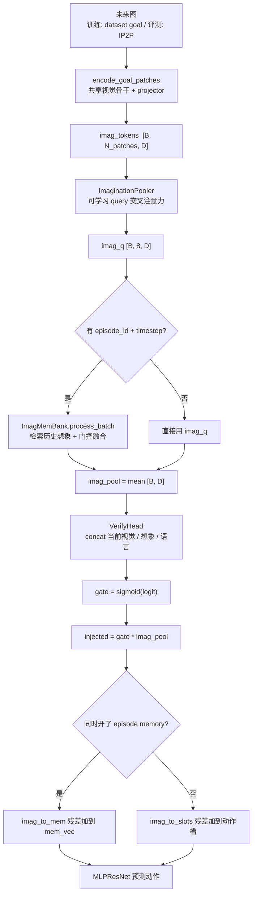

<!-- Generated by SpecStory, Markdown v2.1.0 -->

# 2026-08-20 06:13:16Z

<!-- Cursor IDE Session afcffe7f-14ce-4a66-b1ad-a86de975effc (2026-08-20 06:13:16Z) -->

_**User**_

@prismatic/vla/memory_bank.py @\mnt\Projects\VLA-Adapter\ 
@memory_bank.py (439-464) 我这里所写的这个ImagMemBank在哪里用到了这个的？

---

_**Agent (grok-4.6)**_

<think><details><summary>Thought Process</summary>
正在查找 `ImagMemBank` 在代码库中的使用位置。

已定位到 `ImagMemBank` 的类定义在 `memory_.py` 第 439-464 行。接下来将搜索该类的调用位置。
</details></think>

_**Agent (grok-4.6)**_

我先在仓库里搜索 `ImagMemBank` 的引用位置。

_**Agent (grok-4.6)**_

<tool-use data-tool-type="unknown" data-tool-name="ripgrep_raw_search"><details>
<summary>Tool use: **ripgrep_raw_search**</summary>

Parameters:

```json
{
  "caseInsensitive": false,
  "path": "/mnt/Projects/VLA-Adapter",
  "pattern": "ImagMemBank"
}
```
Additional data:

```json
{
  "isPruned": true,
  "outputMode": "content",
  "path": "/mnt/Projects/VLA-Adapter",
  "pattern": "ImagMemBank",
  "topFiles": [
    {
      "matchCount": 2,
      "uri": "./prismatic/models/action_heads.py"
    },
    {
      "matchCount": 1,
      "uri": "./prismatic/vla/memory_bank.py"
    }
  ],
  "totalFiles": 2,
  "totalMatches": 3
}
```
Status: **completed**

</details></tool-use>

_**Agent (grok-4.6)**_

<tool-use data-tool-type="unknown" data-tool-name="ripgrep_raw_search"><details>
<summary>Tool use: **ripgrep_raw_search**</summary>

Parameters:

```json
{
  "caseInsensitive": false,
  "glob": "*.{py,sh,yml,yaml,json}",
  "path": "/mnt/Projects/VLA-Adapter",
  "pattern": "imag_mem|ImagMem"
}
```
Additional data:

```json
{
  "isPruned": true,
  "outputMode": "content",
  "path": "/mnt/Projects/VLA-Adapter",
  "pattern": "imag_mem|ImagMem",
  "topFiles": [
    {
      "matchCount": 1,
      "uri": "./vla-scripts/eval_imag.sh"
    },
    {
      "matchCount": 5,
      "uri": "./experiments/robot/libero/run_libero_eval.py"
    },
    {
      "matchCount": 1,
      "uri": "./vla-scripts/train.sh"
    },
    {
      "matchCount": 3,
      "uri": "./experiments/robot/openvla_utils.py"
    },
    {
      "matchCount": 12,
      "uri": "./prismatic/models/action_heads.py"
    },
    {
      "matchCount": 7,
      "uri": "./vla-scripts/finetune.py"
    },
    {
      "matchCount": 1,
      "uri": "./prismatic/vla/memory_bank.py"
    }
  ],
  "totalFiles": 7,
  "totalMatches": 30
}
```
Status: **completed**

</details></tool-use>

_**Agent (grok-4.6)**_

<think><details><summary>Thought Process</summary>
已定位到 ImagMemBank 的调用位置。正在查看 action_heads.py 中的实例化、重置和批量处理逻辑，以完整说明其使用方式。

同时也在检查 finetune.py 评估流程中该模块的接入方式。
</details></think>

_**Agent (grok-4.6)**_

定义只在 `memory_bank.py`，实际实例化在 action head 里。我再看一下它怎么被创建和调用。

_**Agent (grok-4.6)**_

<tool-use data-tool-type="read" data-tool-name="read_file_v2"><details>
<summary>Tool use: **read_file_v2** • Read file: /mnt/Projects/VLA-Adapter/prismatic/models/action_heads.py</summary>

</details></tool-use>

_**Agent (grok-4.6)**_

<tool-use data-tool-type="read" data-tool-name="read_file_v2"><details>
<summary>Tool use: **read_file_v2** • Read file: /mnt/Projects/VLA-Adapter/prismatic/models/action_heads.py</summary>

</details></tool-use>

_**Agent (grok-4.6)**_

<think><details><summary>Thought Process</summary>
正在确认 L1RegressionActionHead 是否是唯一使用该模块的 action head，并追踪 finetune 与 eval 中 flag 的传递路径。

`ImagMemBank` 仅在 `prismatic/models/action_heads.py` 的 `L1RegressionActionHead` 中被导入并实例化。它在初始化时创建为 `self.imag_mem_bank`，并在 `reset_memory()` 和 `_process_imagination()` 中分别调用 `reset()` 与 `process_batch()`。`use_imag_mem` 标志由 `vla-scripts/finetune.py` 和 `experiments/robot/libero/run_libero_eval.py` 传入。

另外，`experiments/robot/openvla_utils.py` 在构造 action head 时也会传入该标志。Shell 脚本 `la-scripts/eval_imag.sh` 与 `vla-scripts/train.sh` 同样控制了该开关的启用。`ImagMemBank` 本身不被其他文件直接调用，仅通过 `L1RegressionActionHead` 间接使用。
</details></think>

_**Agent (grok-4.6)**_

`ImagMemBank` **只在一处被真正实例化和调用**：`L1RegressionActionHead`（`prismatic/models/action_heads.py`）。类定义本身没有其他子类、也没有别处直接 `ImagMemBank(...)`。

## 直接使用（唯一调用点）

`action_heads.py` 里 import 后，在 `use_imag_mem=True` 时创建：

```102:114:prismatic/models/action_heads.py
        if use_imag_mem:
            self.imag_pooler = ImaginationPooler(hidden_dim, num_tokens=imag_num_tokens)
            self.imag_mem_bank = ImagMemBank(
                dataloader_type=memory_dataloader_type,
                group_size=memory_group_size,
                token_size=hidden_dim,
                mem_length=imag_mem_length,
                ...
            )
```

随后只做两件事：

1. **每个 episode 开始时清空** — `reset_memory()` 里 `self.imag_mem_bank.reset()`
2. **前向时检索/融合未来状态 token** — `_process_imagination()` 里 `process_batch(tokens, episode_ids, timesteps)`，再经 verify gate 注入动作头

`predict_action()` 在 `use_imag_mem and imag_tokens is not None` 时才会走到这条路径。

## 间接开关（谁把 `use_imag_mem` 传进去）

这些文件 **不直接引用 `ImagMemBank`**，只把 flag 传给 action head：

| 位置 | 作用 |
|---|---|
| `vla-scripts/finetune.py` | 训练配置 `use_imag_mem` / `imag_mem_length` |
| `experiments/robot/openvla_utils.py` | 构建 action head 时传入 `use_imag_mem=...` |
| `experiments/robot/libero/run_libero_eval.py` | 评测开关，并在有 `future_predictor` 时走 imag 路径 |
| `vla-scripts/train.sh`、`vla-scripts/eval_imag.sh` | `--use_imag_mem True` |

结论：仓库里没有第二处 `ImagMemBank` 实例。关掉 `use_imag_mem` 时，这个类完全不会被构造。

---

_**User**_

这里面对想象的处理过程是怎么样的？你给我详细讲解一下

---

_**Agent (grok-4.6)**_

<think><details><summary>Thought Process</summary>
用户希望了解代码库中对"想象"这一概念的处理流程。

我将深入阅读相关文件，梳理从imag_tokens生成、ImaginationPooler、ImagMemBank到验证头、一致性头、记忆注入及训练损失的完整处理链路。
</details></think>

_**Agent (grok-4.6)**_

我会把想象从生成、池化、记忆检索到注入动作头的整条链路读一遍，再按数据流讲解。

_**Agent (grok-4.6)**_

<tool-use data-tool-type="read" data-tool-name="read_file_v2"><details>
<summary>Tool use: **read_file_v2** • Read file: /mnt/Projects/VLA-Adapter/prismatic/models/action_heads.py</summary>

</details></tool-use>

_**Agent (grok-4.6)**_

<tool-use data-tool-type="read" data-tool-name="read_file_v2"><details>
<summary>Tool use: **read_file_v2** • Read file: /mnt/Projects/VLA-Adapter/prismatic/models/imagination.py</summary>

</details></tool-use>

_**Agent (grok-4.6)**_

<tool-use data-tool-type="read" data-tool-name="read_file_v2"><details>
<summary>Tool use: **read_file_v2** • Read file: /mnt/Projects/VLA-Adapter/prismatic/vla/memory_bank.py</summary>

</details></tool-use>

_**Agent (grok-4.6)**_

<think><details><summary>Thought Process</summary>
正在查看训练阶段（finetune.py）和评估阶段（run_libero_eval.py、openvla_utils.py）中 imag_tokens 的生成逻辑。

接下来将梳理从图像生成到编码再到头部的完整流程，以及 verify 和 consistency 损失函数的作用。
</details></think>

_**Agent (grok-4.6)**_

接下来把训练和评测里 `imag_tokens` 怎么生成、以及 verify/consistency 损失怎么算补齐。

_**Agent (grok-4.6)**_

<tool-use data-tool-type="unknown" data-tool-name="ripgrep_raw_search"><details>
<summary>Tool use: **ripgrep_raw_search**</summary>

Parameters:

```json
{
  "caseInsensitive": false,
  "glob": "*.py",
  "path": "/mnt/Projects/VLA-Adapter",
  "pattern": "imag_tokens|encode_goal_patches|imag_verify|consistency_head|last_imag_aux|goal_image|future_predictor"
}
```
Additional data:

```json
{
  "isPruned": true,
  "outputMode": "content",
  "path": "/mnt/Projects/VLA-Adapter",
  "pattern": "imag_tokens|encode_goal_patches|imag_verify|consistency_head|last_imag_aux|goal_image|future_predictor",
  "topFiles": [
    {
      "matchCount": 2,
      "uri": "./prismatic/models/imagination.py"
    },
    {
      "matchCount": 2,
      "uri": "./vla-scripts/preview_ip2p.py"
    },
    {
      "matchCount": 19,
      "uri": "./experiments/robot/libero/run_libero_eval.py"
    },
    {
      "matchCount": 4,
      "uri": "./pretrained_models/configs/modeling_prismatic.py"
    },
    {
      "matchCount": 8,
      "uri": "./experiments/robot/openvla_utils.py"
    },
    {
      "matchCount": 22,
      "uri": "./prismatic/models/action_heads.py"
    },
    {
      "matchCount": 4,
      "uri": "./prismatic/extern/hf/modeling_prismatic.py"
    },
    {
      "matchCount": 22,
      "uri": "./vla-scripts/finetune.py"
    },
    {
      "matchCount": 4,
      "uri": "./prismatic/vla/datasets/datasets.py"
    }
  ],
  "totalFiles": 9,
  "totalMatches": 87
}
```
Status: **completed**

</details></tool-use>

_**Agent (grok-4.6)**_

<tool-use data-tool-type="read" data-tool-name="read_file_v2"><details>
<summary>Tool use: **read_file_v2** • Read file: /mnt/Projects/VLA-Adapter/vla-scripts/finetune.py</summary>

</details></tool-use>

_**Agent (grok-4.6)**_

<tool-use data-tool-type="read" data-tool-name="read_file_v2"><details>
<summary>Tool use: **read_file_v2** • Read file: /mnt/Projects/VLA-Adapter/experiments/robot/libero/run_libero_eval.py</summary>

</details></tool-use>

_**Agent (grok-4.6)**_

<tool-use data-tool-type="read" data-tool-name="read_file_v2"><details>
<summary>Tool use: **read_file_v2** • Read file: /mnt/Projects/VLA-Adapter/experiments/robot/openvla_utils.py</summary>

</details></tool-use>

_**Agent (grok-4.6)**_

<think><details><summary>Thought Process</summary>
正在查看 finetune.py 中一致性损失的剩余代码，以及数据集如何提供 pixel_values_goal。

同时检查 datasets.py 中目标图像的处理逻辑。
</details></think>

_**Agent (grok-4.6)**_

<tool-use data-tool-type="read" data-tool-name="read_file_v2"><details>
<summary>Tool use: **read_file_v2** • Read file: /mnt/Projects/VLA-Adapter/vla-scripts/finetune.py</summary>

</details></tool-use>

_**Agent (grok-4.6)**_

<tool-use data-tool-type="read" data-tool-name="read_file_v2"><details>
<summary>Tool use: **read_file_v2** • Read file: /mnt/Projects/VLA-Adapter/prismatic/vla/datasets/datasets.py</summary>

</details></tool-use>

_**Agent (grok-4.6)**_

<tool-use data-tool-type="read" data-tool-name="read_file_v2"><details>
<summary>Tool use: **read_file_v2** • Read file: /mnt/Projects/VLA-Adapter/vla-scripts/finetune.py</summary>

</details></tool-use>

_**Agent (grok-4.6)**_

<tool-use data-tool-type="read" data-tool-name="read_file_v2"><details>
<summary>Tool use: **read_file_v2** • Read file: /mnt/Projects/VLA-Adapter/prismatic/models/imagination.py</summary>

</details></tool-use>

_**Agent (grok-4.6)**_

<think><details><summary>Thought Process</summary>
我已经完整理解了想象处理流程的全貌。

我将从九个层面展开讲解：设计哲学、训练与推理差异、编码与池化、ImagMemBank检索融合、验证门控、动作头注入路径、辅助损失、负样本，以及mermaid流程图。
</details></think>

_**Agent (grok-4.6)**_

这套设计的核心不是「再喂一张未来图给 VLA」，而是把想象当成**前瞻记忆（prospective memory）**：先得到一张未来画面，压成少量 token，过验证门，再残差注入动作头。

---

## 1. 设计意图

`imagination.py` 开头写得很明确：想象**不拼进视觉流**，而是压缩成未来状态 token，走记忆银行。

训练和评测的「未来图」来源不同：

| 阶段 | 未来图从哪来 |
|---|---|
| **训练** | 数据集里的 `pixel_values_goal`（默认 `episode_end`：该 episode 结束时的场景；也可 `future_k` 用 t+K 帧） |
| **评测** | Instruct-Pix2Pix 根据当前观测 + 语言指令生成 `goal_image`，可每隔 `imag_refresh_every` 步刷新 |

也就是说：训练用 oracle 未来，评测用生成未来；后面的 token / 记忆 / 门控是同一条路。

---

## 2. 总流程



---

## 3. 第一步：未来图 → `imag_tokens`

训练时（`finetune.py`）骨干被冻结，只编码 goal 图：

```466:475:vla-scripts/finetune.py
        imag_tokens, imag_tokens_neg = None, None
        if use_imag:
            with torch.no_grad():
                imag_tokens = encode_goal_patches(
                    vla.module,
                    batch["pixel_values_goal"].to(torch.bfloat16).to(device_id),
                    use_film=False,
                )
            if imag_tokens.shape[0] > 1:
                imag_tokens_neg = torch.roll(imag_tokens, shifts=1, dims=0)
```

`encode_goal_patches` 会临时把 backbone 切成单图输入，过 SigLIP+DINO + projector，得到 `[B, num_patches, llm_dim]`。这些 patch **不进 LLM**，只给动作头。

负样本是把 batch 里的 goal token **roll 一位**：样本 i 的「错误未来」= 样本 i-1 的真实未来。后面 Verify 用这对正负样本做二分类。

评测时：`run_libero_eval.py` 用 IP2P 生成 `goal_image` → `openvla_utils.py` 同样 `encode_goal_patches`，再传给 `predict_action(..., imag_tokens=...)`。

---

## 4. 第二步：压缩成前瞻 token（Pooler）

未来图有一整张 patch 图，太长，不能当记忆。`ImaginationPooler` 用 **8 个可学习 query** 对 patch 做交叉注意力，压成 `[B, 8, D]`：

```36:40:prismatic/models/imagination.py
    def forward(self, tokens: torch.Tensor) -> torch.Tensor:
        # tokens: [B, N, D]
        tokens = self.norm(tokens)
        query = self.queries.expand(tokens.shape[0], -1, -1).to(dtype=tokens.dtype)
        return self.attn(query, tokens, tokens)
```

这就是进入 `ImagMemBank` 的 working memory。

---

## 5. 第三步：`ImagMemBank` 当「想象历史」

`ImagMemBank` 几乎就是 `CogMemBank`，只是默认 `mem_length=8`，存的是**压缩后的未来 token**，不是当前语言/视觉。

对 batch 里每个样本：

1. **Working memory**：当前这步的 8 个想象 token。
2. **Retrieval**：同一 `episode_id` 下历史想象堆成 key/value；可加 timestep PE。经过 2 层交叉注意力后，取出 `retrieved = working - query`（相对增量）。
3. **Fusion（gate）**：`fused = LN(work) + tanh(MLP) * LN(retrieved)`。最后一层零初始化，一开始 gate≈0，记忆默认关闭，再慢慢学着开。
4. **Consolidate**：把当前 token 写入 bank。超长时用 ToMe：把最相似的相邻两帧平均合并，而不是简单 FIFO 丢掉最早的。

没有 `episode_ids` / `timesteps` 时跳过 bank，直接用 pooler 输出。episode 开始会 `reset()`，避免跨 episode 泄漏。

和认知记忆的分工：

- `CogMemBank`：语言侧摘要  
- `PerMemBank`：当前视觉 patch  
- `ImagMemBank`：过去若干步「我以为接下来会变成什么样」

---

## 6. 第四步：Verify 门控（能不能信这张想象）

当前观测和语言从 LLM 最后一层拆出来：

- `current_pool`：视觉 patch 均值  
- `lang_pool`：语言 token 均值（去掉最后一个位置）

然后：

```
imag_pool = imag_f.mean(dim=1)          # [B, D]
verify_logit = VerifyHead([current, imag, lang])
gate = sigmoid(logit)
injected = gate * imag_pool
```

`ImaginationVerifyHead` 是一个小 MLP：三路 concat → Linear → GELU → 标量 logit，语义是「这个未来对当前状态和任务是否可达/一致」。

门控规则：

- `imag_verify=False`：gate 恒为 1，全部注入  
- **训练**：soft gate，梯度能流过  
- **推理**：`gate < 0.5`（`imag_verify_threshold`）则硬置 0，不可信的想象直接丢掉  

负样本只走 Verify，**不进 ImagMemBank**，避免脏未来污染记忆。

---

## 7. 第五步：注入动作头（两条残差通路）

`imag_to_mem` / `imag_to_slots` 最后一层都是 **零初始化**，训练初期想象对动作几乎没影响，避免破坏已有 checkpoint。

**开了 episode memory：**

```
mem_vec = [cog_pool || per_pool]
mem_vec = mem_vec + imag_to_mem(injected)   # D → 2D
动作槽初始值 = mem_init_proj(mem_vec)
```

想象加在记忆向量上，再投影成动作 chunk 槽。

**没开 episode memory：**

动作槽先全零，再：

```
slots += imag_to_slots(injected)            # D → chunk * action_dim * D
```

之后仍走原来的 `MLPResNet`：槽位特征与各层 `h_t` / `h_a` / proprio 交叉注意力，出连续动作。

所以想象只调制动作槽的初值，不改 VLM 主干。

---

## 8. 训练损失：主损失 + 两个辅助项

总损失：

\[
\mathcal{L} = \mathrm{L1}(\hat{a}, a) + \lambda_v \mathcal{L}_{\mathrm{verify}} + \lambda_c \mathcal{L}_{\mathrm{cons}}
\]

默认 \(\lambda_v = \lambda_c = 0.1\)。

**Verify loss（正负二分类）**

- 正样本：本样本自己的 goal → label 1  
- 负样本：batch 内 roll 来的别人的 goal → label 0  
- `BCEWithLogits`

逼 VerifyHead 区分「匹配的未来」和「错配的未来」，推理时才能靠阈值丢掉 IP2P 胡编的图。

**Consistency loss（动作 ↔ 想象）**

```
pred_future = ConsistencyHead(current_pool.detach(), predicted_actions)
L_cons = 1 - cosine(pred_future, imag_pool)
```

`ImaginationConsistencyHead` 把「当前视觉 + 展平动作 chunk」映射到未来视觉空间，要求它和 `imag_pool` 对齐。含义是：若想象可信，那预测动作执行完后，场景应靠近这张未来图。`current_pool` 被 detach，这条损失主要拉动作（以及 consistency 头本身）。

---

## 9. 训练 vs 推理对照

| | 训练 | 推理 |
|---|---|---|
| 未来图 | 数据集 goal（episode 结束或 t+K） | IP2P 生成，可缓存若干步 |
| 负样本 | batch roll，训练 Verify | 无 |
| Verify | soft sigmoid | 低于阈值硬关 |
| ImagMemBank | 按 episode/timestep 写入、检索 | 同；每 episode `reset` |
| 一致性损失 | 有 | 无（只前向） |

---

## 10. 一句话串起来

当前帧正常走 VLA；另外用一张未来图压成 8 个 token → 与本 episode 历史想象融合 → VerifyHead 看它是否和当前视觉、语言一致 → 通过才残差注入动作槽 → 再预测动作。训练额外用错配未来教门控、用「动作应能到达想象场景」拉一致性。这样想象是可开关的条件，而不是强行多出来的一路视觉输入。

---

_**User**_

那你觉得这样的对想象的处理过程是合理的吗？有没有什么改进的地方？

---

_**Agent (grok-4.6)**_

<think><details><summary>Thought Process</summary>
用户在询问我是否认为当前的想象处理流程合理，并希望了解是否有改进空间。

正在从设计哲学、训练与评估差异、特征压缩、记忆库机制、验证门控及损失函数等维度，系统地审视该流程的合理性与改进空间。

发现两个关键问题。一是训练与评估存在不一致：训练使用真实未来帧，评估却依赖可能幻觉且风格不一致的IP2P生成图像。二是验证头的判别目标过于简单——它只需区分不同样本的场景任务，而实际失败模式是同一场景下生成了看似合理但不可达的未来画面。

还发现几个实现细节值得斟酌。

负样本的批次滚动方式可能受任务分组影响，导致负样本过于相似或差异过大。IP2P若仅每N步刷新，连续想象会生成重复内容，记忆库将存储大量重复记忆。检索逻辑也略显特殊——它直接用交叉注意力后的working状态作为检索结果，而非通常使用的query输出。

进一步审视发现，ToMe 对相邻未来图像的合并策略在 IP2P 噪声较大时容易误合并，导致相似性判断失准。同时注意到一个更严重的结构性缺陷：若目标始终固定为 episode_end，则同一回合内所有时间步的 imag_tokens 几乎完全相同，记忆库将被大量重复内容填满，这会严重削弱记忆库的检索效率与多样性。

进一步对比两种目标策略：若目标始终为 episode_end，同一回合内记忆库几乎存储完全相同的压缩特征，检索结果也高度相似，此时记忆库的实际作用有限；只有采用 future_k 时，前后时间步的想象内容才会真正不同，记忆库才能提供有意义的上下文差异。零初始化的设计则能避免破坏已有检查点。

训练时的软门控意味着即使质量差的想象也会泄漏通过，因为门控值永远不会严格等于零。推理阶段若验证头校准不佳，硬阈值 0.5 可能使 IP2P 图像持续通过或持续被拒。

注入前的均池化将 8 个 token 的空间与结构信息压缩为单一向量，大量空间细节在进入记忆库前即已丢失。此外，若同时启用记忆与图像注入，图像仅会进入 imag_to_mem 路径，无法直接注入 slots。

还发现一致性损失存在梯度断链问题。`aux["imag_pool"]` 被 detach，导致该损失无法反向传播至池化器与记忆库，一致性头的优化因此无法有效更新记忆库。

进一步发现一致性损失存在单向约束与循环优化的问题。由于 imag_pool 被 detach，该损失只能驱动动作头去匹配冻结的想象池，却无法让想象池回流修正动作预测。这种双向约束缺失可能导致一致性头通过忽略动作或微调来欺骗损失，形成循环优化。

进一步审视发现，detach 想象池以维持单向约束，其本意或许是防止想象退化为与策略动作同质化。但早期训练中 imag_to_* 仍为零，一致性损失却要求动作去匹配已完成场景的 embedding，而当前动作 chunk 仅约 8 步，这与目标场景相距甚远，容易与 L1 动作损失冲突。若目标固定为 episode_end，t=0 时刻的动作片段往往无法生成完整的完成态场景，一致性约束因此难以成立。

进一步确认这是时域错配：一致性头要求单个动作块去匹配 episode_end 这类长时视觉嵌入，两者尺度不匹配。除非目标重标使用 future_k 且时域长度接近动作块，否则该约束难以成立。

另外注意到几个实现细节：goal patch 编码器被 freeze，仅 pooler 参与训练，这在计算上是合理的权衡。IP2P 在评估时开销较大，refresh_every 能缓解这一问题。

确认了负样本路径的实现细节：`imag_tokens_neg` 确实传入了 `predict_action`，且在 `_process_imagination` 中负样本会跳过记忆库，不会错误地写入记忆库。

另外注意到一个实现细节：`verify_logit_pos` 并未 detach，因此验证头仍能正常训练；而 gate 仅在 aux 字典中 detach，用于注入的 gate 在前向传播中并未 detach，这与之前分析的梯度断链问题存在细微差异。

验证头同时接收 BCE 损失与 L1 梯度，门控可能被策略利用来帮助动作损失，而非真正保证图像可验证。若验证头不够鲁棒，评估时 IP2P 的垃圾图像也会混入。

进一步审视发现，零初始化配合小辅助权重，可能使 imagination 在 L1 占主导时缺乏学习贡献的动机。记忆库或许应改用对比检索，而非复用CogMemBank架构。IP2P与想象生成可引入本体感知与近期动作条件，提升与当前状态的相关性。硬阈值0.5过于武断，建议引入温度或校准机制。若 refresh_every 大于1，记忆库中会出现重复图像。更合理的做法或许是存储"当前减去想象"的残差未来，使记忆聚焦于变化而非完整场景。
</details></think>

_**Agent (grok-4.6)**_

先对照训练/评测设定和几处关键实现，再判断这条想象链路哪里站得住、哪里容易失效。

_**Agent (grok-4.6)**_

<tool-use data-tool-type="read" data-tool-name="read_file_v2"><details>
<summary>Tool use: **read_file_v2** • Read file: /mnt/Projects/VLA-Adapter/experiments/robot/libero/run_libero_eval.py</summary>

</details></tool-use>

_**Agent (grok-4.6)**_

<tool-use data-tool-type="read" data-tool-name="read_file_v2"><details>
<summary>Tool use: **read_file_v2** • Read file: /mnt/Projects/VLA-Adapter/prismatic/models/action_heads.py</summary>

</details></tool-use>

_**Agent (grok-4.6)**_

<tool-use data-tool-type="read" data-tool-name="read_file_v2"><details>
<summary>Tool use: **read_file_v2** • Read file: /mnt/Projects/VLA-Adapter/vla-scripts/finetune.py</summary>

</details></tool-use>

_**Agent (grok-4.6)**_

<tool-use data-tool-type="unknown" data-tool-name="ripgrep_raw_search"><details>
<summary>Tool use: **ripgrep_raw_search**</summary>

Parameters:

```json
{
  "caseInsensitive": false,
  "glob": "*.{py,sh}",
  "path": "/mnt/Projects/VLA-Adapter",
  "pattern": "imag_refresh_every|goal_relabeling|update_fused|imag_num_tokens"
}
```
Additional data:

```json
{
  "isPruned": true,
  "outputMode": "content",
  "path": "/mnt/Projects/VLA-Adapter",
  "pattern": "imag_refresh_every|goal_relabeling|update_fused|imag_num_tokens",
  "topFiles": [
    {
      "matchCount": 1,
      "uri": "./vla-scripts/eval_imag.sh"
    },
    {
      "matchCount": 4,
      "uri": "./experiments/robot/libero/run_libero_eval.py"
    },
    {
      "matchCount": 2,
      "uri": "./vla-scripts/train.sh"
    },
    {
      "matchCount": 1,
      "uri": "./prismatic/vla/datasets/rlds/utils/goal_relabeling.py"
    },
    {
      "matchCount": 2,
      "uri": "./experiments/robot/openvla_utils.py"
    },
    {
      "matchCount": 6,
      "uri": "./prismatic/models/action_heads.py"
    },
    {
      "matchCount": 7,
      "uri": "./prismatic/vla/memory_bank.py"
    },
    {
      "matchCount": 3,
      "uri": "./vla-scripts/verify_episode_end_goal.py"
    },
    {
      "matchCount": 7,
      "uri": "./vla-scripts/finetune.py"
    },
    {
      "matchCount": 3,
      "uri": "./prismatic/vla/datasets/datasets.py"
    },
    {
      "matchCount": 1,
      "uri": "./vla-scripts/inspect_libero_rlds.py"
    },
    {
      "matchCount": 8,
      "uri": "./prismatic/vla/datasets/rlds/dataset.py"
    }
  ],
  "totalFiles": 12,
  "totalMatches": 45
}
```
Status: **completed**

</details></tool-use>

_**Agent (grok-4.6)**_

<think><details><summary>Thought Process</summary>
思路已清晰。将用中文撰写一份全面、平衡的技术批评。

正在系统评估该方案的合理性与改进空间。

合理之处包括：
- 未将想象作为额外相机输入，避免污染视觉流且保持检查点兼容
- 零初始化残差注入
- Verify-then-act 的概念设计
- 冻结主干网络编码目标
- 使用紧凑 token 替代完整 patch
- 将 imagine bank 与认知/感知模块分离

主要问题按影响排序：
- 训练与评估域不一致，这是最大隐患
- 验证负样本过于简单

继续梳理剩余缺陷：

- 时域不匹配：episode_end 与 action chunk 不一致
- 想象记忆库与静态目标近冗余
- 注入前信息瓶颈：均值池化 8→1
- 阈值硬且未校准：0.5 阈值配合未校准 logits
- 一致性损失与 L1 矛盾，且 imag_pool 脱离梯度
- 刷新频率过低（每 4 步）导致 bank 内重复
- 门控双重梯度：L1 与 BCE 双重压力，可能恒开
- 查询方式继承自 working - query，未必适合 imagine
- 缺少 delta 表示（未来 − 当前）
</details></think>

_**Agent (grok-4.6)**_

**骨架是合理的，作为「可关掉的条件」也站得住；真正会拖效果的，是训练信号和评测失败模式对不上。**  
Imagine–Verify–Act、不把未来图拼进视觉流、零初始化残差注入，这几件事方向都对。下面按「哪里对 / 哪里容易失效 / 建议改什么」说。

---

## 哪些设计是对的

- **不当成第二路相机。** 未来图只编码成 token，不进 LLM，旧 checkpoint 能加载，VLM 视觉分布也不被 IP2P 风格带偏。
- **先压缩再进记忆。** 整图 patch 太长；8 个 query 做 pooler，适合当前瞻记忆。
- **Verify 再注入。** 生成未来不可靠时，门控是必要的，否则胡想会直接污染动作。
- **`imag_to_mem` / `imag_to_slots` 零初始化。** 训练初期想象默认关闭，不会一上来毁掉已有动作头。
- **负样本不写入 `ImagMemBank`。** 这点是对的，脏未来不能进历史。

这些说明模块划分清楚，工程上也兼容现有 Adapter。问题主要在**学什么、用什么当监督**。

---

## 最关键的三个缺口

### 1. 训练未来 ≠ 评测未来（影响最大）

训练用数据集 `pixel_values_goal`（`train.sh` 里是 `episode_end`：任务完成时的真图）。评测用 IP2P 生成图，风格、几何、物体状态都可能偏。

动作头、pooler、Verify 几乎只见过「完美未来」，推理时却要消化「有噪、可能不可达的未来」。Verify 再强，也是在另一类输入上工作。

更稳的做法是让训练也见到评测分布，例如：

- 一部分 batch 用 oracle goal，一部分用 IP2P / 强增强 / 轻微错误的未来；
- 或对 oracle 做颜色、裁剪、物体扰动，专门模拟「看起来像、其实不对」。

否则 `use_imag_mem` 在 LIBERO 上很容易变成：训练有用、评测乱注入或几乎全被关掉。

### 2. Verify 的负样本太容易，打不中真失败模式

现在负样本是 **batch 内 `roll`：别人的 goal**。

这是跨场景、经常跨任务的分类，VerifyHead 很好学。评测时真正该拒绝的是：**同一场景、同一指令下，IP2P 画错了**（杯子还在原处、抽屉开反了、物体漂了）。那种负样本当前几乎没有。

建议负样本改成「难负」为主：

- 同一 episode 更早/更晚的帧（还没完成 vs 已经完成）；
- 同任务、不同物体配置；
- 对 goal 做局部遮挡、换物体、左右翻转；
- 有 IP2P 的话，把生成失败明确标成负。

`roll` 可以留作 easy negative，但不应是唯一来源。否则推理时 `0.5` 硬阈值会失准：要么 IP2P 几乎全过，要么几乎全杀。

### 3. Consistency 的时间尺度对不上

`ImaginationConsistencyHead` 吃的是 **一个 action chunk**（大约 8 步），却要去对齐 `episode_end` 的整段任务完成图。

t=0 时，这 8 步通常到不了「任务完成」。于是这条损失在和 L1 抢：L1 要跟示范动作，consistency 要「这 8 步看起来像已经做完」。权重 0.1 压得住时它变弱监督；压不住就会扭曲短程动作。

更自洽的设定：

- consistency 的目标改成 **`future_k`，且 k ≈ chunk 长度**；或
- `episode_end` 只当 Verify / 语义目标，**不要**用「单 chunk → 完成态」做 cosine。

另外 `imag_pool` 和 `current_pool` 都被 detach 了：consistency **只拉动作和 consistency 头，不更新 pooler/bank**。这能防止想象塌缩去迎合当前策略，但也让「想象表征」得不到「动作是否真能到达」的反馈。若目标是学好前瞻表征，应对 pooler 开一条很弱的 stop-grad 反向，或只用 `future_k` 时才反传到 pooler。

---

## `ImagMemBank` 在当前设定下偏冗余

`episode_end` 时，**整个 episode 的 goal 图几乎不变**。Bank 里存的是同一未来在不同 timestep 的拷贝，检索到的也几乎是自身，timestep PE 成了主要差别。GateFusion 再零初始化，记忆这条路对想象贡献很小。

评测 `eval_imag.sh` 里 `imag_refresh_every=4`，连续几次 query 写入同一张 IP2P 图，bank 更容易被重复帧占满，ToMe 合并的也是重复项。

更合理的 imag bank 内容是 **「未来相对当前怎么变」**，而不是绝对未来图：

- 存 `imag_q - current` 这类 delta token；或
- 只在想象相对上一次变化足够大时才写入（和 `refresh_every` 对齐）；
- 检索时 query 用当前视觉，key/value 用历史想象，而不是「当前想象 attend 历史想象」。

现在 retrieval 还继承了 `retrieved = working - query`，对「几乎不变的未来」来说，retrieved 接近 0，融合约等于直接用当前 pooler。**在 `episode_end` 下，ImagMemBank 很大概率没在干活。** 若消融里「有 bank / 无 bank」差不多，就是这个原因。

---

## 注入路径的信息瓶颈

8 个 token 先 `mean` 成一个向量，再乘 gate，再经一层线性加到 `mem_vec` 或动作槽。空间结构（物体在哪、目标姿态）基本没了。

Verify 用全局均值也可以；**注入动作头时更该保留那 8 个 token**，例如：

- 对动作槽做 cross-attn，而不是加一个全局向量；
- 或 `injected` 用 token 级 gate，不要先平均。

否则想象再准，动作头也只能拿到「有一个模糊的未来语义」，很难用来对准抓取点、抽屉开合这类空间细节。

---

## 门控本身：训练软、推理硬，校准不足

- 训练：`sigmoid` 软门，L1 能穿过 gate 反传到 Verify。oracle goal 总是有用时，Verify 会学成 **「尽量开」**，BCE 又要求区分 roll 负样本——两者不矛盾，因为负样本太简单。结果：对「本任务的任何看起来像 goal 的图」都倾向打开。
- 推理：`< 0.5` 直接清零。logit 没校准的话，这个阈值没有物理含义。

可改的方向：

- 推理用软门，或按 gate 做温度缩放，不要一刀切；
- 监控 `imag_gate_mean`：训练接近 1、评测 IP2P 也接近 1，说明没在筛；评测接近 0，说明想象等于没开；
- 把「L1 反传到 gate」关掉（`gate.detach()` 再乘），Verify **只**由难负 BCE 训练，避免策略为了降 L1 把闸门撬开。

---

## 建议的改动优先级

| 优先级 | 改什么 | 为什么 |
|---|---|---|
| 高 | 训练掺入 IP2P / 增强 / 同场景难负 | 消灭 train–eval 分布差 |
| 高 | Verify 负样本改成同任务、同场景错误未来 | 现在的 roll 打不中 IP2P 失败 |
| 高 | consistency 对齐 `future_k ≈ chunk`，或从 `episode_end` 上拿掉 | 避免短程动作去拟合完成态 |
| 中 | 注入时保留 8 token，不要先 mean | 空间细节才是操作需要的 |
| 中 | bank 存 delta / 只在想象变化时写入 | `episode_end` + `refresh_every` 下 bank 近乎空转 |
| 中 | gate 与 L1 解耦，推理看校准后的 gate 分布 | 防止「永远开」或「一刀切全关」 |
| 低 | 多采样 IP2P，用样本方差当不确定度 | 比单个 0.5 阈值更像「验」 |
| 低 | 消融：无 bank、无 verify、oracle eval | 先确认每一块有没有真正贡献 |

一个很便宜的诊断：评测时同时跑 **oracle `goal_image`（仿真未来真帧）** 和 **IP2P**。若 oracle 明显好、IP2P 接近关掉 imag 的基线，问题就在生成器和 Verify 迁移，不在动作头结构。

---

## 总结

**作为架构：合理。** 把想象当成可门控的前瞻记忆，而不是多一路相机，是对的，也和现有 Cog/Per memory 兼容。

**作为学习问题：当前实现更像「oracle 未来的条件策略」，还不是「会检验生成想象的策略」。** 默认 `episode_end`、roll 负样本、chunk 级 consistency，会让 ImagMemBank 和 Verify 在训练里都偏闲置或学错东西；评测再换 IP2P，缺口会被放大。

若只改一两处，我会先做：**难负 Verify + 训练见到 IP2P 分布 + consistency 改成短视野 `future_k`。** Bank 和 token 级注入是下一档，等确认想象表征真的在被用之后再动更合适。

---

_**User**_

这个 imag_pooler，imag_verify_head，imag_consistency_head分别是干什么的？你给我详细讲解一下

---

_**Agent (grok-4.6)**_

<think><details><summary>Thought Process</summary>
正在准备详细讲解 imag_pooler、imag_verify_head 和 imag_consistency_head 的具体功能与作用。

正在重新核对相关代码，确保解释准确无误。
</details></think>

_**Agent (grok-4.6)**_

我对照这三个模块的定义和调用点，按「输入 → 计算 → 输出 → 训练时怎么用」讲清楚。

_**Agent (grok-4.6)**_

<tool-use data-tool-type="read" data-tool-name="read_file_v2"><details>
<summary>Tool use: **read_file_v2** • Read file: /mnt/Projects/VLA-Adapter/prismatic/models/imagination.py</summary>

</details></tool-use>

_**Agent (grok-4.6)**_

<tool-use data-tool-type="read" data-tool-name="read_file_v2"><details>
<summary>Tool use: **read_file_v2** • Read file: /mnt/Projects/VLA-Adapter/prismatic/models/action_heads.py</summary>

</details></tool-use>

_**Agent (grok-4.6)**_

<tool-use data-tool-type="read" data-tool-name="read_file_v2"><details>
<summary>Tool use: **read_file_v2** • Read file: /mnt/Projects/VLA-Adapter/vla-scripts/finetune.py</summary>

</details></tool-use>

_**Agent (grok-4.6)**_

<tool-use data-tool-type="read" data-tool-name="read_file_v2"><details>
<summary>Tool use: **read_file_v2** • Read file: /mnt/Projects/VLA-Adapter/prismatic/vla/memory_bank.py</summary>

</details></tool-use>

_**Agent (grok-4.6)**_

<think><details><summary>Thought Process</summary>
已掌握全部细节。接下来将用中文详细讲解 imag_pooler、imag_verify_head 和 imag_consistency_head 三个模块的具体功能。

讲解将覆盖六个方面：各自功能、架构、输入输出、流水线位置、训练方式、模块间关系。同时会说明 consistency head 中 NUM_ACTIONS_CHUNK 与 action_dim 的作用。
</details></think>

_**Agent (grok-4.6)**_

这三个模块对应 Imagine–Verify–Act 里的三件事：**压缩未来图、判断能不能信、约束「动作做完应靠近这个未来」**。它们职责不重叠：pooler 在前向必走；verify 决定注不注入；consistency **不进前向**，只在训练算辅助损失。

---

## 总关系

```
未来图 patch tokens [B, N_patches, D]
        │
        ▼
  imag_pooler          ← 压缩成少量前瞻 token
        │
        ▼
  ImagMemBank（可选）
        │
        ▼
  mean → imag_pool [B, D]
        │
        ├──► imag_verify_head  → gate → 注入动作头   （训练+推理）
        │
        └──► imag_consistency_head(当前视觉, 预测动作)
                    vs imag_pool 的 cosine           （仅训练）
```

`hidden_dim` 默认和动作头一致（约 4096 或 Mini 的 896）。`imag_num_tokens` 默认 8。

---

## 1. `imag_pooler`：把一整张未来图压成 8 个 token

**干什么：** 视觉骨干给出的 goal patch 很长（整图空间 token），不能直接当记忆、也不该整段塞进动作头。Pooler 用一组**可学习 query** 做交叉注意力，抽成固定长度的「前瞻摘要」。

结构：

```26:40:prismatic/models/imagination.py
class ImaginationPooler(nn.Module):
    """Compress projected goal patches into a small set of prospective tokens."""

    def __init__(self, dim: int, num_tokens: int = 8):
        ...
        self.queries = nn.Parameter(torch.randn(1, num_tokens, dim) * 0.02)
        self.attn = CrossTransformerBlock(dim)

    def forward(self, tokens: torch.Tensor) -> torch.Tensor:
        tokens = self.norm(tokens)
        query = self.queries.expand(tokens.shape[0], -1, -1).to(dtype=tokens.dtype)
        return self.attn(query, tokens, tokens)
```

计算过程：

1. 输入 `imag_tokens`：`[B, N, D]`，N 是 goal 图的 patch 数（`encode_goal_patches` 的输出）。
2. LayerNorm。
3. 把 8 个可学习向量扩成 batch：`query [B, 8, D]`。
4. `CrossTransformerBlock(query, tokens, tokens)`：query 当 Q，patch 当 K/V，再加 FFN。

输出 `imag_q`：`[B, 8, D]`。这 8 个 token 才进入 `ImagMemBank`。

可学习 query 的含义接近 DETR：每个 query 可以学成关注未来图的不同方面（物体、目标位姿、场景布局），而不是对所有 patch 做无差别平均。平均会在更后面、给 Verify 用时才做。

**谁在用：** `_process_imagination` 里正样本必过；负样本也过同一个 pooler，但**不进 bank**。

**梯度：** 骨干 `encode_goal_patches` 是 `no_grad` 的，pooler **会训**。它是想象表征里唯一可学的压缩器。

---

## 2. `imag_verify_head`：判断这个未来能不能信

**干什么：** 看「当前看到的、想象的未来、语言任务」是否一致，输出一个分数。分数经 sigmoid 变成 **gate**，用来缩放要注入动作头的想象向量。语义是：这个未来对当前状态、当前指令是否可达/匹配。

结构很小：三路向量拼接后过两层 MLP，出一个 logit。

```43:62:prismatic/models/imagination.py
class ImaginationVerifyHead(nn.Module):
    """Predict whether an imagined future is reachable / task-consistent."""
    ...
    def forward(self, current_pool, imag_pool, lang_pool) -> torch.Tensor:
        fused = torch.cat([current_pool, imag_pool, lang_pool], dim=-1)
        return self.net(fused)   # LayerNorm(3D) → Linear → GELU → Linear → [B, 1]
```

三路输入都是 `[B, D]`：

| 输入 | 来源 | 含义 |
|---|---|---|
| `current_pool` | LLM 最后一层视觉 patch 的均值 | 现在看到什么 |
| `imag_pool` | pooler（+bank）后再 `mean(dim=1)` | 想象的未来摘要 |
| `lang_pool` | 语言 token 均值 | 任务指令 |

输出 `verify_logit` → `gate = sigmoid(logit)` ∈ (0,1)。

前向里怎么用：

```164:174:prismatic/models/action_heads.py
        imag_pool = imag_f.mean(dim=1)
        verify_logit = self.imag_verify_head(current_pool, imag_pool, lang_pool)
        gate = torch.sigmoid(verify_logit)
        ...
        injected = gate * imag_pool
```

- `imag_verify=False`：gate 恒为 1。
- **训练：** 软门，梯度能穿过 gate。
- **推理：** `gate < 0.5`（`imag_verify_threshold`）则置 0，整份想象丢掉。

**训练信号（BCE）：** 正样本是本样本自己的 goal；负样本是 batch 里 `roll` 来的别人的 goal。负样本同样过 pooler，再过 Verify，但跳过 bank。

```python
# 正：logit_pos，label = 1
# 负：logit_neg，label = 0
verify_loss = BCEWithLogits(cat(pos, neg), cat(1, 0))
```

权重默认 `imag_verify_weight=0.1`。

所以 Verify 学的是：**「当前视觉 + 语言」和「这份未来」是否配对。** 它不管动作对不对；那是 consistency 的事。它也不生成未来，只当开关。

注意：注入用的是标量 gate 乘 **已经平均过的** `imag_pool`，不是 8 个 token 各自一门。Verify 看到的也是全局一句摘要，没有空间分辨率。

---

## 3. `imag_consistency_head`：用「当前视觉 + 预测动作」去预测未来表征

**干什么：** 它**不参与** `predict_action` 出动作。只在 `finetune.py` 里、动作已经预测完之后，当辅助头：若策略按这些动作执行，未来视觉应靠近刚才的 `imag_pool`。

结构：

```65:79:prismatic/models/imagination.py
class ImaginationConsistencyHead(nn.Module):
    """Map (current visual, predicted actions) to a future visual embedding."""
    def forward(self, current_pool, actions):
        flat_actions = actions.reshape(actions.shape[0], -1)
        return self.net(torch.cat([current_pool, flat_actions], dim=-1))
```

输入：

- `current_pool`：`[B, D]`，当前视觉（训练时 **detach**，不让这条损失去改 VLM 视觉）。
- `actions`：`[B, chunk, action_dim]`，动作头刚预测的 chunk，展平成 `chunk * action_dim` 维。

输出 `pred_future`：`[B, D]`，应落在和 `imag_pool` 同一空间。

损失：

```509:516:vla-scripts/finetune.py
                pred_future = action_head.module.imag_consistency_head(
                    aux["current_pool"].detach(),
                    predicted_actions,
                )
                cons_loss = 1.0 - F.cosine_similarity(
                    pred_future.float(), aux["imag_pool"].float(), dim=-1
                ).mean()
```

`imag_pool` 也是 detach 的，所以这条损失主要更新：

- `imag_consistency_head` 自己
- 动作头（通过 `predicted_actions`）

**不更新** pooler、bank、Verify、视觉骨干。用意是：想象当固定目标，逼动作「做完应能到达这个未来」，而不是让想象塌缩去迎合当前策略。

推理时这个头完全不跑，对延迟无影响。

---

## 三者对比

| | `imag_pooler` | `imag_verify_head` | `imag_consistency_head` |
|---|---|---|---|
| 角色 | 压缩 | 筛选 | 对齐动作与未来 |
| 输入 | goal patch `[B,N,D]` | 当前视觉 + 想象 + 语言 | 当前视觉 + 预测动作 |
| 输出 | 8 个 token `[B,8,D]` | 1 个 logit / gate | 预测的未来向量 `[B,D]` |
| 前向是否使用 | 是 | 是（乘到注入上） | **否** |
| 训练损失 | 间接受 L1、Verify BCE | BCE（正负 goal）+ 可能穿过 gate 的 L1 | `1 - cosine` |
| 推理 | 用 | 用（可硬阈值） | 不用 |

一句话：

- **Pooler** 把未来图变成记忆能存的短序列。  
- **Verify** 决定这份未来要不要、以多大权重进动作头。  
- **Consistency** 只在训练时说：你刚预测的那一截动作，执行完后场景应该像这份想象。

---

_**User**_

@prismatic/models/imagination.py:26-40 为什么要用这样的网络结构来压缩？你给我详细解释一下

---

_**Agent (grok-4.6)**_

<think><details><summary>Thought Process</summary>
正在分析 ImaginationPooler 采用可学习查询与交叉注意力块来压缩目标补丁的深层原因。需要对比均值池化、MLP 或卷积等简单替代方案，说明这种架构在特征交互和信息保留上的优势。

正在从六个维度展开解释：机械运作原理、为何优于简单池化、可学习查询的 Perceiver/DETR 风格、交叉注意力块包含 FFN 的必要性、8 个 token 而非单 token 的设计依据，以及该结构如何适配下游的 ImagMemBank。同时也在审视这种选择可能存在的局限。
</details></think>

_**Agent (grok-4.6)**_

先把这个结构和它下游怎么用对齐，再说明为什么用「可学习 query + 交叉注意力」，而不是直接平均或线性压维。

_**Agent (grok-4.6)**_

<tool-use data-tool-type="read" data-tool-name="read_file_v2"><details>
<summary>Tool use: **read_file_v2** • Read file: /mnt/Projects/VLA-Adapter/prismatic/vla/memory_bank.py</summary>

</details></tool-use>

_**Agent (grok-4.6)**_

<tool-use data-tool-type="read" data-tool-name="read_file_v2"><details>
<summary>Tool use: **read_file_v2** • Read file: /mnt/Projects/VLA-Adapter/prismatic/models/action_heads.py</summary>

</details></tool-use>

_**Agent (grok-4.6)**_

<think><details><summary>Thought Process</summary>
已掌握所需信息，准备详细解释该网络结构的压缩原理。

核心思路是受 Perceiver / DETR / Q-Former 启发的池化设计。

压缩的根本原因是显存限制。目标图像通常包含 256 个以上 patch，若将所有 patch 都存入记忆库，内存占用会膨胀到 T×N×D 的巨大规模。例如历史特征堆叠为 (1, 2048, D) 时，检索 token 数量高达 2048；而降至 64 个 token 时，显存开销可缩小约 32 倍。

同时，学习可查询的注意力机制优于简单的平均池化。平均池化会抹平 patch 间的差异，丢失物体中心信息，最终只能得到一个单一向量。

进一步解释了各环节的设计原因。

验证阶段仍采用平均池化，但记忆库中仅保留 8 个可学习查询 token。这样可让每个查询专门化，同时大幅压缩显存。

不采用线性投影的原因是 patch 数量 N 变动且很大，拼接后无法处理。注意力机制本身对 patch 排列不变，能自然处理空间 token。

使用 CrossTransformerBlock（注意力加
</details></think>

_**Agent (grok-4.6)**_

这不是随便叠的一层 MLP，而是 **Perceiver / Q-Former / DETR decoder** 那一类做法：用固定数量的可学习 query，去「读」变长的视觉 patch。这样压，是为了同时满足三件事：**变长输入、信息有选择、输出能直接进记忆银行**。

---

## 它实际在算什么

输入是未来图的投影 patch：`tokens [B, N, D]`。N 通常很大（ViT 一整张图，常常一两百个 token），D 和 LLM/动作头 hidden 对齐。

```
可学习 queries  [1, 8, D]  ──expand──►  Q  [B, 8, D]
未来图 patches   [B, N, D]  ──LN──►     K,V [B, N, D]
                                              │
                              CrossTransformerBlock
                         Q attend 所有 patch，再过 FFN
                                              │
输出 imag_q  [B, 8, D]   ← 长度固定，和 N 无关
```

`CrossTransformerBlock` 里是标准的「交叉注意力 + 残差 + FFN」：

1. `attn(Q, K, V)`：每个 query 对 N 个 patch 做加权求和  
2. `LN(query + attn_out)`：结果加回 **query 槽位**，不是加回 patch  
3. FFN 再变换一次，得到最终 8 个 token

所以压缩发生在注意力这一步：N 个 patch → 8 个槽；FFN 不负责降长度，只负责改表征。

---

## 为什么要压缩，而且要压成「一小段 token」

下游 `ImagMemBank` 按时间步存的是 **整段 token**，检索时会把历史拼成 `T × N` 再做交叉注意力。

若直接存原始 patch：

- 每步 N≈256，bank 长度 8 → 检索 key 约 2000 个 token，又慢又噪  
- 未来图大部分是背景、桌子、墙壁，对动作没用

压成 8 个之后，bank 每步只存 8 个，检索约 `8 × mem_length` 个 token，才和「前瞻记忆」的设定匹配。

后面 Verify 还会 `mean` 成一个向量。那为什么不在 pooler 里直接平均成 1 个？因为 **bank 需要一段可检索的序列**，不是一个全局向量。8 这个数是折中：比 1 个均值保留更多「多物体 / 多区域」结构，又远小于整图。

---

## 为什么用可学习 query，而不是别的压法

常见替代和它们缺什么：

| 做法 | 问题 |
|---|---|
| 对 N 做 `mean`/`max` | 所有 patch 同等权重；杯子、目标物体和桌布混在一起；只能出 1 个向量 |
| 随机采样 / 跨步池化 | 不知道哪块 patch 重要，位置还不对齐 |
| `Linear(N*D → 8*D)` | N 必须固定；空间排列被拉平，换分辨率就坏 |
| 卷积 / SE 压空间 | 仓库里有 `BottleneckSE`，但要求 token 数是完全平方，且偏「图像网格」而不是「语义槽」 |

可学习 query 解决的是：**让模型自己学「该看未来图的哪 8 件事」**。

这和 DETR 的 object query、BLIP-2 的 Q-Former 是同一思路：

- query 0 可能学成关注「要操作的物体」  
- query 1 关注「目标位置 / 容器」  
- query 2 关注「场景布局」  
- ……

每个 query 有自己的注意力分布，等价于 8 个可学习的软 ROI。权重来自数据和损失（动作 L1、Verify BCE），不是手写的。

`nn.Parameter(..., * 0.02)` 是小方差初始化，训练初期注意力接近均匀，不会一上来就锁死在某几个 patch。

---

## 为什么是交叉注意力，而不是 self-attention 或只做 MLP

**Query 去读 patch，而不是 patch 自己互相看完再池化**，这一点是刻意的。

- Self-attention 在 N 个 patch 上是 \(O(N^2)\)，算完长度还是 N，还得再压一次。  
- 交叉注意力是 \(O(8 \times N)\)：短 query、长 memory，这正是 Perceiver 省算力的原因。  
- 输出长度 **由 query 个数决定**，和 N 无关。训练 oracle 图、推理 IP2P 图，只要 projector 出来都是 `[B, N, D]`，N 略有差别也能吃。

残差加在 query 上，表示：每个槽位是一个「角色」，注意力往这个角色里填内容。如果残差加在 patch 上，输出长度还会是 N，压缩就没做成。

---

## 为什么后面还要 FFN，而不是注意力完就结束

注意力只是 **按位置混合**：每个 query 仍是 patch 的线性组合（再过 QKV 投影）。  
FFN（`D → 4D → D` + GELU）是 **逐 token 的非线性**，把「读到的视觉混合」映射到 ImagMemBank / 动作头用的特征空间。

这是 Transformer block 的标准两段式：

- Attention：从哪看  
- FFN：看成什么表示  

这里复用 `memory_bank.py` 里的 `CrossTransformerBlock`，和 Cog/Per 记忆检索是同一套算子，表征空间更容易对齐（都是 hidden_dim 上的同一类 block）。

输入先 `LayerNorm(tokens)` 也有道理：`encode_goal_patches` 是 **冻结骨干**，patch 范数可能很大或和动作头不一致。先归一化，再让随机初始化的 query 去读，训练更稳。

---

## 和「压缩」这个目标如何对齐

可以把它想成带注意力的编码器：

\[
\text{imag\_q}_i = \mathrm{FFN}\Big(\mathrm{LN}\big(q_i + \mathrm{Attn}(q_i, \{p_j\})\big)\Big)
\]

- **压缩比** 由 `num_tokens / N` 决定，默认 8/N，N 大时压缩很狠  
- **保什么** 由 8 个 query 的注意力决定，可学习  
- **输出接口** 固定为 `[B, 8, D]`，正好当 `CogMemBank.process_batch` 的 `tokens`

所以选这个结构，不是因为它「更深所以更好」，而是同时满足：

1. 输入长度可变、空间 token 无序/网格均可；  
2. 参数量小（主要是 8 个 query + 一套 QKV/FFN），骨干仍冻结；  
3. 输出是短序列，能进记忆检索，而不是一个死均值。

---

## 这个选择的代价（便于理解「为什么是这样」）

结构合理，不等于没有取舍：

- **只有一层** 交叉注意力。复杂场景里，query 可能分不开两个相似物体；加深或加 slot attention 会更强，也更贵。  
- Query 之间 **没有 self-attention**，8 个槽不能互相通信（「我看杯子、你看盘子」无法协调去重）。DETR decoder 通常会先 self-attn 再 cross-attn，这里省掉了。  
- 压完以后 Verify 仍会 `mean` 掉这 8 个 token，空间结构在门控阶段又丢掉一截。Pooler 保留 8 个，主要是给 **bank 检索** 用的。

一句话：用可学习 query + 单层交叉 Transformer，是为了把「一张未来图的很多 patch」变成「固定 8 个、能进记忆银行的前瞻 token」，在算力、可变长度和可学习的空间选择之间取了一个和现有 `CrossTransformerBlock` 同构的方案。

---

_**User**_

@prismatic/models/action_heads.py:268-270 我这里是把想象图片的信息跟mem_vec加在一起，这样感觉不是很合理，我想着是不是也得跟vla-adapter里面的做法一样，把想象图片信息也当作一种状态信息，然后让action_head的Query去查验，这样是不是更合理？

---

_**Agent (grok-4.6)**_

<think><details><summary>Thought Process</summary>
用户在质疑将想象图片信息直接与mem_vec相加的做法是否合理。他建议参考VLA-Adapter的思路：把想象图片当作独立的状态模态，让action_head的Query通过交叉注意力去主动查询和利用这些信息。

正在对比VLA-Adapter中任务隐藏状态、动作隐藏状态、本体感知与记忆注入的处理方式，以判断将想象图片作为独立状态模态并通过Query主动查询是否更合理。
</details></think>

_**Agent (grok-4.6)**_

先把 VLA-Adapter 动作头里 Query 怎么查验各路状态、以及当前想象是怎么加进 `mem_vec` 的对照清楚，再判断你这个改法是否更合理。

_**Agent (grok-4.6)**_

<tool-use data-tool-type="read" data-tool-name="read_file_v2"><details>
<summary>Tool use: **read_file_v2** • Read file: /mnt/Projects/VLA-Adapter/prismatic/models/action_heads.py</summary>

</details></tool-use>

_**Agent (grok-4.6)**_

<tool-use data-tool-type="read" data-tool-name="read_file_v2"><details>
<summary>Tool use: **read_file_v2** • Read file: /mnt/Projects/VLA-Adapter/prismatic/models/action_heads.py</summary>

</details></tool-use>

_**Agent (grok-4.6)**_

<think><details><summary>Thought Process</summary>
正在查看 MLPResNetBlock_Pro 中 h_t、h_a 与 p 的具体用法，以便给出更精确的建议。
</details></think>

_**Agent (grok-4.6)**_

<tool-use data-tool-type="read" data-tool-name="read_file_v2"><details>
<summary>Tool use: **read_file_v2** • Read file: /mnt/Projects/VLA-Adapter/prismatic/models/action_heads.py</summary>

</details></tool-use>

_**Agent (grok-4.6)**_

<think><details><summary>Thought Process</summary>
已理清 VLA-Adapter 的 action head 架构。

当前实现将压缩后的 imagine 向量直接加到 mem_vec 上。VLA-Adapter 的 Query 会从 action slots 自身、adapter/task 路径的 h_a/p 和 task 路径的 h_t 中提取 K/V。因此让 imagine 信息作为独立状态参与查询确实更合理。

当前路径是先将 imagine 压缩为单向量再注入 mem_vec，这导致空间结构丢失且仅在初始化时起作用。将其作为独立状态模态让 Query 持续关注，才能真正融入多层交互。

Imagination 属于未来状态，应作为 K/V 参与查询，而非混入 query 初始化。当前做法把未来信息混入 mem_vec，会污染语言记忆与视觉记忆两半，并通过 mem_init_proj 将同一信号均匀注入所有 action slot。改用交叉注意力后，不同维度或时间步可以分别关注不同的 imagine token。

建议把 imagine 作为独立的 KV 分支接入，而不是拼进 h_t 或 h_a/p。它需要单独的 k/v 投影和门控，类似 adapter gate，初始可零初始化以便关闭。verify gate 不应丢弃，可以缩放 imagine 的 KV，或将其用于 FiLM 调制。h_t 是当前视觉，h_a/p 是当前动作与本体，两者都属于现态，不能把未来状态混进去。

新增 attention 分支会改变 MLPResNetBlock 的权重签名，旧 checkpoint 缺少 k_imag/v_imag，新模块需零初始化 o_proj 贡献或零门控，否则无法兼容。

mem_vec 加法可以保留为弱残差初始化，也可以在交叉注意力生效后移除，两者并存略显冗余。

Query 应当关注池化后的 8 个 imagine token，而非压缩后的单向量，这才是核心区别。

h_t 在每个 VLM 层中都是不同的，因此 imagine 的 KV 也应逐层独立计算，而非共享同一组。

Imagination 可以广播到所有 block，也可以仅作用于最后几层。接下来会给出明确的接口建议。
</details></think>

_**Agent (grok-4.6)**_

**更合理。** 现在把想象加进 `mem_vec`，和 VLA-Adapter「动作槽是 Query、状态是 Key/Value」的用法是拧着的。想象应作为**另一路状态**，让 Query 去查，而不是揉进记忆初值。

---

## 现在这三行在做什么

```268:271:prismatic/models/action_heads.py
            mem_vec = torch.cat([cog_f.mean(dim=1), per_f.mean(dim=1)], dim=-1)
            if imag_injected is not None:
                mem_vec = mem_vec + self.imag_to_mem(imag_injected)
            rearranged_actions_hidden_states = self.mem_init_proj(mem_vec).view(...)
```

`mem_vec` 是 **过去/当前** 的两路摘要：`[语言记忆 ‖ 视觉记忆]`。`imag_injected` 是 8 个前瞻 token **平均再乘 gate** 之后的一个向量。`imag_to_mem` 把它线性扩成 2D，加到整段记忆上，再 `mem_init_proj` 变成动作槽的**初值**。

之后 24 层 block 里，Query 去看的是：

| 支路 | 内容 | 时间 |
|---|---|---|
| `x` 自注意力 | 动作槽自己 | — |
| `h_a` + `p` | VLM 动作 token + 本体 | **当前** |
| `h_t` | 各层视觉/任务 token | **当前** |

想象只出现在槽位初始化里，**后面每一层交叉注意力都再也看不到未来图**。

这有三个不匹配：

1. **语义混在一起。** 认知记忆、感知记忆是「已经发生的」；想象是「还没发生的」。加在同一个 2D 向量里，再投影，模型分不清哪半是历史、哪半是未来。
2. **结构被压没了。** Pooler 特意留 8 个 token，这里 `mean` 成 1 个再加进去。抓取点、抽屉缝这类空间信息，Query 根本查不到。
3. **和 Adapter 的信息流相反。** Adapter 里状态从不拿来「改 Query 初值再忘掉」，而是每层都作为 KV 被查。本体 `p`、视觉 `h_t` 都是这样；只有想象被降成一次 bias。

所以你会觉得「不太合理」，就是因为它其实是在改 **Query 的起点**，而不是提供 **可查询的状态**。

---

## 和 VLA-Adapter 对齐应长什么样

`MLPResNetBlock_Pro` 已经是「一路 Query、多路 KV」：

```570:615:prismatic/models/action_heads.py
        h_adapter = torch.cat((h_a, p), dim=1)   # 当前动作 token + proprio
        h_task = h_t                             # 当前视觉
        q_1 = self.q_proj(x)
        ...
        attn_scores.append(torch.matmul(q_1, k_adapter...))
        attn_scores.append(torch.matmul(q_1, k_task...) * ratio_g)
```

想象最顺的接法是 **第四路 KV**，不要拼进 `h_t` 或 `h_a`：

- `h_t` 是当前观测，和未来图抢同一个 softmax，谁范数大谁赢。
- `h_a`+`p` 是当前动作/关节，和「目标场景」不是一类东西。

更干净的接口：

```text
Q  = 动作槽 x
K/V_self     = x
K/V_adapter  = [h_a, proprio]          # 现在
K/V_task     = h_t                     # 现在（原 gating_factor）
K/V_imag     = imag_f                  # 未来：pooler(+bank) 的 [B, 8, D]
```

`imag_f` 用 **8 个 token**，不要用 `imag_injected` 那个均值。Verify 的 gate 仍可保留：乘在 imag 的 attention logits 上，或乘在 V 上，不可信时等价于这路 KV 消失。这比「先平均再加到 mem」更能同时做到 **能查、能关**。

独立一路还有一个好处：可以像 `gating_factor` 那样给 imag 一个 **tanh 门、零初始化**。旧 checkpoint 加载后这路默认关闭，不会把已有 Adapter 打乱——这正是当初 `imag_to_mem` 零初始化想达到的，但放在注意力里比放在 `mem_vec` 上更名正言顺。

---

## 建议怎么改（不必两套都留）

1. **主路径：** `predict_action` 把 `imag_f`（verify 之前或之后的 `[B, 8, D]`）传进 `MLPResNet`；每个 block 增加 `k_imag / v_imag`，或先 concat 成 `h_imag` 再投影。
2. **Gate：** `injected = gate * imag_f`（token 级广播 gate），不可信则 Query 自然 attend 不到。
3. **拿掉或弱化** `mem_vec + imag_to_mem`。初值还加一份、注意力再查一份，信号重复，也说不清贡献来自哪。交叉注意力跑通后，记忆仍只负责 **历史**，想象只走 KV。
4. **不要** 把未来图 patch 直接当 `h_t`。那会变成「多一路相机」，和现在「前瞻记忆、不进视觉流」的设定相反；8 个 pooler token 已经是对的粒度。

层数上：`h_t` 每层不同（VLM 各层），想象只有一份编码。**24 层共用同一组 `imag_f`** 即可，和 proprio 的用法一样。

---

## 需要注意的点

- **权重不兼容：** 新 `k_imag/v_imag` 旧 ckpt 里没有，必须新模块 + 零门；只在 `mem_vec` 上加线性层才是为了「还能加载」。若你还要接着训旧 imag ckpt，需要把新支路默认关掉再热启。
- **Softmax 竞争：** 多一路 KV 后，task/adapter 的注意力会被分走。零初始化的 imag 门（或很小的 logit scale）可以避免一上来抢光 `h_t`。
- **Verify 仍有意义：** 交叉注意力解决的是「怎么用」；Verify 解决的是「用不用」。两件事可以叠：先 gate，再让 Query 查被 gate 过的 8 个 token。

**结论：** 按 Adapter 的方式，把想象当作未来状态、让动作 Query 去查 8 个前瞻 token，比加到 `mem_vec` 上更自洽。当前写法更像给槽位加了一个全局未来 bias，空间结构和「状态可查询」都丢掉了。`mem_vec` 继续只融合 Cog/Per 历史即可。

---

_**User**_

我觉得“imag_injected 是 8 个前瞻 token 平均再乘 gate 之后的一个向量”是不是不需要对前瞻的token进行mean处理呀，也不需要进行gate处理，因为这样会损失很多信息

---

_**Agent (grok-4.6)**_

<think><details><summary>Thought Process</summary>
用户质疑是否必须对8个前瞻token做mean池化和gate处理后再注入。他们担心这会损失大量信息。

我将解释当前代码为何对8个前瞻token做mean池化和gate处理。针对用户提出的cross-attention路径，建议直接保留原始token，无需mean；gate可以单独处理，例如用标量广播或替换为注意力机制。我会先精读代码，准确区分mean与gate在流水线中的位置。
</details></think>

_**Agent (grok-4.6)**_

你的判断对：**给动作头当状态去查时，不该先 mean，也不必做成「平均后再乘门」那一种 gate。** 我按现在代码里这两步各自在干什么、改成 Query 查验时该留什么来说。

_**Agent (grok-4.6)**_

<tool-use data-tool-type="read" data-tool-name="read_file_v2"><details>
<summary>Tool use: **read_file_v2** • Read file: /mnt/Projects/VLA-Adapter/prismatic/models/action_heads.py</summary>

</details></tool-use>

_**Agent (grok-4.6)**_

<think><details><summary>Thought Process</summary>
准备用中文清晰解释该问题，并区分不同概念。

均值仅因接口限制（单向量输入）而必要，验证头内部可自行聚合。门控是信任策略，与均值无关。跨注意力路径中，直接将8个token作为KV传入即可；action head不应提前聚合。门控建议保留为标量缩放，或由注意力机制自动忽略，避免损失token信息。

VerifyHead 目前拼接 3 个池化向量，因此它需要池化。但 action head 看到的是独立的输入，二者相互独立。
</details></think>

_**Agent (grok-4.6)**_

对。**给动作头用的那路，不必 mean，也不该先压成「一个向量再乘 gate」。** 现在这两步是为了迁就 `imag_to_mem` / `imag_to_slots` 只吃 `[B, D]`，不是前瞻 token 本身需要被压扁。

这两件事要分开看。

---

## Mean：注入动作头时不该做

`imag_f` 已经是 `[B, 8, D]`。Pooler 用 8 个 query，就是为了保留「物体 / 位置 / 布局」这类不同槽。`mean(dim=1)` 等于把 8 路再混成一句全局摘要：

- 杯子在左边还是右边没了  
- 哪个 query 盯目标物体没了  
- 后面 Query 也无法对 8 个槽做不同的注意力  

若想象要当 **KV 状态**，动作槽 Query 直接查 `imag_f` 即可，和查 `h_t`、`proprio` 一样，长度 8 完全合法。

Mean 只适合「必须变成一个向量」的地方，例如：

- 现在的 `imag_to_mem(D → 2D)`、`imag_to_slots`  
- **VerifyHead 自己的输入**（它是 `concat(current, imag, lang)` 的 MLP，吃的就是三个 `[B, D]`）

所以可以：**Verify 内部仍对一份拷贝做 mean；送给 Adapter 的保持 8 个 token。** 不要用 Verify 用过的那个均值去当动作条件。

---

## Gate：不必做成「先平均再乘」；不等于必须丢掉 Verify

当前是：

```text
imag_pool = mean(imag_f)     # 已经丢结构
injected  = gate * imag_pool # 再乘一个标量
动作头只看见 injected
```

Gate 的本意是「这张想象可不可信」，这是 **整份未来一个分数**，不是「8 个 token 各要不要」。它可以和 8 个 token 共存，例如：

- `h_imag = gate * imag_f`（标量广播到 8 个 token，结构还在，不可信时整路变弱）  
- 或乘在 imag 的 attention logits / V 上，效果类似 Adapter 的 `gating_factor`

不推荐的是：mean 完再注入——那是为了适配加法，不是为了 Verify。

**能不能连 gate 都不要？** 可以，但那是另一件事。交叉注意力自己能学「某几个 imag token 权重大、垃圾未来就少看」，某种程度上已经是软门。代价是：IP2P 很吵时，softmax 仍可能分到错误 KV，没有「整路关掉」的显式开关。更稳的是 **保留一个标量 Verify 门，但门作用在 8 个 token 上，而不是作用在均值上。**

---

## 若按 Query 去查，数据流可以是

```text
imag_f [B, 8, D]  = pooler (+ bank)
                    │
        ┌───────────┴───────────┐
        ▼                       ▼
  Verify：mean(imag_f)     动作头：h_imag = imag_f
          → logit → gate          或 gate * imag_f
        只训练「可不可信」         每层 Q 去 attend 这 8 个
```

Consistency 若仍要对齐一个未来向量，可以继续用 `mean(imag_f)` 当目标；那也只是损失空间，不必回流成动作条件。

---

**结论：**  
- 给动作头：**不要 mean**，把 8 个前瞻 token 当状态 KV。  
- Gate：**不要先 mean 再乘**；要留的话用标量乘在 8 个 token 或 imag 注意力上。  
- Mean 只留给 Verify / consistency 这种「需要一个全局未来摘要」的头。  

你觉得会损失很多信息，就是因为当前注入路径把 pooler 的 8 槽和 Verify 的全局门绑死了；拆开之后两者可以各干各的。
